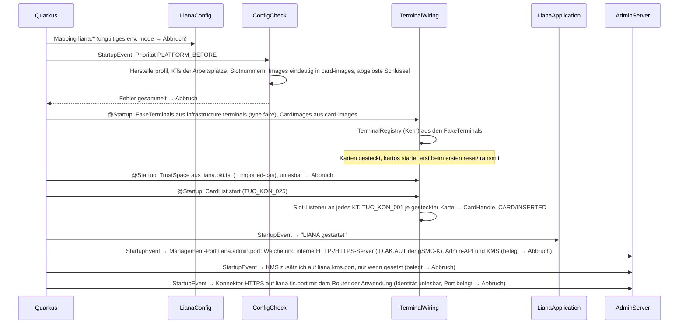

# LIANA – Architektur

Stand: **0.7.22** (Property `revision` in `pom.xml`). Das Diagramm zeigt, was im Code existiert. Geplantes ist gestrichelt und nennt Ticket oder Phase. Wer Komponenten, Ports, Schnittstellen oder externe Prozesse ändert, ändert dieses Dokument im selben Commit; jeder Commit, der die Version hebt, zieht die Stand-Zeile nach.

## Komponenten

Module nach decision-8: `liana-kern` ohne Abhängigkeiten, Adapter nur am Kern, `liana-app` verdrahtet mit Quarkus.

```mermaid
flowchart LR
  classDef port fill:#e6efea,stroke:#2f6b55,color:#1c2321
  classDef planned fill:#ffffff,stroke:#8a958f,color:#5b6662,stroke-dasharray:4 3
  classDef ext fill:#f4f4f4,stroke:#8a958f,color:#1c2321
  classDef file fill:#f8efdc,stroke:#9a6a14,color:#1c2321

  subgraph CALLERS["Aufrufer"]
    PSC["popp-client 2.9.0 · Testhub-PoPP und -ZETA<br/>Testhub-Stand in docs/intern.md, tools/testhub/popp.sh<br/>über docker-tiger-proxy: liana:8082 → :8080 (LIANA-37)"]:::ext
    PMN["newman · Konnektor-PoPP-Postman (17 Collections)<br/>tools/testhub/postman.sh, popp-bridge → popp-server<br/>über docker-tiger-proxy: ip=liana (Port 80), SOAP liana:8082 (LIANA-40)"]:::ext
    ADMC["Testsuite-Setup · Admin"]:::ext
    BROWSER["Browser · Testende, PS-Entwickler<br/>Control Center http://host:9090/,<br/>im Testhub PORT_LIANA_ADMIN (LIANA-163)"]:::ext
    ROBOTC["tiger-ehealth-kt-e2e · AutomationRobotGlueCode<br/>„ROBOT steckt …“, „ROBOT gibt Verifikationspin ein“<br/>Lauf der Suite: tools/testhub/ehkt.sh (LIANA-106)"]:::ext
    CATSC["tiger-cats-extensions 1.4.0 · Konnektor-QES/-E2E<br/>„CATS steckt die Karte …“, @RemoveAllCardsAfterTest<br/>Basis-URL http://host:9090/cats/KT-01 (LIANA-147),<br/>QES fest http://127.0.0.1:9998 (LIANA-67); Lauf der Suite:<br/>tools/testhub/qes.sh (LIANA-91),<br/>Profile parallel, je eigener Netz-Namensraum (LIANA-112.14)"]:::ext
    PSSIMC["PSSIM (tiger-pssim-extension) · Konnektor-QES<br/>über konnektor-service-client 1.6.2: GetSubscription,<br/>Unsubscribe je EventTo, Subscribe CARD/INSERTED (LIANA-59),<br/>VerifyPin, GetJobNumber, Sign-/Verify-/Encrypt-/<br/>DecryptDocument, auch MTOM (LIANA-60);<br/>eHealth-KT-Suite: RequestCard, EjectCard (LIANA-110)"]:::ext
    TLSC["Clientsysteme über TLS (Tests: TlsProbe, JDK-Client aus .kon)<br/>Testhub-Suiten noch über HTTP (CONNECTOR_SECURE_ENABLE=false)"]:::ext
    VSDMC["vsdm-client · Testhub-VSDM, konnektor-client<br/>über docker-tiger-proxy: liana:8082 → :8080<br/>IKNR und Namen über ReadVSD (LIANA-105)"]:::ext
    KMSC["kms-client · popp-bridge (findInLog, getCardSessionTimeout,<br/>ensureKmsParameter), Konnektor-E2E CATS_CS<br/>(tools/testhub/e2e.sh, LIANA-65), konnektorClient der<br/>Konnektor-QES (TKQES online/offline, LIANA-96)<br/>Hersteller aus der Suite-Umgebung"]:::ext
  end

  subgraph APP["liana-app · Quarkus, natives Image"]
    CFG["config.LianaConfig<br/>@ConfigMapping liana.*<br/>infrastructure: konnektor.gsmc-k (ID.AK.AUT, ID.SAK.AUT, image LIANA-112.13),<br/>terminals je CT.CTID (fake, sicct, gsmc-kt); card-images (LIANA-98)"]
    RETIRED["config.RetiredKeys<br/>ConfigSourceInterceptor: abgelöste Schlüssel<br/>liana.terminals.*, tls/ctm.identity → Startfehler mit Nachfolger"]
    CHK["config.ConfigCheck<br/>Startprüfung"]
    WIRE["wiring.TerminalWiring<br/>mode fake | sicct | mixed (LIANA-76),<br/>SicctTerminals + Dienstsuche im Hintergrund<br/>CardList @Startup, Clock, Infomodel, GetCards,<br/>GetCardTerminals, GetResourceInformation,<br/>OperatingState aus liana.operating-state (LIANA-187)<br/>CardSessions + Timer-Takt 200 ms"]
    SIGSC["crypto.SignedScenarios<br/>JWS ES256 gegen x5c[0] (4701),<br/>StandardScenario nach api-popp,<br/>Header typ/stpl (4286, A_26069-01)"]
    SIGNER["crypto.ScenarioSignerCheck<br/>TUC_KON_037: Zeit, KeyUsage, Aussteller,<br/>Signatur (10xx), Rolle oid_popp (4700),<br/>C.ZD.SIG; OCSP offline"]
    EGKCHK["crypto.EgkCertificateCheck<br/>TUC_KON_037 offline für C.CH.AUT:<br/>Zeit, Aussteller in TSL/importiert, Signatur"]
    TRUST["crypto.TrustSpace<br/>CA/PKC aus der TSL + CERT_IMPORTED_CA_LIST,<br/>CA/QC aus der BNetzA-VL (LIANA-112.07)<br/>@Startup, ohne TSL-Signaturprüfung;<br/>Ladezeit je Liste im Startlog, BC ohne<br/>Miller-Rabin für RSA-Moduli (LIANA-178);<br/>TSL im Image beim Build gezogen,<br/>OnlineTsl: tsl-online.mode off/background/enforce,<br/>replaceTsl tauscht die CAs (LIANA-180)"]
    CMSV["crypto.CmsVerifier<br/>CoreValidation RFC 5652 5.6 mit BC: jede SignerInfo,<br/>Parallel- und Gegensignaturen, RSA/PSS/ECDSA,<br/>signing-certificate(-v2); Zertifikat ohne Sperrstatus:<br/>QES gegen BNetzA-VL, nonQES gegen TSL (TAB_KON_786);<br/>CRLF-Ausweichen (LIANA-112.07)"]
    SELF["crypto.CryptoSelfTest<br/>über :9090 GET /admin/selftest/crypto/{check} (LIANA-149)<br/>BC, BCJSSE, Brainpool"]
    CATS["cats.CatsServer + CatsTerminals<br/>Router je CATS-Terminal (liana.cats.terminals) unter /cats/{KT} auf :9090,<br/>mit port zusätzlich eigener Vert.x-Server ohne Präfix (QES: :9998, LIANA-147)<br/>config/card/slot/{n}[/cardImage] (zieht belegte Slots), insert, slots/reset,<br/>cardsim delay, manipulateSignatureResponse (Fault response),<br/>insert-delay: Stecken nach Frist (LIANA-112.02)<br/>sonst und für eHealth-KTs 501 (LIANA-93, LIANA-94)"]
    ROBOT["robot.RobotServer + RobotTerminals<br/>:9997 nur mit liana.robot.port, POST /api/robot/robotCommand<br/>Removinator-Fächer SC1–SC8 → Slot 1 (eGK) / 2 (Berechtigte),<br/>Stecker I*/C*, press*/remove*,<br/>Stift am PIN-Pad: verifyPin, enterWrongPin, enterPUK,<br/>enterTransportPin, customPin, enterPinWithStop,<br/>enterIncompletePin → PIN-Script (LIANA-68);<br/>await-pin: PIN-Pads warten auf den Robot;<br/>eHealth-KT über kartos: KartosRobots, KartosControl,<br/>RobotPinTerminal hält PERFORM VERIFICATION an (LIANA-112.15);<br/>Admin-PIN, Virtual Card Kit 501"]
    PSW["tls.ProtocolSwitch<br/>:9090 Management-Port (decision-017), Vert.x-NetServer:<br/>erstes Byte 0x16 → interner HTTPS-Server (ID.AK.AUT, ohne Client-Auth),<br/>sonst interner HTTP-Server; Loopback mit PROXY v1"]
    GUI["admin.Gui + gui/ (LIANA-148)<br/>statisch, Preact+htm vendort, ohne Build<br/>Übersicht, Kartenterminals mit Kartendetails und Sitzungen,<br/>Systemprotokoll, Ereignis-Abos, TLS mit PKI, Profil mit Abweichungen<br/>und Einstellungen, Infomodell & .kon (LIANA-151);<br/>live per /admin/events (LIANA-150)"]
    ADMIN["admin.AdminServer + AdminApi<br/>Router für HTTP und HTTPS auf :9090, /admin/* JSON,<br/>/ und /gui/* Control Center, /rest/mgmt, KoCoBox- und RISE-Pfade des KMS,<br/>/cats als Subrouter von CATS, übrige Pfade 501, unbekannte unter /admin 404<br/>ready (LIANA-107), info, terminals (mit ct), ct-list (LIANA-76), slots PUT/DELETE,<br/>slots/{n}/fault PUT/DELETE (LIANA-41), infomodel, tls, reset,<br/>vendor GET/PUT mit strict (LIANA-62, LIANA-126), log?from&to (LIANA-54)<br/>GET clients/{id}/config.kon<br/>cards, images, subscriptions, sessions, pki, settings GET/PUT,<br/>deviations, selftest/crypto, ct-discovery, openapi.yaml (LIANA-149),<br/>vsdm/online-checks (LIANA-141),<br/>operating-state GET/PUT (LIANA-187)"]
    AEVT["admin.AdminEvents (LIANA-150)<br/>GET /admin/events, Server-Sent Events: log, card, terminal, state,<br/>subscription, session (LIANA-151), resync<br/>Ringpuffer mit Last-Event-ID, ein Ereignis-Thread,<br/>Heartbeat 15 s, höchstens 16 Streams"]
    VWIRE["wiring.VendorWiring<br/>liana.vendor → VendorProfile,<br/>liana.strict → PeerDeviations"]
    SWIRE["wiring.SignatureWiring<br/>JobNumbers, DocumentSigning, SimulatedOcsp,<br/>ComfortSettings, ComfortSignature (Ziehen beendet die Session)"]
    PADES["crypto.PadesSignatures<br/>Apache PDFBox 3 (decision-020): pdfaid:part aus XMP,<br/>Incremental Update ETSI.CAdES.detached, /M, /Reason,<br/>ByteRange und Contents lesen (LIANA-112.08)"]
    XADES["crypto.XadesSignatures<br/>JSR 105 des JDK (decision-023): XAdES-EPES unter NFDM,<br/>Signaturwert über eigenen Provider von der Karte,<br/>TUC_KON_162 mit BC, NFD-Schema, Latin-9 (LIANA-112.09)"]
    CADES["crypto.CadesSignatures<br/>CAdES-BES mit BC: SHA-256, ecdsa-with-SHA256,<br/>signingTime, signing-certificate-v2, ContentHints,<br/>enveloping/detached, Parallelsignatur (LIANA-112.02),<br/>OCSP-Antwort in crls.other (RFC 5940, LIANA-112.03)"]
    SOCSP["crypto.SimulatedOcsp<br/>OCSP-Simulator (decision-021): Status good,<br/>CertID aus Aussteller und AKI, producedAt = Uhr,<br/>Signer P-256 TEST-ONLY beim Start (LIANA-112.03)"]
    KMS["kms.KmsServer<br/>mount: /rest/mgmt (LIANA-146), /j_security_check,<br/>/administration/* (LIANA-96), /api/* (LIANA-97),<br/>/api/* auch am Router der Konnektor-Schnittstelle<br/>(nur TLS, Profil RISE, sonst 404), eigener HTTPS-Listener<br/>nur mit liana.kms.port (8500, 9443)<br/>Profil ohne KMS → 501 (decision-12)"]
    TLSS["tls.KonnektorTlsServer<br/>:8443 eigener Vert.x-HTTPS-Server<br/>mit dem Quarkus-Router (gleiche Dienste wie :8080)<br/>Identität und Client-Auth je Handshake (LIANA-65),<br/>restart() beim KMS-Neustart"]
    GUARD["tls.PlainHttpGuard<br/>:8080 ANCL_TLS_MANDATORY → 403,<br/>connector.sds bei ANCL_DVD_OPEN (TIP1-A_4515)"]
    KTTLS["crypto.KtTls · SmktCertificateCheck<br/>TLS-Client zum KT: BCJSSE, TLS 1.2,<br/>ECDHE-ECDSA AES-GCM, ID.SAK.AUT;<br/>C.SMKT.AUT nach TUC_KON_037 (oid_smkt_aut,<br/>serverAuth, Aussteller aus der TSL)"]
    KTLS["crypto.KonnektorTls · TlsIdentity · ClientCertificateList<br/>BCJSSE an BC, nur TLS 1.2, ECDHE P-256/P-384/bp256/bp384,<br/>ECDSA/RSA AES-GCM/CBC, ohne SHA-1;<br/>Client-Zertifikat ∈ ANCL_CCERT_LIST, nicht abgelaufen"]
    TLSRT["crypto.ServerIdentities · ClientCertificates · TlsKeys<br/>ID.AK.AUT ECC/RSA (TLS_USE_ECC_FOR_CS) oder Software-<br/>Serverzertifikat; ANCL_CCERT_LIST je Clientsystem;<br/>erzeugen/importieren nach A_21811-05 (RSA-3072, P-256),<br/>PKCS#12-Export, 5 Jahre (A_24483), reset (LIANA-65)"]
    TWIRE["wiring.TlsWiring<br/>liana.tls.* → TlsIdentity, ClientSystemBinding,<br/>ServerIdentities, ClientCertificates"]
    EWIRE["wiring.EventWiring<br/>Subscriptions + CetpSender,<br/>liana.events.max-try (EVT_MAX_TRY), connect-timeout"]
    VSWIRE["wiring.VsdmWiring<br/>liana.vsdm.* → OnlineCheck, UfsClient,<br/>http: TCP, https: CardTls mit der SM-B des Aufrufs"]
    SOWIRE["wiring.SoapWiring<br/>liana.soap.request-validation → RequestValidation"]
    CARDTLS["crypto.CardTls<br/>TUC_KON_110 (TIP1-A_4720-03): BC-TLS-API, TLS 1.2,<br/>ECDHE-ECDSA, C.FD.TLS-S gegen TrustSpace (4156),<br/>Client C.HCI.AUT, Signatur auf der SM-B (4157)"]
    CETPTLS["crypto.CetpTls<br/>TLS-Client zur Ereignissenke: BCJSSE, TLS 1.2,<br/>Suites wie KonnektorTls, Client-Zertifikat ID.AK.AUT,<br/>Zertifikat der Senke ungeprüft (TIP1-A_4595)"]
    KMSE["kms.EhexKms · Profile EHEX, SECUNET<br/>Login/Logout (Token), Kartendienst cardSessionTimeout,<br/>Leistungsumfang online, Download system/OP (LIANA-55),<br/>Signaturdienst sakComfortSignature* (LIANA-112.06),<br/>Neustart nk/system (LIANA-65); sonst 501"]
    KMSK["kms.KocoKms · Profile KOCO, CGM<br/>j_security_check (JSESSIONID), start.htm (X-TOKEN),<br/>logout, json-retrieve/-store management (MGM_LU_ONLINE),<br/>cardservice (CARD_TIMEOUT_CARD, CARD_SESSION_TIMEOUT, LIANA-112.04),<br/>signservice (SAK_COMFORT_SIGNATURE*, LIANA-112.06),<br/>ohne Sitzung 302 login.htm, ohne X-Token 403;<br/>sonst 501 (LIANA-96)"]
    KMSR["kms.RiseKms · Profil RISE<br/>auth/login (JSESSIONID), auth/logout (204),<br/>mgm/config GET/PUT (MGM_LU_ONLINE),<br/>card/config GET/PUT (CARD_TIMEOUT_CARD, LIANA-112.05),<br/>sak/config GET/PUT (SAK_COMFORT_SIGNATURE*, LIANA-112.06),<br/>ohne Sitzung 401, ohne X-Requested-With 403;<br/>sonst 501 (LIANA-97)"]
    KMSCS["kms.EhexClientSystems<br/>ak/info, clientsysteme/{id}/zertifikat, clientsystem-anbindung/<br/>einstellungen (300 + confirmationToken) und server-zertifikat,<br/>tls/einstellungen; PASSWORD → 501 (LIANA-65)"]
    SMT["sm.TrustedChannelTerminal · ElcSessionkey4Sm · SecureMessaging<br/>nur mit card.terminate-secure-messaging (LIANA-28):<br/>Hop A PoPP-Service ↔ LIANA als Karte (Zwilling per ICCSN),<br/>Hop B LIANA als Terminal ↔ Karte (gsmc-kt, LIANA-99),<br/>SM aus Hop A aus-, in Hop B einwickeln (gemSpec_COS 13.2/13.3)"]
    GSMCK["sm.ImageGsmcK<br/>Port kern.card.GsmcK: ICCSN, C.NK.VPN<br/>aus dem gSMC-K-Image"]
    SMID["sm.TerminalIdentity · ImageObjects · Cvc<br/>PrK.SMC.AUTD_RPS_CVC.E256 + CVC-Kette der gSMC-KT,<br/>PrK.SAK.AUTD_CVC.E256 + Kette der gSMC-K (LIANA-112.13),<br/>Cross-CVCs aus der TSL zur Root der Karte"]
    SMC2C["sm.ImageCardToCard · SourceCard · SmChannel<br/>Port CardToCard, TUC_KON_005 gegenseitig+TC:<br/>LIANA als Quellkarte (gSMC-K, gSMC-KT),<br/>Kette per 6A88/Cross-CVCs, elcSessionkey4SM (LIANA-112.13)"]
  end
  PKIP["TSL-Download, OCSP, TUC_PKI_001/006/018<br/>Abnahme per PKITS (LIANA-87)"]:::planned

  subgraph SOAPM["liana-adapter-soap"]
    EVTSVC["EventServiceResource<br/>:8080 POST /ws/EventService<br/>SOAPAction-Dispatch, StAX, GetCards,<br/>GetCardTerminals (LIANA-108), GetResourceInformation (LIANA-187),<br/>Subscribe, Unsubscribe, RenewSubscriptions,<br/>GetSubscription (LIANA-59)"]
    SOAPTPL["templates/soap/<br/>GetCardsResponse.xml, GetCardTerminalsResponse.xml, CardTerminal.xml,<br/>GetResourceInformationResponse.xml (LIANA-187), Fault.xml, Gerror.xml,<br/>Subscribe-, Unsubscribe-, RenewSubscriptions-,<br/>GetSubscriptionResponse.xml,<br/>RequestCard-, EjectCardResponse.xml, Card.xml (LIANA-110),<br/>Start/Stop/SecureSendAPDU-Response,<br/>ReadCardCertificateResponse.xml,<br/>CheckCertificateExpirationResponse.xml (LIANA-188),<br/>PinResponse.xml (Verify-, Change-, Unblock-,<br/>Enable-, DisablePin, LIANA-109), GetPinStatusResponse.xml,<br/>ExternalAuthenticateResponse.xml,<br/>GetJobNumberResponse.xml,<br/>ReadVSDResponse.xml (LIANA-119)"]:::file
    CARDSVC["CardServiceResource<br/>:8080 POST /ws/CardService 8.2<br/>StartCardSession, SecureSendAPDU,<br/>StopCardSession, VerifyPin,<br/>GetPinStatus (LIANA-63);<br/>VerifyPin, GetPinStatus auch v8.1 (LIANA-106)"]
    CTSVC["CardTerminalServiceResource<br/>:8080 POST /ws/CardTerminalService 1.1<br/>RequestCard, EjectCard (LIANA-110),<br/>antwortet nach Stecken/Ziehen oder TimeOut"]
    CERTSVC["CertificateServiceResource<br/>:8080 POST /ws/CertificateService 6.0<br/>ReadCardCertificate, CheckCertificateExpiration (LIANA-188)"]
    AUTHSVC["AuthSignatureServiceResource<br/>:8080 POST /ws/AuthSignatureService<br/>SignatureService 7.4: ExternalAuthenticate<br/>(SignatureType, SignatureSchemes ignoriert:<br/>G2.1 → ECDSA, LIANA-64)"]
    SIGSVC["SignatureServiceResource<br/>:8080 POST /ws/SignatureService 7.5 und 7.4<br/>GetJobNumber; SignDocument nonQES CAdES<br/>(SM-B, auch MTOM, LIANA-112.02), QES (HBA), StopSignature;<br/>Activate-/DeactivateComfortSignature,<br/>GetSignatureMode (LIANA-112.06);<br/>VerifyDocument CAdES (LIANA-112.07),<br/>PAdES/XAdES als SOAP-ENV:Client"]
    ENCSVC["EncryptionServiceResource<br/>:8080 POST /ws/EncryptionService 6.1<br/>EncryptDocument, DecryptDocument<br/>nur bis TUC_KON_000, MTOM (LIANA-60)"]
    VSDSVC["VsdServiceResource<br/>:8080 POST /ws/VSDService 5.2<br/>ReadVSD (LIANA-119), Prüfungsnachweis gzip/Base64 (LIANA-141);<br/>ReadOnlineReceipt ohne Onlineprüfung, HBA → SOAP-ENV:Client (LIANA-103)"]
    SOAPF["SoapFaults<br/>GERROR mit Instance Konnektor-Lokal,<br/>Protokollcode je Herstellerprofil"]
    REQCHK["RequestCheck, RequestValidation<br/>in jeder Dienst-Ressource, off | log | reject (LIANA-48):<br/>Operation gegen das XSD (neueste Nebenversion),<br/>SOAPAction gegen die soapAction der WSDL;<br/>reject → 4000 bzw. SOAP-ENV:Client"]
    KVKSVC["KvkServiceResource<br/>:8080 POST /ws/KVKService 4.0<br/>ReadKVK, SOAPAction #ReadVDT laut WSDL (LIANA-113)"]
    UNSUP["UnsupportedServiceResource<br/>:8080 POST /ws/{service}, alle übrigen Dienste<br/>SOAP-Fault „von LIANA nicht unterstützt“ (decision-12, LIANA-69)"]
  end

  subgraph CETPM["liana-adapter-cetp"]
    CETPS["CetpSender<br/>Verbindung je EventTo bleibt offen (LIANA-91),<br/>„CETP“ + Länge Big-Endian + Event-XML<br/>(TIP1-A_4594, 5536, 4596), Warteschlange je Senke"]
    EVXML["EventXml<br/>Event nach EventService.xsd v7.2,<br/>Filter per XPath (TUC_KON_256 5c, 4095)"]
  end

  subgraph VSDMM["liana-adapter-vsdm"]
    UFSC["UfsClient · UfsXml<br/>GetUpdateFlags (cm/uf/UFS.wsdl), Lokalisierung UFS/ProviderID,<br/>HTTP/1.1, Fault → GERROR-Code (LIANA-141)"]
  end

  subgraph SDSM["liana-adapter-sds"]
    SDS["ServiceDirectoryResource<br/>:8080 GET /connector.sds<br/>Event, CardTerminal (LIANA-110), Card, Certificate, AuthSignature,<br/>Signature, Encryption (LIANA-85), VSDService (LIANA-119),<br/>KVKService (LIANA-189.01, ReadKVK LIANA-113),<br/>je Dienst alle bedienten Versionen (LIANA-120);<br/>ProductVendorID je Profil (LIANA-91)"]
    TPL["templates/connector.sds.xml"]:::file
    REACH["ReachabilityResource<br/>:8080/:8443 GET / → 200<br/>(Erreichbarkeitsprüfung Epikur, LIANA-189.02)"]
  end

  subgraph KERN["liana-kern · reines Java"]
    REG["kern.terminal.TerminalRegistry<br/>CTM_CT_LIST"]
    CT{{"kern.terminal.CardTerminal<br/>Port: reset, transmit,<br/>pinCommand (PIN-Pad: PERFORM VERIFICATION,<br/>MODIFY VERIFICATION DATA, LIANA-109), verifyPin,<br/>requestCard, ejectCard mit Wartezeit (LIANA-110)"}}:::port
    TLT["kern.terminal.TimeLimitedTerminal<br/>CARD_TIMEOUT_CARD (TAB_KON_554)<br/>→ CardTimeoutException, 4094"]
    CARDS["kern.card.CardList<br/>CM_CARD_LIST, CardHandle<br/>TUC_KON_001, TUC_KON_025"]
    READER["kern.card.CardReader<br/>TUC_KON_001 2c: eGK G2/G3, SMC-B G2, HBA G2,<br/>KVK am synchronen ATR + KVK-AID (LIANA-113)<br/>Typ, ICCSN, Version, AUT-Zertifikat<br/>(Name, KVNR nur eGK, Ablauf)"]
    GETC["kern.event.GetCards<br/>TIP1-A_4605-03, TUC_KON_253"]
    GETCT["kern.event.GetCardTerminals<br/>TIP1-A_4604, TUC_KON_252<br/>CardTerminal.info() (LIANA-108)"]
    GETRI["kern.event.GetResourceInformation<br/>TIP1-A_4607, TUC_KON_254: Karte, KT oder Konnektor,<br/>4000, 4007, 4097, 4098, 4099, 4101 (LIANA-187)"]
    KTSVC["kern.cardterminal.CardTerminalService<br/>TIP1-A_5411-02/5412/5413, TUC_KON_056/057<br/>Anzeige TIP1-A_5408, TimeOut s bzw. ms,<br/>wartet auf CM_CARD_LIST; 4039, 4051, 4097,<br/>4101, 4202, 4203, 4222; CT/ERROR (LIANA-110)"]
    ACC["kern.access.Infomodel<br/>TUC_KON_000 (R1, R3), SM-B_Verwaltet (R7),<br/>Protokollcodes 4004–4006 hinter 4021"]
    JOBS["kern.signature.JobNumbers<br/>GetJobNumber ABC-123,<br/>eindeutig über 1000 Aufrufe;<br/>SignDocument je Jobnummer einmal (4252)"]
    DSIGN["kern.signature.DocumentSigning<br/>TAB_KON_756, TUC_KON_160/165/166 nonQES:<br/>Default TAB_KON_583, 4111, 4126, 4197, 4120;<br/>TUC_KON_150/152/168 QES mit dem HBA (LIANA-112.04):<br/>QES_DocFormate 4110, TUC_KON_080 Text/TIFF 4024,<br/>TUC_KON_023 Lock, PIN.QES, DF.QES verlassen;<br/>TUC_KON_154 Stapel, Teilstapel,<br/>StopSignature 4243, TAB_KON_192 (LIANA-112.05);<br/>TUC_KON_170/158 Komfortsignatur ohne PIN, 4271 (LIANA-112.06);<br/>TUC_KON_159 online: Statusabfrage, 4123,<br/>IncludeRevocationInfo (LIANA-112.03);<br/>PAdES für PDF/A, TUC_KON_080 PDF/A 4024 (LIANA-112.08);<br/>XAdES QES unter NFDM (LIANA-112.09);<br/>S/MIME nonQES über Smime, TUC_KON_080 (D) 4024 (LIANA-112.10);<br/>Stapel und Komfort im SE #2 über kern.card.TrustedChannels:<br/>PIN.QES per Remote-PIN (gSMC-KT), PSO CDS im Kanal gSMC-K↔HBA (LIANA-112.13)"]
    COMF["kern.signature.ComfortSignature<br/>CARDSESSION.SIGNMODE je HBA-Kartensitzung,<br/>TUC_KON_171 PIN.QES „Komfortsignatur aktivieren“,<br/>TUC_KON_172/173, Zähler A_19100-01, Timer A_18686-01,<br/>UserId UUID (4272), letzte 1.000 (4270);<br/>SE #1 ohne SM (112.13) (LIANA-112.06)"]
    CMSP{{"kern.signature.CmsSignatures<br/>Port: CMS-Signatur, Hash von der Karte"}}:::port
    PDFP{{"kern.signature.PdfSignatures<br/>Port: PDF/A-Kennung, PAdES signieren,<br/>Signaturfelder lesen"}}:::port
    XMLP{{"kern.signature.XmlSignatures<br/>Port: TUC_KON_080 (A), XAdES signieren,<br/>XML-Signaturen prüfen"}}:::port
    REVP{{"kern.signature.RevocationSource<br/>Port: OCSP-Antwort zum Signaturzertifikat"}}:::port
    DVERIFY["kern.signature.DocumentVerification<br/>VerifyDocument TAB_KON_760: 4000, TUC_KON_000,<br/>TUC_KON_151 (QcCompliance) bzw. TUC_KON_161,<br/>Zeitpunkt TIP1-A_5545/5540-01, TAB_KON_754,<br/>IncludeRevocationInfo; 4253, 4279 (LIANA-112.07);<br/>PAdES je Signaturfeld, /M, 4024 (LIANA-112.08);<br/>XAdES TUC_KON_162 (LIANA-112.09);<br/>S/MIME pkcs7-mime, 4024 MIME (LIANA-112.10)"]
    VERP{{"kern.signature.SignatureVerifier<br/>Port: CMS prüfen, Signaturzertifikat prüfen"}}:::port
    CSIG["kern.card.CardSignature<br/>TUC_KON_218: SELECT DF.ESIGN/DF.QES, MSE SET DST,<br/>PSO CDS; AUT_E256, OSIG_E256, QES_E256;<br/>DF verlassen (SELECT MF)"]
    CERTS["kern.card.CardCertificates<br/>TIP1-A_4700-03, TUC_KON_216<br/>SM-B, HBAx (DF.ESIGN, DF.QES):<br/>TAB_KON_858, Crypt ECC/RSA;<br/>C.SMKT.AUT der gSMC-KT (DF.KT)"]
    CEXP["kern.card.CertificateExpiration<br/>TIP1-A_4699-07, TUC_KON_033/034:<br/>HBAx, SM-B, gSMC-KT im Slot, gSMC-K (C.NK.VPN),<br/>Warnung 4257 je Karte (LIANA-188)"]
    CACC["kern.card.CardAccess<br/>TUC_KON_000 mit CardHandle: R7 SMC-B (4009, 4013),<br/>R9 HBAx ohne UserId (4003),<br/>TUC_KON_026 Schritt 2: fremdes Lock → 4093"]
    CLOCKS["kern.card.CardLocks<br/>TUC_KON_023 je Karte, A_25895"]
    PINV["kern.card.PinVerification<br/>TIP1-A_4587 VerifyPin, TUC_KON_012 Mandatorisch,<br/>TIP1-A_4588 ChangePin TUC_KON_019, TIP1-A_4590 UnblockPin TUC_KON_021,<br/>TIP1-A_5487 Enable/DisablePin TUC_KON_027 (LIANA-109);<br/>PIN.SMC (SMC-B), PIN.CH (HBAx), eGK-PINs im MF,<br/>PIN.QES in DF.QES für SignDocument (LIANA-112.04),<br/>PinCommand und Anzeigen nach TAB_KON_090/838,<br/>6400/6401/64A1/6A88 → 4043/4049/4008/4072, PinMismatch → 4067,<br/>6983/6985 → WASBLOCKED/TRANSPORT_PIN (Schritt 5);<br/>GetPinStatus TIP1-A_4589, TUC_KON_022:<br/>AUTHSTATE → VERIFIED, sonst GET PIN STATUS"]
    KVKF["kern.card.KvkFiles<br/>TUC_KON_202 für die KVK: SELECT KVK-AID,<br/>READ BINARY bis 6282 (SICCT 5.5.8.1)"]
    RKVK["kern.vsdm.ReadKvk, KvkTemplate<br/>Fachmodul VSDM ReadKVK (3.2.2): Anhang E,<br/>Prüfsumme → 3021, sonst 3020 (VSDM-A_2611),<br/>abgelaufen nur Log (VSDM-A_2626)"]
    EGKF["kern.card.EgkFiles<br/>TUC_KON_018: DF.HCA ≠ 9000 → gesperrt,<br/>C.CH.AUT über Port CertificateCheck;<br/>TUC_KON_202 in DF.HCA (EF.PD, EF.VD, EF.StatusVD)"]
    RVSD["kern.vsdm.ReadVsd<br/>Fachmodul VSDM, Tab_FM_VSDM_15:<br/>114 vor 107 (A_23020), PIN.SMC → 3041,<br/>Onlineprüfung (PerformOnlineCheck, VSDM-A_2575),<br/>Status 1 → 3001, VD zwischen den Offsets (VSDM-A_2784),<br/>ohne C2C, GVD, Protokoll, Aktualisierung"]
    OCHK["kern.vsdm.OnlineCheck · Pruefungsnachweis<br/>Kette liana.vsdm.online.sources (LIANA-141),<br/>MAXTIME_VSDM (VSDM-A_2998), MGM_LU_ONLINE, strict ohne fixed,<br/>Spec-Rückfall Ergebnis 3; PN nach Tab_FM_VSDM_04 (VSDM-A_2770),<br/>letztes Ergebnis je eGK"]
    UFSRC["kern.vsdm.UfsSource<br/>Endpunkte je ProviderID (4.3.3), retry-after,<br/>TIMEOUT_VSDM; Update ohne CCS → 3"]
    FIXSRC["kern.vsdm.FixedSource<br/>Ergebnis 2, Prüfziffer SHA-512(KVNR)[0..48]<br/>wie Testhub-Mock, bewusste Abweichung"]
    UFSPORT{{"kern.vsdm.UpdateFlagService<br/>Port: GetUpdateFlags"}}:::port
    EXTA["kern.card.ExternalAuthentication<br/>TIP1-A_5439-02, TUC_KON_218<br/>PrK.HCI.AUT.E256 / PrK.HP.AUT.E256"]
    AUTHST["kern.card.AuthState<br/>CARDSESSION.AUTHSTATE<br/>Karte, Mandant, Clientsystem"]
    SESS["kern.card.CardSessions<br/>TUC_KON_223/208/224, Lock A_25895 (4093),<br/>APDU-Szenario-Timer A_25860-01,<br/>Sperre je Sitzung, kein globaler Monitor"]
    DEC{{"kern.card.ScenarioDecoder<br/>Port"}}:::port
    ERR["kern.error.ConnectorError<br/>1016–1027 (PKI), 1039 (Warnung offline), 4000–4021, 4039, 4044, 4051, 4058,<br/>4085, 4090, 4093–4097, 4101, 4102, 4149, 4202, 4203,<br/>4024, 4110, 4111, 4120, 4123, 4126, 4197, 4209, 4222, 4252, 4258, 4279,<br/>4284–4288, 4700, 4701"]
    SL{{"kern.terminal.SlotListener<br/>CT/SLOT_IN_USE, CT/SLOT_FREE"}}:::port
    TCL{{"kern.terminal.TerminalConnectionListener<br/>CT/DISCONNECTED (TIP1-A_4537)"}}:::port
    SYSLOG["kern.event.SystemLog<br/>Systemprotokoll TIP1-A_4715, TUC_KON_271<br/>Zeit, Op/Sec, Schwere, Topic, Parameter<br/>rollierend, ohne Personenbezug (TIP1-A_4710-02)"]
    CSET["kern.management.ComfortSettings<br/>SAK_COMFORT_SIGNATURE, _MAX, _TIMER (TAB_KON_596),<br/>ohne TLS-Pflicht: Deviation, strict lehnt ab;<br/>Disabled → TUC_KON_172 (LIANA-112.06)"]
    MSET["kern.management.ManagementSettings<br/>CARD_SESSION_TIMEOUT, CARD_TIMEOUT_CARD (TAB_KON_554),<br/>MGM_LU_ONLINE (TAB_KON_658), reset"]
    OPST["kern.management.OperatingState<br/>TIP1-A_4509: VPN TI/SIS, Transportnetz,<br/>Fehlerzustandsliste TAB_KON_503 (A_17085–A_17087),<br/>OPERATIONAL_STATE/$EC (TIP1-A_4512-06), reset (LIANA-187)"]
    BIND["kern.management.ClientSystemBinding<br/>TAB_KON_506-01: ANCL_TLS_MANDATORY, ANCL_CAUT_*,<br/>ANCL_DVD_OPEN, TLS_USE_ECC_FOR_CS, Softwareschlüssel, reset"]
    VPROF["kern.vendor.VendorProfile<br/>Herstellerprofil (decision-10): neutral, KOCO,<br/>RISE, SECUNET, EHEX, CGM; einzige Stelle für<br/>Herstellerabweichungen, umschaltbar, reset;<br/>KOCO 4005, RISE leere UserId 4000 (LIANA-60)"]
    PDEV["kern.vendor.PeerDeviations · Deviation<br/>liana.strict (LIANA-126): bekannte Spec-Abweichungen<br/>der Gegenstellen tolerieren oder abweisen,<br/>je Fall LIANA/DEVIATION Warning bzw. Error;<br/>umschaltbar, reset"]
    EVT["CardEvent, CardSessions.Timeout<br/>CARD/INSERTED, CARD/REMOVED,<br/>CARD/SESSION/TIMEOUT"]
    SUBS["kern.event.Subscriptions · Event<br/>TIP1-A_4608/4609/5112/4610: 25 h, 4102,<br/>TUC_KON_256 5a Topic-Präfix, 5b TUC_KON_000 mit CtID,<br/>Auto-Unsubscribe nach EVT_MAX_TRY, leer beim Start"]
    SINK{{"kern.event.EventSink<br/>Port: send(Event, Subscription, Outcome)"}}:::port
  end

  subgraph FAKEM["liana-adapter-fake-terminal"]
    FTS["FakeTerminals<br/>Stecken, Ziehen per Imagename<br/>reset auf YAML-Stand"]
    FAKE["FakeTerminal<br/>simuliertes PIN-Pad: PIN-Script (PinInput wie kartos terminal:<br/>correct, wrong, digits, cancel, timeout, puk, transport,<br/>incomplete; LIANA-68), sonst konfigurierte PIN<br/>(infrastructure.terminals.&lt;id&gt;.pin, 123456);<br/>Robot-KTs warten auf die Eingabe (await, 30 s)<br/>Fault je Slot: status-word, response,<br/>io-error, delay<br/>APDU belegt nur ihre Karte, nicht das KT<br/>Display: RequestCard/EjectCard warten auf<br/>Stecken/Ziehen (Admin-API, Robot, LIANA-110)"]
    PUSHT["TrafficPushingTerminal + TrafficPush<br/>nur mit liana.trace.push-url<br/>SICCT-Umschlag, asynchron"]
    ENG{{"CardEngine / Card"}}:::port
    KE["KartosEngine, KartosCard"]
    KVKC["KvkCard<br/>KVK als Speicherkarte ohne Card-Engine,<br/>Image kvk/*.xml: ATR + VersichertenDatenTemplate (LIANA-113)"]
    ISP["CardImages<br/>Index der Kartenimages: Dateiname, ICCSN (EF.GDO),<br/>absoluter Pfad; mehrdeutige ICCSN → Fehler (LIANA-98)"]
  end

  subgraph SICCTM["liana-adapter-sicct"]
    SENV["SicctEnvelope<br/>Umschlag SICCT §6.2.4.2,<br/>Testvektoren kartos-Wire-Trace"]
    SCONN["SicctConnection<br/>Lese-Thread, R-Kommando per seq,<br/>Ereignisse, Abbruch → CT/DISCONNECTED<br/>(TIP1-A_4537)"]
    STERMS["SicctTerminals · CtObject<br/>CTM_CT_LIST (TAB_KON_522),<br/>TUC_KON_054/055, GetStatus, TIP1-A_4540 (mit TUC_KON_050);<br/>Dienstanfrage an getrennte aktive KTs<br/>alle CTM_SERVICE_DISCOVERY_CYCLE (TIP1-A_4538-02, LIANA-112.15);<br/>TUC_KON_053 Pairing, TUC_KON_050 VALIDATE,<br/>Arbeitsverbindung (LIANA-77), Heartbeat<br/>GET STATUS (TIP1-A_4536, LIANA-78)"]
    STA["TerminalAuthenticate<br/>EHEALTH TERMINAL AUTHENTICATE<br/>CREATE / VALIDATE (gemSpec_KT 3.7.2)"]
    SKT["SicctTerminal<br/>CardTerminal je YAML-KT, SLOTCOUNT,<br/>SLOTS_USED aus Schritt 11 und 84/85 (LIANA-78);<br/>reset = RESET ICC, transmit an FU 00nn,<br/>pinCommand = PERFORM VERIFICATION<br/>mit Anzeigen TAB_KON_090 (ISO 646-DE), P2 D0 (LIANA-80),<br/>MODIFY VERIFICATION DATA 80 19, Null-PIN (LIANA-127),<br/>REQUEST/EJECT ICC mit WT DO,<br/>Antwortfrist Wartezeit + CARD_TIMEOUT_CARD<br/>(LIANA-79, LIANA-110)"]
    SDISC["DiscoveryChannel · ServiceDiscovery<br/>UDP :4742, SICCT §6.2.3"]
  end

  subgraph TRACEM["liana-trace-tests · nur Tests"]
    REPLAY["@TraceReplay<br/>tiger-rbel, RbelPath-Assertions<br/>@LianaConfig, @Replace, @Carry, @ReplaceSteps<br/>mit Begründung; JWS neu signiert;<br/>@GegenStub: Framework-Selbsttests gegen<br/>StubServer statt LIANA (LIANA-124)"]
  end
  subgraph CLIENTM["Konnektor-Client · Java 17, nie an LIANAs Laufzeit (decision-016, Enforcer)"]
    CONTRACT["liana-contract<br/>support/schemas als Ressourcen,<br/>Schemas.resource (LIANA-131);<br/>quirks.json: Abweichungen je Produkt mit Quelle,<br/>LIANA je Herstellerprofil (LIANA-134)"]
    KCLIENT["konnektor-client<br/>JAXB-Bindings je Dienst-Nebenversion (de.gematik.liana.konnektor.ws.*),<br/>ServiceDirectory: connector.sds lesen, Version je Operation<br/>nach TIP1-A_4966, Operation SHORT/LONG (LIANA-132);<br/>Konnektor: .kon v1.0.0 / Builder, invoke (SOAP 1.1),<br/>HttpTransport: JDK HttpClient, Proxy, BCJSSE TLS 1.2<br/>P-256/P-384/bp256/bp384, mTLS aus PKCS#12 (LIANA-133);<br/>info, supports, QuirksTable: Produkt erkennen (LIANA-134);<br/>cards, terminals, card: pin, certificate,<br/>authenticate, jws (LIANA-135);<br/>KonnektorFault je ErrorType, ProductUnsupported,<br/>onPinPrompt, events: Subscribe + CETP-Senke,<br/>awaitCard (LIANA-137);<br/>sign (CAdES/PAdES/XAdES), signatures, comfort,<br/>decrypt, encrypt, verify (LIANA-136);<br/>readVsd, professionOids (LIANA-105)"]
    KCALL["Replay aus KSP-Traces für Signatur und<br/>Verschlüsselung (LIANA-136), Veröffentlichung (LIANA-155 bis LIANA-157)"]:::planned
    CTRLC["liana-control-client<br/>LianaControl: jeder Admin-API-Endpunkt,<br/>Fault, PinInput, LianaControlException (LIANA-138)"]
    CONFORM["konnektor-client-conformance<br/>ReadOnlyIT gegen TI_TEST_KON_PATH (.kon),<br/>interaktiv per Schalter, Aufnahme über Tiger-Proxy<br/>als .tgr ohne Authorization (LIANA-139);<br/>Nightly gegen LIANA und KSP: LIANA-100"]
  end
  PMJ["liana-app Tests: de.gematik.liana.postman<br/>Konnektor-PoPP-Collections als JVM-Tests (LIANA-40),<br/>PoppServiceDouble statt PoPP-Service und popp-bridge"]
  TGR["Golden Traces *.tgr<br/>support/traces: connector-sds<br/>support/vendor/traces: popp-kon-tu, vsdm,<br/>ps-epikur (Epikur-Pairing, LIANA-189.04)"]:::file
  PKI["Replay-CA + Signer<br/>support/pki/replay"]:::file
  TSL["RU-TSL<br/>support/pki/tsl, /opt/liana/pki<br/>liana.pki.tsl"]:::file
  BVL["BNetzA-VL der Konnektor-QES<br/>support/pki/tsl, /opt/liana/pki<br/>liana.pki.bnetza-vl"]:::file
  TLSPKI["Konnektor-TLS-PKI (tools/pki/konnektor-tls.sh)<br/>support/pki/server: Komp-CA, ID.AK.AUT p256/bp256/rsa<br/>support/pki/clients: CS1 p256/bp256"]:::file
  BP["Blueprints<br/>support/blueprints"]:::file
  SCHEMAS["Konnektor-WSDL/XSD<br/>support/schemas, api-telematik 6.0.3"]:::file

  YAML["application.yaml<br/>+ LIANA_* Env<br/>Testhub: infra/docker/liana/application.yaml"]:::file
  IMG["Kartenimages *.xml<br/>support/images(/gsmc-kt, /gsmc-k), /opt/liana/images(/gsmc-kt, /gsmc-k)<br/>Testhub: data/cards → /opt/liana/testhub-cards"]:::file
  KPIPE["kartos pipe &lt;image&gt;<br/>eigener Prozess je Karte<br/>/opt/liana/bin/kartos, sonst tools/kartos/<br/>(KartosLocator, fehlt es: kein Start, LIANA-121)"]:::ext
  KTERM["kartos terminal (eH-KT-Sim)<br/>dasselbe Binary, eigener Prozess<br/>SICCT :4742, gSMC-KT gsmckt-valid<br/>Ereignisse 84/85, KEEP ALIVE (LIANA-71)<br/>Steuerung HTTP :4743 /api/v1: Kartenbibliothek, PIN-Skript, Störungen (LIANA-72–74, kartos 0.8.0 LIANA-118)<br/>Container kartos-terminal (LIANA-70)"]:::ext
  TIGER["Tiger-Proxy<br/>POST /traffic (Admin-Port)"]:::ext
  UFSX["UFS · Fachdienst VSDM<br/>lokaler Mock-Container oder Stub (Tests: VsdOnlineCheckTest,<br/>TlsStubServer); TI-Intermediär per DNS-SD: später"]:::ext
  PSSINK["Ereignissenke des Clientsystems<br/>cetp://host:port, TCP oder TLS-Server<br/>Konnektor-QES: Tiger-Proxy cetpProxy :7001<br/>(→ localhost:1234, socat in qes.sh, LIANA-95);<br/>Tests: CetpReceiver, QesEventIT"]:::ext
  PSPROXY["PS-Intercept · tools/testhub/ps-proxy.sh (LIANA-183, ein Tiger seit LIANA-189.03)<br/>Primärsystem → ein Tiger-Proxy: HTTP und HTTPS auf :80/:443/:8080/:8443 (TIP1-A_4528, LIANA-184),<br/>WebUI :9080; TLS mit ID.AK.AUT der Komp-CA (SAN mit PS_HOST), immer HTTPS zu LIANA :8443<br/>mit der p12 des PS oder CS1 (LIANA-186); CETP ohne Proxy (PS_CETP);<br/>Sitzung laufend in _runs/ps-sessions/NNN-Zeit.tgr, Key-Log target/sharedSecrets.txt,<br/>Parser sicct, X509, X500, asn1, OCSP, b64gzip (LIANA-185)"]:::ext
  TIGERS["Tiger-Proxy tiger-sicct (Testhub)<br/>directReverseProxy :4742 → kartos-terminal,<br/>TLS aufgebrochen mit ID.SMKT.AUT der gSMC-KT,<br/>zu kartos mit ID.SAK.AUT (LIANA-88),<br/>activateRbelParsingFor sicct (LIANA-81)<br/>tools/testhub/tiger-sicct"]:::ext

  PSC -- "HTTP GET" --> SDS
  PSPROXY -- "SOAP, connector.sds<br/>(Endpunkte über kon-export.url, tls.url)" --> SDS
  PSPROXY -- "GET /" --> REACH
  CETPS -- "liana.events.redirect (PS_CETP):<br/>jede CETP-Verbindung an eine Senke, ohne Proxy" --> PSSINK
  PSSIMC -- "SOAP GetSubscription, Unsubscribe,<br/>Subscribe, GetCards" --> EVTSVC
  EVTSVC --> SUBS
  SUBS --> ACC
  SUBS -. "Fehler" .-> ERR
  CARDS -- "CARD/INSERTED, CARD/REMOVED<br/>(TUC_KON_256 Schritte 5, 6)" --> SUBS
  PINV -- "CARD/PIN/VERIFY_STARTED,<br/>VERIFY_FINISHED (TUC_KON_012 7a/7d, LIANA-63)" --> SUBS
  SUBS -- "je passender Anmeldung" --> SINK
  CETPS -- "implementiert" --> SINK
  CETPS --> EVXML
  CETPS -- "Ergebnis (Outcome)" --> SUBS
  CETPTLS -- "Socket" --> CETPS
  CETPS -- "CETP, TLS 1.2 nur bei<br/>ANCL_TLS_MANDATORY (TAB_KON_852)" --> PSSINK
  CETPTLS -- "gsmc-k.ak-aut" --> TLSPKI
  EWIRE --> SUBS
  EWIRE --> CETPTLS
  EWIRE --> CFG
  ADMIN -- "subscriptions, lastDelivery,<br/>reset leert" --> SUBS
  PSC -- "SOAP GetCards" --> EVTSVC
  PSC -- "SOAP StartCardSession,<br/>SecureSendAPDU, StopCardSession" --> CARDSVC
  PMN -- "HTTP GET, SOAP GetCards,<br/>Start-/SecureSend-/StopCardSession" --> CARDSVC
  PMN -- "POST /admin/reset,<br/>FF_005: PUT HBA in KT-01/3" --> PSW
  ADMC -- "JSON" --> PSW
  BROWSER -- "HTTP oder HTTPS :9090<br/>/, /gui/*, JSON /admin/*,<br/>EventSource /admin/events (Polling nur als Rückfall)" --> PSW
  ADMIN -- "/ und /gui/*" --> GUI
  ADMIN -- "/admin/events,<br/>terminal/state nach Schreibaufrufen" --> AEVT
  SYSLOG -- "neuer Eintrag" --> AEVT
  CARDS -- "CARD/INSERTED, REMOVED" --> AEVT
  PINV -- "CARD/PIN/*" --> AEVT
  SESS -- "CARD/SESSION/TIMEOUT,<br/>Beginn und Ende (LIANA-151)" --> AEVT
  SUBS -- "Anmeldung, Zustellversuch (LIANA-151)" --> AEVT
  FAKE -- "Anzeige" --> AEVT
  KMS -- "KmsChanged (CDI)" --> AEVT
  CATSC -- "CATS-REST (CardAction)<br/>:9090 /cats/{KT}" --> PSW
  CATSC -. "QES: :9998 (liana.cats.terminals[].port)" .-> CATS
  ADMIN -- "Subrouter /cats" --> CATS
  CATS -- "put, remove" --> FTS
  CATS -- "fault, clearFault" --> FAKE
  ADMIN -- "reset" --> CATS
  ROBOTC -- "robotCommand {command, input}" --> ROBOT
  ROBOT -- "put, remove" --> FTS
  ROBOT -- "enterPin, awaitPinInput" --> FAKE
  ROBOT -- "HTTP :4743 /api/v1<br/>Karte hochladen, stecken, ziehen,<br/>PIN-Script (LIANA-112.15)" --> KTERM
  ADMIN -- "reset" --> ROBOT
  KMSC -- "HTTPS oder HTTP :9090 /rest/mgmt" --> PSW
  KMSC -. "HTTPS :8500 / :9443 nur mit liana.kms.port" .-> KMS
  PSW -- "HTTP und HTTPS per Loopback" --> ADMIN
  ADMIN -- "mount: /rest/mgmt, KoCoBox-Pfade" --> KMS
  TLSC -- "HTTPS :8443, mTLS optional" --> TLSS
  GUARD -- "vor jeder Anfrage auf :8080" --> SDS
  TLSS -- "Router der Anwendung" --> SDS
  TLSS -- "Router der Anwendung" --> SOAPM
  TLSS -- "Router der Anwendung: /api/* bei RISE" --> KMS
  TLSS --> KTLS
  TLSS -- "je Handshake" --> TLSRT
  TLSRT -- "Wahl der Identität" --> BIND
  GUARD -- "ANCL_TLS_MANDATORY, ANCL_DVD_OPEN" --> BIND
  KMS --> KTLS
  TWIRE -- "gsmc-k.ak-aut, ak-aut-rsa" --> TLSPKI
  KTLS -- "liana.tls.client-certs" --> TLSPKI
  ADMIN -- "config.kon: trustStore,<br/>credentials pkcs12" --> TLSPKI
  KMS -- "aktives Profil, ehexKms(), kocoKms(), riseKms()" --> VPROF
  KMS --> KMSE
  KMSE --> KMSCS
  KMSCS -- "lesen, setzen" --> BIND
  KMSCS -- "Zertifikate erzeugen, importieren" --> TLSRT
  KMSE -- "Neustart: restart()" --> TLSS
  KMSE -- "lesen, setzen" --> MSET
  KMS --> KMSK
  KMSK -- "MGM_LU_ONLINE, Kartendienst lesen, setzen" --> MSET
  KMS --> KMSR
  KMSR -- "MGM_LU_ONLINE, CARD_TIMEOUT_CARD lesen, setzen" --> MSET
  KMSE -- "Komfortsignatur lesen, setzen" --> CSET
  KMSK -- "Komfortsignatur lesen, setzen" --> CSET
  KMSR -- "Komfortsignatur lesen, setzen" --> CSET
  MSET -- "MGM/LU_CHANGED/LU_ONLINE" --> SYSLOG
  SESS -- "CARD_SESSION_TIMEOUT je neuer Sitzung" --> MSET
  ADMIN -- "settings, reset" --> MSET
  ADMIN -- "vendor, reset" --> VPROF
  ADMIN -- "strict, deviations, reset" --> PDEV
  ADMIN -- "selftest/crypto" --> SELF
  ADMIN -- "pki" --> TRUST
  PDEV -- "LIANA/DEVIATION" --> SYSLOG
  SKT -- "6700 auf 80 19: KARTOS_MODIFY_VERIFICATION_DATA" --> PDEV
  ADMIN -- "log, reset leert" --> SYSLOG
  EVT -- "TUC_KON_256 Schritt 2" --> SYSLOG
  KMSE -- "Log-Download" --> SYSLOG
  VWIRE --> VPROF
  VWIRE -- "liana.strict" --> PDEV
  VWIRE --> CFG

  SDS --> TPL
  SDS -- "productVendorId()" --> VPROF
  SDS -- "liana.kon-export.url" --> YAML
  YAML --> CFG
  CHK --> CFG
  CHK --> ISP
  CHK -- "abgelöste Schlüssel" --> RETIRED
  WIRE --> CFG
  WIRE --> FTS
  WIRE --> REG
  EVTSVC --> SOAPTPL
  EVTSVC --> GETC
  GETC --> ACC
  GETC -- "liest" --> CARDS
  EVTSVC --> GETCT
  PSSIMC -- "SOAP RequestCard, EjectCard" --> CTSVC
  CTSVC --> SOAPTPL
  CTSVC --> KTSVC
  KTSVC --> ACC
  KTSVC -- "wartet auf Karte, liest" --> CARDS
  KTSVC -- "prüft (4093)" --> CLOCKS
  KTSVC -- "requestCard, ejectCard" --> CT
  KTSVC -- "CT/ERROR" --> SYSLOG
  KTSVC -. "Fehler" .-> ERR
  WIRE --> KTSVC
  GETCT --> ACC
  EVTSVC --> GETRI
  GETRI --> GETCT
  GETRI --> ACC
  GETRI -- "Konnektor" --> OPST
  OPST -- "MGM_LU_ONLINE" --> MSET
  OPST -- "OPERATIONAL_STATE/$EC" --> SYSLOG
  ADMIN -- "operating-state, reset" --> OPST
  WIRE --> GETCT
  GETC -. "Fehler" .-> ERR
  WIRE --> GETC
  CARDSVC --> SOAPTPL
  PSC -- "SOAP ReadCardCertificate (ZETA)" --> CERTSVC
  CERTSVC --> SOAPTPL
  CERTSVC --> CERTS
  CERTSVC --> CEXP
  CEXP --> CERTS
  CEXP --> ACC
  CEXP -- "Port GsmcK" --> GSMCK
  GSMCK -- "gsmc-k.image" --> IMG
  CERTS --> CACC
  CARDSVC --> PINV
  PINV --> CACC
  PINV -- "pinCommand: PIN-Eingabe am KT,<br/>transmit: GET PIN STATUS" --> CT
  PINV -- "PIN.SMC verifiziert" --> AUTHST
  PSC -- "SOAP ExternalAuthenticate (ZETA)" --> AUTHSVC
  AUTHSVC --> SOAPTPL
  UNSUP -- "Fault.xml" --> SOAPTPL
  AUTHSVC --> EXTA
  VSDMC -- "SOAP ReadVSD (LIANA-105)" --> VSDSVC
  VSDSVC --> SOAPTPL
  VSDSVC --> RVSD
  RVSD -- "TUC_KON_000" --> CACC
  RVSD -- "eGK reservieren" --> CLOCKS
  RVSD -- "TUC_KON_022 PIN.SMC" --> PINV
  RVSD --> EGKF
  RVSD -- "PerformOnlineCheck" --> OCHK
  OCHK --> UFSRC
  OCHK --> FIXSRC
  OCHK -- "LIANA/VSDM/ONLINE_CHECK" --> SYSLOG
  OCHK -- "MGM_LU_ONLINE" --> MSET
  OCHK -- "strict" --> PDEV
  UFSRC --> UFSPORT
  UFSC -- "implementiert" --> UFSPORT
  UFSC -- "SOAP GetUpdateFlags, http oder https" --> UFSX
  CARDTLS -- "Socket (https)" --> UFSC
  CARDTLS -- "C.FD.TLS-S" --> TRUST
  CARDTLS -- "Handshake-Signatur" --> EXTA
  VSWIRE --> CARDTLS
  ADMIN -- "vsdm/online-checks, reset" --> OCHK
  EGKF -- "transmit" --> CT
  ROBOTC -- "SOAP ReadKVK (PSSIM, EE_KT_T_KVK_READ)" --> KVKSVC
  KVKSVC --> SOAPTPL
  KVKSVC --> RKVK
  RKVK -- "TUC_KON_000, TUC_KON_026" --> CACC
  RKVK --> KVKF
  KVKF -- "transmit" --> CT
  EGKCHK -- "implementiert CertificateCheck" --> EGKF
  EGKCHK -- "Aussteller" --> TRUST
  PSSIMC -- "SOAP GetJobNumber, SignDocument,<br/>VerifyDocument" --> SIGSVC
  PSSIMC -- "SOAP EncryptDocument, DecryptDocument" --> ENCSVC
  SIGSVC -- "GetJobNumber" --> JOBS
  SIGSVC -- "TUC_KON_000" --> CACC
  SIGSVC -- "VerifyDocument" --> DVERIFY
  DVERIFY -- "TUC_KON_000" --> ACC
  DVERIFY --> VERP
  CMSV -- "implementiert" --> VERP
  DVERIFY -- "IncludeRevocationInfo, online" --> REVP
  CMSV -- "Aussteller" --> TRUST
  CMSV -- "CRLF" --> PDEV
  ENCSVC -- "TUC_KON_000" --> CACC
  SIGSVC -- "leere UserId" --> VPROF
  ENCSVC -- "leere UserId" --> VPROF
  SOAPF -- "reportsProtocolError" --> VPROF
  REQCHK -- "4000, Client-Fault" --> SOAPF
  REQCHK -- "XSD, WSDL vom Klassenpfad" --> CONTRACT
  SOWIRE --> REQCHK
  SWIRE --> JOBS
  EXTA --> CACC
  EXTA -- "prüft (4085)" --> AUTHST
  EXTA --> CSIG
  CSIG -- "MSE SET DST, PSO CDS" --> CT
  SIGSVC -- "SignDocument, StopSignature" --> DSIGN
  SIGSVC -- "Activate-/DeactivateComfortSignature, GetSignatureMode" --> COMF
  DSIGN -- "Modus Comfort: TUC_KON_170" --> COMF
  COMF -- "PIN.QES (TUC_KON_171)" --> PINV
  COMF -- "DF.QES verlassen (TUC_KON_172)" --> CSIG
  COMF -- "SAK_COMFORT_SIGNATURE*" --> CSET
  CSET -- "ohne TLS-Pflicht" --> PDEV
  DSIGN --> JOBS
  DSIGN -- "TUC_KON_000, TUC_KON_026" --> CACC
  DSIGN -- "C.SIG (TUC_KON_216)" --> CERTS
  DSIGN -- "PIN.SMC (4085)" --> AUTHST
  DSIGN -- "PIN.QES (TUC_KON_012)" --> PINV
  DSIGN -- "TUC_KON_023 (QES)" --> CLOCKS
  DSIGN --> CSIG
  DSIGN --> CMSP
  CADES -- "implementiert" --> CMSP
  DSIGN --> PDFP
  DVERIFY --> PDFP
  PADES -- "implementiert" --> PDFP
  PADES -- "CMS ohne signingTime" --> CADES
  DSIGN --> XMLP
  DVERIFY --> XMLP
  XADES -- "implementiert" --> XMLP
  DSIGN -- "nur online" --> REVP
  SOCSP -- "implementiert" --> REVP
  PKIP -.-> REVP
  SWIRE --> DSIGN
  CERTS -- "SELECT DF.ESIGN, READ BINARY" --> CT
  SESS --> CACC
  SESS -- "reserviert, gibt frei" --> CLOCKS
  CACC -- "prüft" --> CLOCKS
  CACC --> ACC
  CARDSVC --> SESS
  SESS -- "liest, CARD/REMOVED" --> CARDS
  SESS -- "Reset, APDUs" --> CT
  SESS --> DEC
  SIGSC -- "implementiert" --> DEC
  SIGSC -- "Signer x5c[0]" --> SIGNER
  SIGNER --> TRUST
  TRUST -- "liest beim Start" --> TSL
  TRUST -- "liest beim Start" --> BVL
  TRUST -.-> PKIP
  TRUST -. "liana.pki.imported-cas<br/>(Tests)" .-> PKI
  SIGNER -. "Fehler" .-> ERR
  WIRE --> TRUST
  SESS --> EVT
  WIRE --> SESS
  CARDS -- "beim Stecken" --> READER
  READER -- "APDUs über den Port" --> CT
  ADMIN -- "put, remove, images, reset" --> FTS
  ADMIN -- "cards, Slot.card" --> CARDS
  ADMIN -- "sessions" --> SESS
  ADMIN -- "verifiedPins" --> AUTHST
  ADMIN -- "fault, clearFault, enterPin, clearPinScript" --> FAKE
  ADMIN -- "infomodel, kon-export" --> CFG
  WIRE --> CARDS
  REG --> CT
  CARDS -- "start: gesteckte Karten" --> REG
  CARDS -- "implementiert" --> SL
  CT -- "Stecken, Ziehen" --> SL
  CARDS --> EVT
  FAKE -- "implementiert" --> CT
  TLT -- "implementiert, umhüllt FakeTerminal" --> CT
  PUSHT -- "implementiert, umhüllt TimeLimitedTerminal" --> CT
  PUSHT -- "je APDU Kommando + Antwort<br/>HTTP, tgr-sender/-receiver" --> TIGER
  WIRE -. "push-url gesetzt" .-> PUSHT
  WIRE -- "card.card-timeout" --> MSET
  TLT -- "CARD_TIMEOUT_CARD je Kommando" --> MSET
  SMT -- "implementiert, umhüllt TrafficPushingTerminal" --> CT
  SMT -- "Klartext: liana-sm-klartext,<br/>KT-sm-klartext:Slot" --> PUSHT
  SMT -- "Zwilling: ICCSN aus CM_CARD_LIST" --> CARDS
  SMT --> SMID
  SMID -- "gsmc-kt, Zwilling" --> IMG
  DSIGN -- "Port CardToCard, SecureChannel (LIANA-112.13)" --> SMC2C
  SMC2C --> SMID
  SMID -- "Svctype/CA/CVC" --> TSL
  WIRE -. "terminate-secure-messaging" .-> SMT
  FTS --> FAKE
  FTS --> ISP
  FAKE --> ENG
  FAKE -- "Image mit Wurzel kvk" --> KVKC
  KE -- "implementiert" --> ENG
  ISP --> IMG
  KE -- "stdin/stdout, Hex-APDU je Zeile" --> KPIPE
  KE -- "ATR aus coldAnswerToReset" --> IMG
  KPIPE --> IMG
  SCONN -- "SICCT über TLS :4742<br/>(ITs, Trace-ITs sicct, sicct-tls-Selbsttest)" --> KTERM
  SCONN -- "Testhub (popp.sh KARTOS_TERMINAL=1):<br/>SICCT über TLS :4742" --> TIGERS
  TIGERS -- "TLS :4742" --> KTERM
  KTTLS -- "Socket" --> SCONN
  KTTLS --> TRUST
  SCONN -- "ctDisconnected" --> TCL
  STERMS -- "TUC_KON_055: INIT CT SESSION,<br/>GET STATUS 63/46/67" --> SCONN
  STERMS --> SDISC
  STERMS --> STA
  STERMS -- "Signatur C.SMKT.AUT<br/>(SmktCertificateCheck.verifyPlainEcdsa)" --> KTTLS
  STERMS -- "CT/CONNECTED, CT/ERROR,<br/>CT/TLS_ESTABLISHMENT_FAILURE" --> SYSLOG
  SDISC -- "Dienstanfrage / Announcement<br/>UDP" --> KTERM
  SKT -. "implementiert" .-> CT
  SKT -- "CT/SLOT_IN_USE, CT/SLOT_FREE" --> SL
  STERMS -- "CT/CT_ADDING_ERROR" --> SYSLOG
  WIRE -- "mode fake|sicct|mixed" --> SKT
  ADMIN -- "terminals (ct), ct-list,<br/>ct-discovery (TUC_KON_054)" --> STERMS
  TCL -. "SystemLog.ctDisconnected, Wiring LIANA-76/78" .-> SYSLOG
  REPLAY -- "liest" --> TGR
  PMJ -- "SOAP wie die Collections" --> CARDSVC
  PMJ -- "Szenarien aus" --> BP
  PMJ -- "signiert mit" --> PKI
  REPLAY -- "signiert neu" --> PKI
  REPLAY -- "ReplaceSteps" --> BP
  REPLAY -- "startet quarkus-run.jar / Native,<br/>spielt Requests ab (HTTP)" --> SDS
  CONTRACT -- "packt" --> SCHEMAS
  KCLIENT -- "Schemas" --> CONTRACT
  KCALL -.-> KCLIENT
  KCLIENT -- "GET connector.sds, SOAP (HTTP/HTTPS)" --> SDS
  CETPS -- "CETP an EventTo (cetp://Client)" --> KCLIENT
  CTRLC -- "HTTP :9090 JSON" --> PSW
  CONFORM -- "nutzt" --> KCLIENT
  CONFORM -- "zeichnet auf" --> KCTRACES["Aufnahmen<br/>support/traces/konnektor-client,<br/>vsdm/vsdm-read-secunet.tgr<br/>Replay im Client-Test (ReplayTransport)"]:::file
```

| Element | Ort | Entscheidung |
|---|---|---|
| Modulschnitt | `liana-kern`, `liana-adapter-*`, `liana-app` | decision-8 |
| Konnektor-Client | `liana-contract`, `konnektor-client`, `liana-control-client` (Java 17), `konnektor-client-conformance`; Enforcer: keine Abhängigkeit auf LIANAs Laufzeit, Allowlist und Lizenzprüfung für `konnektor-client` | decision-016, LIANA-130 |
| Client-Deployment | gematik-interne CI, Stufe `Deploy` (nur `main`, nach allen grünen Stufen; `docs/intern.md`): Parent-POM, `liana-contract`, `konnektor-client`, `liana-control-client` als `<revision>-SNAPSHOT`; POMs per flatten-maven-plugin aufgelöst (Client-Module ohne Parent), übrige Module `maven.deploy.skip` | LIANA-142 |
| Codequalität | JaCoCo-Agent in Surefire und Failsafe aller Module (nicht mit `-Dnative`), aggregiert in `liana-coverage`; CI-Stufen `OWASP` (mavenOwaspScan) und `Sonar` (mavenCheckWithSonarQube, liest das Aggregat) | LIANA-200 |
| Konfiguration | `liana-app` `config`, `application.yaml` | YAML ist Boot-Zustand (decision-4) |
| Admin-API | `liana-app` `admin`, eigener Vert.x-HTTP-Server auf `liana.admin.port`; Beschreibung als OpenAPI 3.0 handgeschrieben in `resources/admin/openapi.yaml` unter `/admin/openapi.yaml`, `OpenApiTest` gleicht sie mit dem Router ab (LIANA-149) | flüchtig, `reset` auf YAML-Stand (decision-4); keine PIN-Werte, keine privaten Schlüssel außer im `.kon`-Export mit pkcs12 |
| CATS-Schnittstelle | `liana-app` `cats`: je Eintrag in `liana.cats.terminals` ein Router unter `/cats/{KT}` auf dem Management-Port (Standard KT-01), mit `port` zusätzlich ein eigener Vert.x-HTTP-Server ohne Präfix (QES: 9998, LIANA-147), Requests wie `CardAction` von tiger-cats-extensions; Image laden, stecken, ziehen, Slots zurücksetzen über `FakeTerminals`, Störungen delay und response (PSO CDS) | LIANA-67; nur Fake-KTs, eHealth-KTs und übrige CATS-Endpunkte 501 (LIANA-93, LIANA-94); Nachweis mit den unveränderten Steps: `CatsStepsIT` (tiger-cats-extensions 1.4.0-171 im Test-Scope von `liana-trace-tests`) |
| Quirks-Tabelle | `liana-contract` `quirks.json`, gelesen von `konnektor-client` `QuirksTable`; LIANA je Profil als eigenes Produkt (ProductCode LIANA), übereinstimmend mit `VendorProfile` (`QuirksConsistencyTest` in liana-app), live in der Konformitätssuite (`ProductIT`) | LIANA-134, decision-10 |
| Herstellerprofil | `kern.vendor.VendorProfile` aus `liana.vendor` (Standard `neutral`), `GET`/`PUT /admin/vendor`, in `/admin/info`; Herstellerabfragen nur in `kern.vendor` (`VendorArchitectureTest`); nachgebildet: EHEX-KMS (LIANA-55), KOCO-KMS bei KOCO und CGM (LIANA-96), RISE-KMS (LIANA-97), KOCO meldet ein unbekanntes Clientsystem als 4005, RISE eine leere UserId als 4000 (LIANA-60), SignDocument: KOCO Warnung 1039 (LIANA-112.03), RISE und SECUNET QES-Format Binär vor der CMS-Variante (4110), RISE unpassendes Format 4110, KOCO S/MIME 4279 (LIANA-112.04, nonQES und VerifyDocument LIANA-112.10), VerifyDocument: RISE nicht wohlgeformtes XML als 4111 (LIANA-112.09); Liste der Erwartungen in LIANA-62 | decision-10 |
| Systemprotokoll | `kern.event.SystemLog` (TUC_KON_271), gespeist aus CARD/INSERTED, CARD/REMOVED und CARD/SESSION/TIMEOUT (TUC_KON_256 Schritt 2, `TerminalWiring`), CT/DISCONNECTED über `ctDisconnected` (TIP1-A_4537, verdrahtet mit den SICCT-Terminals ab LIANA-76); `GET /admin/log?from&to`, `reset` leert; ICCSN, CardHolderName, KVNR und CardVersion werden nicht protokolliert | TIP1-A_4715, TIP1-A_4710-02 (LIANA-54); Sicherheits- und Fachmodulprotokoll fehlen |
| Management-Port | `liana.admin.port` (9090): `tls.ProtocolSwitch` (NetServer, erstes Byte entscheidet, interne Server auf Loopback mit PROXY-Protokoll v1 für die echte Client-Adresse), ein Router (`admin.AdminServer`) für HTTP und HTTPS: `/` und `/gui/*` (Control Center, `admin.Gui`), `/admin/*`, `/rest/mgmt/*`, `/j_security_check`, `/login.htm`, `/administration/*` und `/api/*` (KMS), `/cats/{KT}/*` (CATS), übrige Pfade 501, unbekannte unter `/admin` und `/gui` 404 | decision-017, LIANA-146, LIANA-147, LIANA-148 |
| Control Center | `liana-app/src/main/resources/gui/`: statische Dateien, Preact mit htm (`gui/vendor/preact-htm.js`, htm 3.1.1, `SOURCE.md`), ES-Module ohne Build; `admin.Gui` liefert eine feste Dateiliste vom Klassenpfad (native: `quarkus.native.resources.includes`), CSP nur für LIANA selbst. Reiner Client der Admin-API (`gui/api.js`), Push über `/admin/events`, Polling alle 2 s nur ohne Stream; Seiten Übersicht, Kartenterminals, Systemprotokoll, Ereignis-Abos, TLS mit PKI, Profil, Infomodell & `.kon` | decision-018, LIANA-148, LIANA-150, LIANA-151; `GuiTest`: Auslieferung, jeder Endpunkt aus `api.js` existiert; Browser nur von Hand |
| KMS | `liana-app` `kms.KmsServer`, Routen unter `/rest/mgmt` (EHEX) und an der Wurzel (KoCoBox, RISE `/api/*`) auf dem Management-Port, per HTTP und HTTPS; `/api/*` auch am Router der Konnektor-Schnittstelle, nur über TLS und bei Profil RISE (konnektor-service-client spricht RISE fest auf 8443 an), sonst 404; eigener Vert.x-HTTPS-Listener nur mit `liana.kms.port` (Kompatibilität: 8500 EHEX/SECUNET, 9443 KoCoBox für Konnektor-QES); TLS wie an der Konnektor-Schnittstelle (`crypto.KonnektorTls`, Identität ID.AK.AUT aus `infrastructure.konnektor.gsmc-k`, ohne Client-Auth, TIP1-A_4806-01); Profile EHEX und SECUNET → `kms.EhexKms` (Login `liana.kms.username`/`password`, Kartendienst, Leistungsumfang, Systemprotokoll-Download), Profile KOCO und CGM → `kms.KocoKms` (Login per Formular und Sitzungs-Cookie, X-TOKEN, Verwaltung MGM_LU_ONLINE, LIANA-96), Profil RISE → `kms.RiseKms` (Login per JSON und Sitzungs-Cookie, X-Requested-With, mgm/config MGM_LU_ONLINE, LIANA-97; card/config CARD_TIMEOUT_CARD, LIANA-112.05), alles andere → HTTP 501 mit Profil, Methode und Pfad, Log-Warnung | decision-10, decision-12, LIANA-55, LIANA-96, LIANA-97 |
| KMS-Parameter | `kern.management.ManagementSettings`: CARD_SESSION_TIMEOUT (Boot aus `liana.card.session-timeout`, gilt für neue Kartensitzungen), CARD_TIMEOUT_CARD (Boot aus `liana.card.card-timeout`, gilt ab dem nächsten Kartenkommando über `TimeLimitedTerminal`, setzbar über das KOCO-KMS, LIANA-112.04, und das RISE-KMS, LIANA-112.05), MGM_LU_ONLINE (Boot Enabled, angenommen und gemeldet; wirkt auf die VSDM-Onlineprüfung, LIANA-141, und auf SignDocument: Statusabfrage TUC_KON_159, LIANA-112.03); `reset` stellt den Boot-Stand her | decision-4, LIANA-55 |
| `.kon`-Export | `AdminApi.konConfig`, `GET /admin/clients/{id}/config.kon` | Format v1.0.0 wie es ist (decision-5) |
| Kartenterminal-Port | `kern.terminal.CardTerminal` | Fake in Phase 0/1, SICCT ab Phase 2 (decision-3) |
| eHealth-KTs (CTM) | `liana-adapter-sicct`: `SicctTerminals` (CTM_CT_LIST, TUC_KON_054 mit Dienstsuche, TUC_KON_055 mit INIT CT SESSION und GET STATUS CTS/CTM/DSPLC, CTM_SUPPORTED_KT_VERSIONS, TIP1-A_4540), `CtObject` (TAB_KON_522), `DiscoveryChannel`/`ServiceDiscovery` (SICCT §6.2.3, Protokoll 1.20), `SicctTerminal` hinter `CardTerminal`; `liana.infrastructure.terminals.<id>` mit `type: sicct` (host, shared-secret), ID.SAK.AUT aus `infrastructure.konnektor.gsmc-k.sak-aut`, `liana.ctm.*` (Ports, Timeouts, Versionen); Admin-API `terminals` mit `ct`, `ct-list`, Stecken an SICCT-KTs 501 | YAML-KTs = ManuallyAdded („zugewiesen“), angekündigte = AutoAdded („bekannt“); Pairing TUC_KON_053 per Admin-API (`…/pairing`, Fingerprint-Bestätigung optional, CREATE-Signatur mit C.SMKT.AUT), Shared Secret aus `terminals.sicct[].shared-secret` oder flüchtig; TUC_KON_050 mit VALIDATE hält die Arbeitsverbindung (CT.CONNECTED, CT/CONNECTED, 4029 → „gepairt“); Wartungspairing (5a) und Admin-Rolle nicht nachgebildet; Arbeitsverbindung: Schritt 11 und Ereignisse 84/85 → `SlotListener` auf eigenem Thread (der Kartenleser schickt APDUs über dieselbe Verbindung), Heartbeat GET STATUS nach `ctm.keep-alive-interval` Stille, Abbau nach `keep-alive-try-count` Fehlschlägen, KEEP ALIVE des KT zählt als Lebenszeichen; getrennte aktive KTs bekommen alle `ctm.service-discovery-cycle` (Standard 10 min) eine Unicast-Dienstanfrage, die Dienstbeschreibung führt wie jede nach TIP1-A_4540 zu TUC_KON_054 und TUC_KON_050 (TIP1-A_4538-02, LIANA-112.15); Kartenzugriff über die Arbeitsverbindung: RESET ICC mit Cold ATR, APDUs an FU 00nn, PERFORM VERIFICATION (P2 D0, APPL DOs mit den Anzeigen aus TAB_KON_090, CMD DO 52, Format-2; 6400/6401 → 4043/4049, LIANA-80), REQUEST/EJECT ICC für TUC_KON_056/057 mit Wartezeit (WT DO, SOAP RequestCard/EjectCard seit LIANA-110) (LIANA-76–79) |
| SICCT-Transport | `liana-adapter-sicct`: `SicctEnvelope` (SICCT 1.2.3 §6.2.4.2), `SicctConnection` (C-/R-Kommandos über die Sequenznummer, Ereignisse §6.2.4.4, Timeout → `CardTimeoutException`, Abbruch → `kern.terminal.TerminalConnectionListener`, CT/DISCONNECTED im Systemprotokoll); TLS-Socket aus `crypto.KtTls` (BCJSSE, ID.SAK.AUT `support/pki/server/sak-aut-bp256.p12`, C.SMKT.AUT über `crypto.SmktCertificateCheck` gegen die TSL); Testvektoren `support/traces/sicct/kartos-wire.jsonl` | TUC_KON_050 Schritt 3 (4028 bei TLS-/Zertifikatsfehler), TIP1-A_4537 (LIANA-75); kein Schlüsselmaterial der TLS-Sitzung in höheren Schichten (Pairing über Shared Secret und Zertifikatsschlüssel, gemSpec_KT 3.7.2), deshalb kann ein Tiger-Proxy mit ID.SMKT.AUT der gSMC-KT dazwischen (LIANA-81), der sich gegenüber dem KT mit LIANAs ID.SAK.AUT ausweist: das KT bindet den Pairing-Block an diesen Schlüssel und beantwortet VALIDATE sonst mit 6900, LIANA meldet 4029 mit dem Statuswort (LIANA-88) |
| Kartenliste | `kern.card.CardList` (CM_CARD_LIST), Slot-Ereignisse über `kern.terminal.SlotListener` | Karten und CardHandles nur über Slot-Ereignisse (TUC_KON_001, TUC_KON_025); CARD/INSERTED und CARD/REMOVED gehen ins Systemprotokoll und an die Abonnements (LIANA-19, LIANA-59) |
| Ereignisse an Clientsysteme | `kern.event.Subscriptions` (Subscribe, Unsubscribe, RenewSubscriptions, GetSubscription, TUC_KON_256 Schritte 5–6), `kern.event.Event` (Parameter aus TUC_KON_001 Schritt 3, TIP1-A_4562 und TUC_KON_012 Schritt 7), Port `EventSink`; `liana-adapter-cetp`: `CetpSender`, `EventXml`; `crypto.CetpTls`; verdrahtet in `EventWiring` (mit `liana.events.redirect` jede Verbindung an eine feste Adresse statt an EventTo, Tiger-Proxy vor der Senke, LIANA-183), die Kartenliste und `PinVerification` melden in `TerminalWiring` | LIANA-59; nur im Speicher, leer beim Start (TIP1-A_4613), `reset` leert; TLS nur mit ANCL_TLS_MANDATORY (TAB_KON_852 CETP1/CETP2, LIANA-117; der Tiger-Proxy der Suiten nimmt beides an), Zertifikat der Senke ungeprüft; nur CARD/INSERTED, CARD/REMOVED und CARD/PIN/VERIFY_STARTED/FINISHED (LIANA-63), keine BOOTUP-, CT-, übrigen PIN- oder Sitzungsereignisse; Nachweis: `EventSubscriptionTest` (CETP1 und CETP2), `QesEventIT` (Ablauf wie PSSIM, Rbel `$.body.Event.Topic.text`) |
| Card-Engine | `adapter.fake.CardEngine`, kartos als Prozess, gefunden über `adapter.fake.KartosLocator` (`card.kartos-bin`, sonst `tools/kartos/`, sonst Startabbruch; LIANA-121) | decision-7, Binary in `tools/kartos/`; Herkunft (Commit, Features) in `tools/kartos/VERSION`, z. Z. kartos 0.8.0 aus dem Branch `jup/LIANA-112.12` (PSO COMPUTE DIGITAL SIGNATURE mit RSA, auf main) mit `terminal-server`, `control-rest` und `fault-injection` (SICCT-Ereignisse, KEEP ALIVE, Steuerschnittstelle `/api/v1`, PIN-Skript, Störungen; LIANA-118): `kartos pipe` und `kartos terminal` aus einem Binary (LIANA-70) |
| Robot-Schnittstelle | `liana-app` `robot`: Vert.x-HTTP-Server nur mit `liana.robot.port` (ehkt.sh: 9997), Kommandos wie `AutomationRobotGlueCode` von tiger-ehealth-kt-e2e; Robot-Terminal n = `liana.robot.terminals[n-1]`, Fach wählen, stecken und ziehen über `FakeTerminals`, am eHealth-KT über die Steuerschnittstelle von kartos terminal (`infrastructure.terminals.<KT>.control`, `KartosRobots`, `KartosControl`; `ehkt.sh` mit `EHKT_SICCT=1`) | LIANA-106; LIANA-68: die PIN-Kommandos hängen eine `PinInput` an das PIN-Script des gewählten KT, mit `liana.robot.await-pin` warten die PIN-Pads der Robot-Terminals darauf (die Suite schickt die Eingabe erst nach dem SOAP-Aufruf); LIANA-112.15: am eHealth-KT hält `RobotPinTerminal` (Hülle im Terminal-Register) das PIN-Kommando an und legt die Eingabe ins PIN-Script von kartos; Admin-PIN und Virtual Card Kit 501; Nachweis: `RobotKartosIT` |
| Karten und Identitäten | `config.LianaConfig.Infrastructure` (`liana.infrastructure`): Konnektor mit gSMC-K (ID.AK.AUT, RSA-Variante, ID.SAK.AUT als PKCS#12; `image` für PrK.SAK.AUTD_CVC.E256, LIANA-112.13), Kartenterminals je CT.CTID mit `type` fake oder sicct; `adapter.fake.CardImages` indexiert `liana.card-images` nach Dateiname und ICCSN für YAML, Admin-API und CATS; `config.RetiredKeys` blendet abgelöste Schlüssel aus dem Mapping aus, `ConfigCheck` meldet sie mit Nachfolger | decision-14, LIANA-98: einzige Stelle für Identitäten; Felder eines Fake-KT an einem sicct-KT bleiben unbeachtet, damit Überlagerungen (Testhub-Env, `%test`) ein KT umstellen können |
| Konnektor-TLS | `tls.KonnektorTlsServer`: eigener Vert.x-HTTPS-Server auf `liana.tls.port` (8443) mit dem Router der Anwendung, weil Quarkus seinen TLS-Kontext selbst baut; `crypto.KonnektorTls` (SSLContext von `CryptoProviders.tls()`, Gruppen und Signaturverfahren je Engine über die BCJSSE-API), `crypto.TlsIdentity` (PKCS#12 über BC), `crypto.ClientCertificateList` (ANCL_CCERT_LIST); HTTP 8080 bleibt offen, `GET /admin/tls` mit Fingerprint (A_24484) | TIP1-A_4514-01, TIP1-A_4515, TIP1-A_4516, GS-A_4384-03, GS-A_5345-04, A_21275-01; keine TSL/OCSP (LIANA-87), ANCL_TLS_MANDATORY und Basic-Auth nicht nachgebildet (LIANA-58) |
| `connector.sds` | `liana-adapter-sds`, Qute-Template; `Endpoint` aus `liana.kon-export.url`, `EndpointTLS` aus `liana.tls.url`, `ClientAutMandatory` aus `liana.tls.client-auth`, `ProductVendorID` aus dem Herstellerprofil (`KOCOC`, `RISEG`, `SECUN`, sonst `LIANA`; konnektor-service-client wählt danach den KMS-Client, LIANA-91); nennt je Dienst alle bedienten Versionen (TIP1-A_4529-02, TIP1-A_4586-04, LIANA-120): EventService 7.2.0, CardTerminalService 1.1.0 (LIANA-110), CardService 8.1.0–8.1.2 und 8.2.0–8.2.1, CertificateService 6.0.0–6.0.2, AuthSignatureService 7.4.0–7.4.1, SignatureService 7.4.0–7.4.3 und 7.5.0–7.5.5, EncryptionService 6.1.0–6.1.1, VSDService 5.2.0 (Tab_FM_VSDM_23, LIANA-119), KVKService 4.0.0 (VSDM-A_2793, LIANA-189.01, LIANA-113); SignatureService und EncryptionService lesen die Konnektor-PoPP-Postman-Collections aus (LIANA-85), umgesetzt sind sie seit LIANA-60 bis zur Zugriffsprüfung | Kein WSDL-Codegen (decision-2) |
| SOAP-Dienste | `liana-adapter-soap`: `/ws/EventService` (GetCards, GetCardTerminals, Subscribe, Unsubscribe, RenewSubscriptions, GetSubscription), `/ws/CardTerminalService` v1.1 (RequestCard, EjectCard, LIANA-110), `/ws/CardService` v8.2 (StartCardSession, SecureSendAPDU, StopCardSession, VerifyPin, GetPinStatus, ChangePin, UnblockPin, EnablePin, DisablePin; die PIN-Operationen auch im Namensraum v8.1, LIANA-106, LIANA-109), `/ws/CertificateService` v6.0 (ReadCardCertificate), `/ws/AuthSignatureService` (SignatureService v7.4, ExternalAuthenticate), `/ws/SignatureService` v7.5 (GetJobNumber; SignDocument nonQES CAdES mit der SM-B, LIANA-112.02, QES mit dem HBA; StopSignature; Activate-/DeactivateComfortSignature, GetSignatureMode, LIANA-112.06; VerifyDocument bis TUC_KON_000), `/ws/EncryptionService` v6.1 (EncryptDocument und DecryptDocument bis TUC_KON_000, auch MTOM), `/ws/VSDService` v5.2 (ReadVSD, LIANA-119; Onlineprüfung mit Prüfungsnachweis, LIANA-141; ReadOnlineReceipt=true ohne Onlineprüfung und HBA als SOAP-ENV:Client mit Ticket), `/ws/KVKService` v4.0 (ReadKVK, LIANA-113), danach SOAP-Fault „nur bis zur Zugriffsprüfung“ (decision-12, LIANA-60), StAX-Parser, Qute-Templates, SOAP-Fault mit GERROR (`Instance` Konnektor-Lokal, GS-A_3856-02), Warnung 4284 als `Warning` im Status; unbekannte Dienste unter `/ws/` und unbekannte Operationen: SOAP-Fault `SOAP-ENV:Client` „<Dienst>: Operation <Op> wird von LIANA nicht unterstützt“ mit Log-Warnung (decision-12, LIANA-69) | Kein WSDL-Codegen (decision-2); Antworten in Tests gegen die XSDs validiert (LIANA-22, LIANA-23) |
| Signaturdienst (SignDocument nonQES und QES) | `kern.signature.DocumentSigning` (TAB_KON_756, TUC_KON_160/165/166: Default nach TAB_KON_583, 4111 für nonQES-XAdES nach A_18756, 4126, 4197, 4252 über `JobNumbers.use`, Parallelsignatur über ReturnUpdatedSignature, KOCO 1039 offline und bei Parallelsignatur; TUC_KON_159 bei MGM_LU_ONLINE=Enabled: Statusabfrage über Port `RevocationSource`, nicht good → 4123, mit IncludeRevocationInfo eingebettet), QES mit dem HBA nach TUC_KON_150/152/168 (QES_DocFormate 4110, TUC_KON_023, PIN.QES über `PinVerification.verifyQes` in DF.QES, Anzeige mit Jobnummer, danach DF.QES verlassen; Stapel nach TUC_KON_154 mit einer PIN.QES je Teilstapel, im SE #2 über `kern.card.TrustedChannels` (MSE RESTORE, PIN.QES im Remote-PIN-Verfahren TIP1-A_5012 über die gSMC-KT des Fake-KT, PSO CDS im Kanal gSMC-K↔HBA nach TUC_KON_005, CVC des HBA vor DF.QES gecacht; ohne gSMC-K-Image, gSMC-KT oder am eHealth-KT SE #1 ohne SM), ein Dokument im SE #1 (SAK_SIMPLE_SIGNATURE_MODE), StopSignature mit 4243 und TAB_KON_192, SignResponse ohne Signatur als Warning mit Fehler; Komfortsignatur nach TUC_KON_170/158/171–173 über `kern.signature.ComfortSignature` und `kern.management.ComfortSettings` (TAB_KON_596 über das KMS je Profil, ohne PIN bis SAK_COMFORT_SIGNATURE_MAX und -TIMER, 4271, 4270, 4272, Abweichung `COMFORT_WITHOUT_CLIENT_TLS`); Komfortsignatur im SE #2 mit einem Kanal gSMC-K↔HBA je Auftrag (A_19258); Reihenfolge Format/Variante und 4110/4111 je Herstellerprofil, KOCO S/MIME als 4279), TUC_KON_080 für Text und TIFF (4024, QES und nonQES), `kern.signature.DocumentFormat`, `crypto.SimulatedOcsp` (decision-021), `kern.card.CardSignature` (TUC_KON_218 mit PrK.HCI.OSIG.E256 bzw. PrK.HP.QES.E256, HBA G2.0 PrK.HP.QES.R2048 mit signPSS nach TAB_KON_900), Port `CmsSignatures`, `crypto.CadesSignatures` (BouncyCastle, CAdES-BES enveloping/detached, ecdsa-with-SHA256 bzw. RSASSA-PSS für ein RSA-Zertifikat, mathematische Prüfung → 4120); PAdES über Port `PdfSignatures` und `crypto.PadesSignatures` (PDFBox, decision-020: Incremental Update, SignaturePtr in der Antwort, TUC_KON_080 (B) über `pdfaid:part`, PDF/A-3 und ohne Kennung 4024); XAdES nur QES unter der Richtlinie NFDM über Port `XmlSignatures` und `crypto.XadesSignatures` (JSR 105, decision-023: internally detached in XPathFirstChildOf, RefURI, OCSP in RevocationValues, TUC_KON_080 (A) 4022/4023 gegen `NFD_Document_v1_4.xsd`, sonst 4111; Antwort mit Base64XML und SignaturePtr/XPath); S/MIME nonQES über `kern.signature.Smime` (TUC_KON_080 (D) 4024, MIME-Entität mit CRLF, CAdES enveloping über `CmsSignatures`, Nachricht `application/pkcs7-mime` in DocumentWithSignature mit SignaturePtr); `SignatureServiceResource` liest Base64Data inline und als XOP-Anhang (MTOM), SignaturePlacement und GenerateUnderSignaturePolicy | LIANA-112.02, LIANA-112.03, LIANA-112.04, LIANA-112.05, LIANA-112.06, LIANA-112.08, LIANA-112.09, LIANA-112.10, LIANA-112.12, LIANA-112.13; Remote-PIN am eHealth-KT, Prüfung der CVC-Kette des HBA durch LIANA, XAdES mit dem G2.0-HBA (RSA) als SOAP-ENV:Client, echte OCSP-Abfrage nach TUC_PKI_006 (LIANA-87), dokumentexkludierende Gegensignatur, XAdES-Parallelsignatur als SOAP-ENV:Client (decision-12), `multipart/signed`; Nachweis: `SmimeTest`, `SignDocumentKartosIT`, `SignDocumentQesKartosIT` (BC-Prüfung, XSD, PAdES, NFDM, HBA G2.0 mit RSA), `CadesSignaturesTest`, `PadesSignaturesTest`, `XadesSignaturesTest`, `XadesIT` (Artefakt, nativ in der CI), `ComfortSignatureKartosIT`, `TrustedChannelSignatureKartosIT` (SE #2, APDUs an kartos), Konnektor-QES KUC/HSK_1601, 1602 (auch Stapel 070–074), 1605_003 und 1608 |
| Signaturprüfung (VerifyDocument CAdES, PAdES, XAdES und S/MIME) | `kern.signature.DocumentVerification` (TAB_KON_760: 4000, TUC_KON_000 ohne Kartensitzung, QES nach TUC_KON_151 bei QcCompliance, sonst TUC_KON_161; Prüfzeitpunkt nach TIP1-A_5545/5540-01, Ergebnis nach TAB_KON_754, Befunde als Warning; IncludeRevocationInfo online über `RevocationSource`), Port `SignatureVerifier`, `crypto.CmsVerifier` (BouncyCastle: jede SignerInfo samt Parallel- und Gegensignaturen, signing-certificate(-v2), Zertifikat gegen BNetzA-VL bzw. TSL mit TAB_KON_786, Abweichung `DETACHED_CONTENT_LF`), `crypto.TrustSpace` mit `liana.pki.bnetza-vl`; PAdES: `crypto.PadesSignatures` liefert je Signaturfeld Contents, ByteRange und `/M`, `CmsVerifier.pdf` prüft wie CAdES; XAdES: `crypto.XadesSignatures` nach TUC_KON_080 (A) (RISE 4111 statt 4022) und TUC_KON_162 je `ds:Signature`, SigningTime als Signaturzeitpunkt; S/MIME: `kern.signature.Smime.signedData` (TUC_KON_080 (D), Content-Type application/pkcs7-mime, sonst 4024), SignedData wie CAdES enveloping; `SignatureServiceResource` mit `vr:VerificationReport` (decision-022) | LIANA-112.07, LIANA-112.08, LIANA-112.09, LIANA-112.10; detached XML-Signaturen, Sperrstatus nach TUC_PKI_006 (LIANA-87), TUC_KON_080 für das signierte Dokument; Nachweis: `CmsVerifierTest`, `PadesSignaturesTest`, `XadesSignaturesTest` (CAdES, PAdES und XAdES der Suite unter `support/signatures`), `VerifyDocumentTest` (XSD), Konnektor-QES KUC/HSK_1603, 1604, 1607, 1609 |
| VSDM-Onlineprüfung | `kern.vsdm.OnlineCheck` (Kette, MAXTIME_VSDM, MGM_LU_ONLINE, strict, letztes Ergebnis je eGK, Systemprotokoll `LIANA/VSDM/ONLINE_CHECK`), `UfsSource` über Port `UpdateFlagService`, `FixedSource`, `Pruefungsnachweis`; `liana-adapter-vsdm`: `UfsClient`, `UfsXml`; `crypto.CardTls` (TUC_KON_110), `crypto.ServerCertificateCheck` (auch für C.SMKT.AUT); verdrahtet in `VsdmWiring`, Admin `GET /admin/vsdm/online-checks` | LIANA-141; Standard leere Kette (nur Spec-Rückfall, Ergebnis 3); kein CCS (LIANA-102), kein Prüfungsnachweis auf der eGK (LIANA-103), kein OCSP und keine Ergebnisse 4–6; TI-Intermediär per DNS-SD später; Nachweis: `OnlineCheckTest`, `UfsClientTest`, `VsdOnlineCheckTest` (Stub-UFS), `CardTlsTest`, `VsdOnlineCheckKartosIT` (HTTPS mit Signatur von kartos) |
| Request-Prüfung | `liana-adapter-soap` `RequestValidation` (je Body-Namensraum die neueste XSD-Nebenversion und die WSDLs, Schemas aus `liana-contract`, xop:Include entfernt), `RequestCheck` in jeder Dienst-Ressource nach dem Parsen; `liana.soap.request-validation` (`off`, `log` Standard, `reject`), verdrahtet in `SoapWiring` | LIANA-48; nur die Operation, nicht Envelope und Header; SOAPAction nach BasicProfile 1.2 R2744 (Wert wie in der WSDL, Anführungszeichen optional); `UnsupportedServiceResource` prüft nicht; Nachweis: `RequestValidationTest` (reject), `RequestValidationLogTest`, `RequestValidationUnitTest`, `RequestValidationIT` (Jar, nativ in der CI) |
| PoPP-Tunnel | `kern.card.CardSessions`: Kartensitzung reserviert die eGK exklusiv über `CardLocks` (TUC_KON_023); VerifyPin, ReadCardCertificate und ExternalAuthenticate prüfen das Lock in TUC_KON_026 (`CardAccess.cardSession`, 4093, A_25895); Sitzungen auf verschiedenen Karten laufen nebeneinander, Reset bei Start und Stop, APDU-Szenario-Timer (`liana.card.session-timeout`, dann TimeSpan), Takt in `TerminalWiring`; SignedScenario über Port `ScenarioDecoder`, Adapter `crypto.SignedScenarios` | Reihenfolge TAB_KON_271: Signatur (4701), Signer nach TUC_KON_037, Inhalt (4286), Sequenzzähler (4285) (LIANA-23, LIANA-24) |
| Zertifikatsprüfung | `crypto.ScenarioSignerCheck` (TUC_KON_037/TUC_PKI_018 für den Signer), `crypto.EgkCertificateCheck` (TUC_KON_037 offline für C.CH.AUT in TUC_KON_018, ohne Sperrstatus; LIANA-119), `crypto.TrustSpace` aus `liana.pki.tsl` und `liana.pki.imported-cas` | TSL als Datei, Signatur/ServiceStatus/NextUpdate ungeprüft; Rolle vor Zertifikatstyp (EE_KON_POPP_FF_016 erwartet 4700); kein OCSP, `stpl` ungelesen (offlineAllowNoCheck) (LIANA-24) |
| Kartendaten | `kern.card.CardReader` liest beim Stecken über `CardTerminal` (TUC_KON_001 2c); GetCards fragt kein Terminal ab | eGK G2/G3, SMC-B G2 (MF-AID D27600014606, kein DF.HCA, C.HCI.AUT mit oid_smc_b_aut) und HBA G2 (MF-AID D27600014601, C.HP.AUT mit oid_hba_aut, LIANA-56) und KVK (synchroner ATR und SELECT der KVK-AID, nur im Fake-KT, LIANA-113) erkannt, sonst UNKNOWN; weitere Typen mit ihren Tickets (LIANA-29) |
| SMC-B für ZETA | `kern.card`: `CardAccess` (TUC_KON_000 mit CardHandle), `CardCertificates` (ReadCardCertificate), `PinVerification` (VerifyPin, simuliertes PIN-Pad am Port `CardTerminal.pinCommand`; GetPinStatus, LIANA-63; PIN-Verwaltung, LIANA-109), `ExternalAuthentication` (TUC_KON_218), `AuthState` (CARDSESSION.AUTHSTATE) | aus Phase 5 vorgezogen, weil popp-client 2.9.0 die SMC-B auf dem Konnektor-Pfad immer beim Konnektor holt (LIANA-29–32); seit LIANA-61 auch der HBAx (PIN.CH, C.AUT/C.ENC/C.QES, PrK.HP.AUT.E256); nur G2.1 mit ECC, PKCS#1/PSS und PIN.QES fehlen |
| Zugriffsprüfung | `kern.access.Infomodel` (TUC_KON_000 R1/R3, SM-B_Verwaltet aus `liana.infomodel.smb-verwaltet`), `kern.card.CardAccess` (R7 4009/4013, R9 4003 bei Operationen mit Kartensitzung), Fehlercodes in `kern.error` | unbekannte Kontext-Entitäten → 4021 an der Außenschnittstelle, 4004–4006 als Protokollcode (TAB_KON_514-01 Hinweis 3; KOCO meldet 4005); ohne `smb-verwaltet` ist jede SMC-B SM-B_Verwaltet jedes Mandanten; 4003 prüfen nur die Dokument-Operationen (LIANA-60), nicht VerifyPin und ExternalAuthenticate; Nachweis: `DocumentOperationsTest`, `QesInfomodelIT` (14 Infomodell-Szenarien der Konnektor-QES ohne KMS-Steps) |
| Krypto | `liana-app` `crypto` | BouncyCastle, Brainpool-TLS über BCJSSE (decision-1) |
| Container | `Dockerfile` (Dev, JVM), `liana-app/src/main/docker/Dockerfile.native-micro` (Release) | gleicher Laufzeitvertrag: `/work/config/application.yaml`, `/opt/liana/images`, `/opt/liana/pki` (TSL, `LIANA_PKI_TSL`; `server/`, `clients/` mit `LIANA_TLS_IDENTITY`, `LIANA_TLS_CLIENT_CERTS`), `/opt/liana/bin/kartos`, 8080/8443/9090, User 1001; `HEALTHCHECK` über `Main` mit `health` (`HealthProbe` → `GET /admin/ready`, `admin.Readiness`, ohne Quarkus-Boot) (LIANA-14, LIANA-24, LIANA-58, LIANA-107) |
| Testhub-Anbindung | LIANA-Konfiguration im Testhub (`.env.liana`, `infra/docker/liana/`; Stand in `docs/intern.md`), `tools/testhub/popp.sh` startet LIANA per `docker run` im Compose-Netz, mit der Testhub-SMC-B in KT-01/2 und optional Traffic-Push an den lokalen Tiger-Proxy der Suite; popp-client erreicht LIANA unter `liana:8082` über den docker-tiger-proxy (Canopy), damit SOAP im Tiger-Log steht; `popp.sh` exportiert nach dem Szenario den HTML-Report des lokalen Proxys; `zeta` startet das ZETA-Szenario `SMCB_AUTH_REAL_KONNEKTOR`, `abnahme` die ganze PoPP-Suite, das eH-KT-Szenario „abgelaufen“ mit der abgelaufenen eGK aus den Testhub-Karten (Mount `/opt/liana/testhub-cards`, `EGK_IMAGE`, LIANA-42, LIANA-177) und danach `zeta` (LIANA-52); `POPP_ENV=tu|ru|ru-dev` zeigt popp-client und Suite auf den PoPP-Service von RISE statt auf den popp-server des Testhubs; `KARTOS_TERMINAL=1` (Phase 2, LIANA-81): KT-01 ist `kartos terminal` (Container `kartos-terminal`, Testhub-eGK und -SMC-B, gSMC-KT, Pairing vorbelegt), LIANA mit `infrastructure.terminals.KT-01.type=sicct` (Env) über den Tiger-Proxy `tiger-sicct` (Dienstanfrage per socat-Relay, kartos kündigt die Proxy-IP an) | Konfiguration und Kartenimages kommen aus dem Testhub; Compose-Service später (LIANA-12, LIANA-26, LIANA-37) |
| Trusted Channel terminieren | `sm.TrustedChannelTerminal` umhüllt jedes KT (außen um `TrafficPushingTerminal`): PSO VERIFY CERTIFICATE und MSE SET AT des PoPP-Service gehen an die Karte, LIANA liest das CVC mit; auf GENERAL AUTHENTICATE baut LIANA Hop B zur Karte (`SourceCard` wie TUC_KON_005 in LIANA-112.13, `TerminalIdentity` aus `infrastructure.terminals.<id>.gsmc-kt`, Kette per MSE SET DST/PSO, Cross-CVCs aus der TSL) und antwortet als Karte mit dem Schlüssel des Zwillings (`ImageObjects`, Image zur ICCSN aus `card-images`); danach jede SM-APDU aus Hop A aus-, in Hop B einwickeln (`SecureMessaging`), Klartext per `TrafficPush.plaintext`; Test-PoPP-Service `support/pki/sm/`, gSMC-KT `support/images/gsmc-kt/` | decision-15, LIANA-28: fake und sicct gleich; ohne Zwilling, Schlüssel, CVC oder Weg zur Root läuft der Kanal direkt; Kommando ohne SM oder SM-Fehler beendet die Sitzung (A_15855, A_15856) |
| Karten-APDUs im Tiger-Log | `adapter.fake.TrafficPushingTerminal` umhüllt jedes KT, `TrafficPush` schickt Kommando und Antwort per `POST /traffic` an `liana.trace.push-url` (SICCT-Umschlag, damit Rbel zerlegt); über SICCT zusätzlich der Tiger-Proxy `tiger-sicct` in der Strecke (`popp.sh` mit `KARTOS_TERMINAL=1`, Export `tiger-sicct-report.html` und `tiger-sicct.tgr` je Lauf) | Push für das Fake-Terminal (stdin/stdout zu kartos, LIANA-27); im SICCT-Proxy erkennt Rbel die Terminalkommandos, Card-APDUs bleiben unerkannt und ungepaart (LIANA-36); Tiger 4.4.5 setzt `tcpIdleTimeoutInSeconds` als TCP_KEEPINTERVAL in ms, deshalb Standardwert (LIANA-81) |
| Golden Traces | `support/traces/*.tgr`, `liana-trace-tests` | `.tgr`, Replay mit tiger-rbel nur im Test-Scope (decision-9); Anpassungen am Trace stehen als Annotationen mit Begründung an der Testklasse (`@LianaConfig`, `@Replace`, `@Carry`, `@ReplaceSteps`), auch gebündelt als Meta-Annotation (`@PoppKonTuGegenLiana`); eine zweite Failsafe-Execution `sicct` lässt die terminalabhängigen Trace-ITs (`PoppKonTuIT`, `TrafficPushIT`) mit KT-01 als `kartos terminal` über SICCT laufen (`KartosTerminalProcess`, LIANA-81, LIANA-124), mit `-Dnative` läuft jede Klasse einmal gegen den Runner; Selbsttests des Replay-Frameworks spielen mit `@GegenStub` gegen einen Stub; ein geänderter JWS-Payload wird mit dem Signer der Replay-CA aus `support/pki/replay` neu signiert, LIANA importiert die Replay-CA (LIANA-21, LIANA-23, LIANA-24) |

## Start



## Abgleich mit der Zielskizze

Die Zielskizze („LIANA: hexagonale Architektur“, claude.ai-Artifact aus einer früheren Projektphase) beschreibt einen Kern ohne Quarkus mit Ports und Adaptern in eigenen Maven-Modulen. Stand des Abgleichs: 0.11.0. Entscheidungen dazu am 2026-10-08: Modulschnitt wie in der Skizze (decision-8), Slot-Ereignisse intern (LIANA-19), Persistenz bleibt flüchtig (decision-4), Verhaltensprofil und Teststeuerung später.

**Übernommen**

- SOAP über Qute-Templates und StAX statt Codegen; `connector.sds` als eigener Eingang.
- Kartenterminal als Port mit austauschbarem Adapter (Skizze: `KartenterminalPort` mit SICCT und DirectLink; hier `CardTerminal` mit `FakeTerminal`, SICCT ab Phase 2).
- Eigene JSON-Management-API (TIP1-A_5661), auf eigenem Port; seit LIANA-148 mit Control Center als reinem Client davon (decision-018).
- YAML als Quelle für Infomodell und Terminals.
- Slot-Ereignisse: Karten und CardHandles entstehen nur über Ereignisse vom Terminal-Port (TUC_KON_001, TUC_KON_025); `CARD/INSERTED` und `CARD/REMOVED` bleiben intern, CETP kommt in Phase 4 (LIANA-19).
- Modulschnitt: Kern ohne Quarkus, Adapter als eigene Maven-Module (decision-8). Module entstehen erst mit Inhalt; heute `liana-kern`, `liana-adapter-fake-terminal`, `liana-adapter-sds`, `liana-app`. Die Compiler-Grenze ersetzt die ArchUnit-Regel nicht, sie ergänzt sie.

**Abweichend**

| Thema | Skizze | Ist | Grund |
|---|---|---|---|
| Karten-Kern | DirectLink: virtuelles KT in-process mit Karten-Kern aus „Strang B“ | kartos als eigener Prozess (`kartos pipe`) | decision-7: Rust, keine C-ABI |
| Persistenz | Port `KonfigurationsSpeicher`, überlebt Neustart, Pairing-Daten | Admin-Änderungen flüchtig, `reset` auf YAML | decision-4; keine automatisierte Suite prüft Werte nach Neustart |
| Selbstauskunft, Versionen | aus dem Verhaltensprofil | in `ServiceDirectoryResource` fest verdrahtet | Kein Profil-Konzept beschlossen |

**Offen** (in der Skizze vorgesehen, bewusst auf später verschoben)

- Verhaltensprofil: der Schalter steht seit LIANA-62 (`kern.vendor.VendorProfile`, decision-10, neutral = Spec-Lesart); Hersteller-Overlays je Abweichung mit Quelle, eigene Golden-Trace-Sätze je Profil noch nicht. Herstellerunterschiede zeigen die Suiten heute vor allem im Management (`kms-client` je Hersteller), kaum am SOAP-Verhalten.
- Teststeuerung als eigener Port (EC-Zustände, steuerbare Uhr, Latenzen). Keine automatisierte Suite setzt heute EC-Zustände oder verstellt die Uhr.
- Operationsrahmen (checkArguments 4000, Sperre 4002, TUC_KON_000, GERROR) – im Phasenplan als SOAP-Fault/GERROR in Phase 3.
- Ports für Uhr, Identitäten (ID.AK.AUT seit LIANA-58 als `crypto.TlsIdentity` in `liana-app`, ID.SAK.AUT) und Vertrauen (OCSP, LIANA-87); die TSL lädt seit LIANA-24 `crypto.TrustSpace` in `liana-app`, ohne Port im Kern. Die Uhr kommt als `Clock`-Bean aus `TerminalWiring` (auch `ServiceDirectoryResource`, LIANA-86).
- Template-Satz je WSDL-Revision; Revisionen eines Namensraums teilen sich Templates und Verhalten, `connector.sds` nennt sie trotzdem einzeln (LIANA-120).
