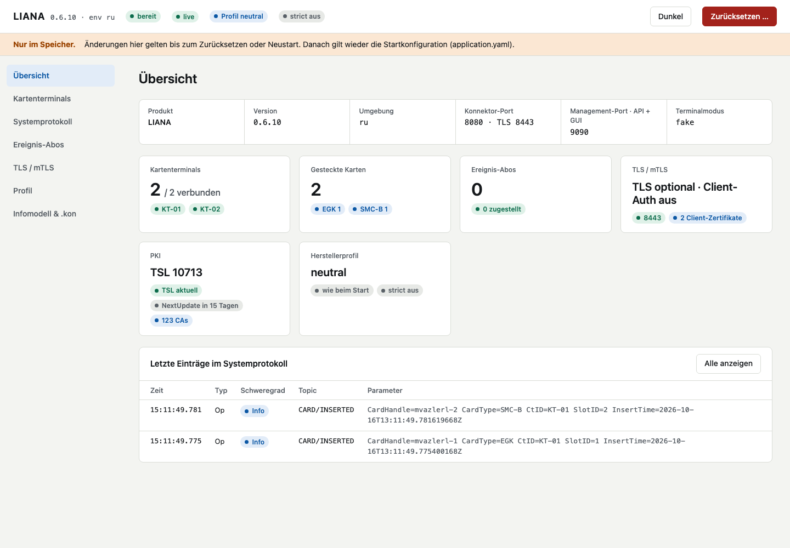

<p align="center">
  
</p>

# LIANA – Konnektor-Simulator

LIANA simuliert den Ausschnitt des Konnektors, den der TI-2.0-Testhub für **PoPP**, **ZETA** und **VSDM2** braucht: Kartenzugriff, Eventing und Informationsmodell. Die Außenkommunikation wird über Golden Traces abgesichert. Kartenterminals sind in Phase 0 und 1 intern gemockt (Fake-Terminal), ab Phase 2 kommt SICCT gegen den eH-KT-Simulator.

- Architektur (Ist-Stand, Mermaid): [`docs/architektur.md`](architektur.md)
- Ticketnummern (`LIANA-…`) und Entscheidungen (`decision-…`) verweisen auf das gematik-interne Backlog; was nur intern gilt (Backlog, CI, Registry, Nexus, Testhub-Stand), steht in `docs/intern.md` (nicht veröffentlicht)

## Schnellstart

```bash
./mvnw quarkus:dev              # Konnektor-Port 8080 (HTTP) und 8443 (HTTPS), Management-Port 9090; kartos aus tools/kartos/
./mvnw verify                   # JVM-Tests; kartos-ITs und Trace-Tests nehmen das eingecheckte kartos (Linux, macOS);
                                # Testabdeckung (JaCoCo) je Modul in target/site/jacoco, gesamt in liana-coverage/target/site/jacoco-aggregate
./mvnw -Powasp verify -DskipTests -DnvdApiKey=…  # OWASP Dependency Check, Bericht in target/dependency-check-report.html
./mvnw verify -Dnative          # Native Image + Integrationstests (langsam, CI)
./mvnw spotless:apply           # Java nach Google Java Format; der Build prüft das in validate (spotless:check)
docker build -t liana:dev .     # Dev-Image ohne lokales JDK (Abschnitt Docker)
```

## Karten-APDUs im Tiger-Log

Mit `liana.trace.push-url` (Env `LIANA_TRACE_PUSH_URL`) meldet LIANA jede APDU an eine Karte an einen Tiger-Proxy: zwei `POST /traffic` an dessen Admin-Port (Kommando `liana → KT-01:1`, Antwort zurück), im SICCT-Umschlag. Im Proxy `activateRbelParsingFor: [sicct]` setzen, dann zerlegt Rbel CLA, INS, P1, P2 und Statuswort. Ohne URL kein HTTP-Verkehr; ein fehlender oder langsamer Proxy hält keine APDU auf (`liana.trace.push-timeout`, Standard 500 ms). Rbel paart Kommando und Antwort dabei nicht.

Lokal, gegen einen tiger-standalone-proxy auf 18080: `LIANA_TRACE_PUSH_URL=http://localhost:18080`, aus einem Container `http://host.docker.internal:18080`.

## Ports

Im Normalbetrieb öffnet LIANA drei Ports, so wie ein echter Konnektor LAN-seitig (decision-017):

| Port | Inhalt |
|---|---|
| 8080 (`quarkus.http.port`) | Konnektordienste per HTTP: `/connector.sds`, SOAP unter `/ws/*` |
| 8443 (`liana.tls.port`) | dieselben Dienste per HTTPS (Abschnitt TLS) |
| 9090 (`liana.admin.port`) | Management-Port, HTTP und HTTPS auf demselben Port: Control Center `/` (Abschnitt Control Center), Admin-API `/admin/*` (ohne Auth), KMS des Herstellerprofils `/rest/mgmt/*` (mit Login, Abschnitt KMS), CATS `/cats/{KT}/*` (Abschnitt CATS-Schnittstelle) |

Auf 9090 entscheidet das erste Byte jeder Verbindung (TLS-Handshake oder nicht), ob HTTP oder HTTPS antwortet; HTTPS mit ID.AK.AUT der gSMC-K wie die Konnektor-Schnittstelle, ohne Client-Auth. Daneben, nur bei Bedarf: CATS zusätzlich auf eigenem Port wie bis 0.6 auf 9998 (`liana.cats.terminals[].port`, standardmäßig zu), Robot 9997 (eHealth-KT-Suite) und das KMS zusätzlich auf eigenem HTTPS-Port `liana.kms.port` wie bis 0.6 auf 8500 (standardmäßig zu).

Intern bleibt es bei 9090, das Portbild eines Herstellers entsteht per Port-Mapping:

| Hersteller (kms-client) | Management-Port beim Hersteller | Mapping |
|---|---|---|
| EHEX/secunet (`/rest/mgmt`) | 8500 | `-p 8500:9090` |
| KoCo/CGM | 9443 | `-p 9443:9090` |
| RISE (`/api`) | 8443 | keins: auch am HTTPS-Port 8443 der Konnektor-Schnittstelle (unten) |

Umgesetzt sind das EHEX-KMS, das KOCO-KMS (Pfade der KoCoBox an der Wurzel: `/j_security_check`, `/login.htm`, `/administration/*`) und das RISE-KMS (`/api/*`). RISE hat Management und Konnektordienste auf einem HTTPS-Port 8443; darum antwortet das RISE-KMS bei Profil RISE auch auf `liana.tls.port`, dort nur über TLS, neben SOAP und `connector.sds` (die Pfade überschneiden sich nicht), bei anderen Profilen 404 wie zuvor. Alles auf 9090 außerhalb von `/`, `/gui`, `/admin`, der KMS-Pfade und `/cats` antwortet wie ein nicht umgesetztes KMS mit 501, Herstellerprofil, Methode und Pfad (decision-12); unbekannte Pfade unter `/admin` mit 404.

## Control Center

Die GUI für Testende und Entwickler von Primärsystemen liegt auf dem Management-Port: `http://localhost:9090/` (auch per HTTPS). Sie ist ein reiner Client der Admin-API (decision-018), ohne Login, und aktualisiert sich per Push über `GET /admin/events` (Kopfzeile „live“, LIANA-150, alle Seiten seit LIANA-151); bricht der Stream ab, fragt sie alle 2 s ab („Polling“), bis der Browser wieder verbunden ist.



| Seite | Inhalt |
|---|---|
| Übersicht | Instanz, Terminals, gesteckte Karten, Ereignis-Abos, TLS, PKI, Herstellerprofil, letzte Einträge im Systemprotokoll |
| Kartenterminals | Fake-KTs: Karte stecken (Auswahl aus dem Image-Katalog oder eigener Pfad)/ziehen, Störung setzen/löschen, PIN-Skript anhängen/leeren; eHealth-KTs: CT-Object, Korrelation, Pairing auslösen/lösen, Shared Secret, Dienstsuche. Karten und Störungen in eHealth-KTs verwaltet kartos (ausgegraut). Je Slot die Karte aus CM_CARD_LIST (CardHandle, ICCSN, Inhaber, KVNR, Zertifikatsablauf, Reservierung); darunter offene Kartensitzungen mit Restzeit und verifizierte PINs (nur PinRef). |
| Systemprotokoll | Zeitraum, Filter nach Typ, Schweregrad und Topic, Parameter aufklappbar, LIANA/DEVIATION hervorgehoben, Live an/aus |
| Ereignis-Abos | Subscriptions der Clientsysteme mit Kontext, Ziel, Topic, Filter, Ablauf und letzter CETP-Zustellung (Erfolg oder Grund); nur lesend |
| TLS / mTLS | ANCL_TLS_MANDATORY, ANCL_CAUT_MANDATORY, ANCL_DVD_OPEN, TLS_USE_ECC_FOR_CS, Serveridentität, Serverzertifikat mit Fingerprint, Client-Zertifikate, Protokoll, Cipher-Suites und Kurven; PKI mit TSL-Stand (`#/tls/pki`); nur lesend |
| Profil | Herstellerprofil und strict umschalten, Abweichung vom Startwert markiert; Katalog der Abweichungen der Gegenstellen; Management-Einstellungen CARD_SESSION_TIMEOUT und Online-Modus |
| Infomodell & .kon | Arbeitsplätze, Mandanten, Clientsysteme, SM-B_Verwaltet; `.kon` je Clientsystem als Vorschau (ohne Passwort und Container) und Download |

Alles bleibt flüchtig wie bei der Admin-API; „Zurücksetzen …“ zeigt, was verloren geht, und ruft `POST /admin/reset`. Fehler der API erscheinen am Feld (400, 404), als Alarm mit Konnektor-Fehlercode (409) oder neutral als „in LIANA nicht umgesetzt“ (501); ist LIANA nicht bereit (503) oder nicht erreichbar, sagt die Seite das. Die Dateien liegen statisch unter `liana-app/src/main/resources/gui/` (Preact mit htm, vendort in `gui/vendor/` mit `SOURCE.md`, kein Node, kein CDN; Content-Security-Policy nur für LIANA selbst). `./mvnw verify` prüft Auslieferung und dass jeder genutzte Endpunkt existiert (`GuiTest`), nicht das Verhalten im Browser.

## Admin-API

Unter `/admin/*` auf dem Management-Port `liana.admin.port` (9090), JSON, ohne Auth, nur internes Netz. Änderungen sind flüchtig, `POST /admin/reset` stellt den Stand aus `application.yaml` her (decision-4). Die ganze API steht als OpenAPI 3.0 unter `GET /admin/openapi.yaml` (handgeschrieben in `liana-app/src/main/resources/admin/openapi.yaml`; `OpenApiTest` hält sie mit den Routen synchron, LIANA-149). Keine Antwort enthält PIN-Werte oder private Schlüssel; Ausnahme ist die `.kon` mit `pkcs12`, die den Client-Container ausliefert.

| Aufruf | Wirkung |
|---|---|
| `GET /admin/ready` | Bereitschaft (LIANA-107): `200 {"ready":true}`, sobald der Start abgeschlossen ist (Konfiguration geprüft, KTs mit gesteckten Kartenimages, Infrastruktur, alle Ports offen, `/connector.sds` gerendert), sonst `503 {"ready":false}`, auch beim Shutdown; vor dem Start des Admin-Servers keine Verbindung |
| `GET /admin/info` | Version, Umgebung, Herstellerprofil, Ports, Terminal-Modus |
| `GET /admin/terminals`, `GET /admin/terminals/{id}` | KTs mit `mode` (fake, sicct), Slots und gesteckten Images, je Slot `cardType` aus CM_CARD_LIST und bei UNKNOWN `unknownReason` (LIANA-121) und den ganzen Eintrag aus CM_CARD_LIST unter `card` (wie `/admin/cards`); eHealth-KTs mit dem CT-Object (`ct`, TAB_KON_522) |
| `GET /admin/cards` | CM_CARD_LIST (TUC_KON_001): `cardHandle`, `ctId`, `slotNo`, `insertTime`, `cardType`, `iccsn`, `cardHolderName`, `kvnr` (eGK), `cardVersion`, `certExpirationDate`, `locked` (durch eine Kartensitzung reserviert); nicht lesbare Werte fehlen |
| `GET /admin/images` | Kartenimages aus `liana.card-images`: `directories` und je Image `name`, `file`, `iccsn` (die Werte für `PUT …/slots/{n}`) |
| `GET /admin/sessions` | `cardSessions`: PoPP-Kartensitzungen (A_25970-01) mit Karte, Ablauf des APDU-Szenario-Timers (`deadline`) und `timer` (Konnektor, PoPP); `verifiedPins`: CARDSESSION.AUTHSTATE je Karte, Mandant und Clientsystem mit `pinRef`, nie ein PIN-Wert |
| `GET /admin/ct-list` | CTM_CT_LIST: alle eHealth-KTs mit CT-Object, auch nur angekündigte (Korrelation „bekannt“) |
| `POST /admin/ct-discovery` (optional `{"ctId":"KT-03"}`) | TUC_KON_054 ManuallyAdded erneut, etwa für ein KT, das beim Start nicht antwortete; ein neues CT-Object bekommt das Pairing aus der YAML. Mit `ctId` dessen Fehler (404 nicht konfiguriert, 409 mit 4033 …), ohne alle konfigurierten eHealth-KTs, Fehler dann nur im Systemprotokoll (CT/CT_ADDING_ERROR); Antwort ist CTM_CT_LIST |
| `POST /admin/terminals/{id}/pairing` | TUC_KON_053: eHealth-KT pairen (optional `{"fingerprint": …}`), danach verbunden; Fehler 409 mit `code` (4040–4042) |
| `PUT /admin/terminals/{id}/pairing` `{"sharedSecret":"<32 hex>"}` / `DELETE …/pairing` | CT.SHARED_SECRET flüchtig setzen (KT aktiv, VALIDATE beim Verbinden, 4029 bei fremdem Pairing) bzw. löschen |
| `PUT /admin/terminals/{id}/slots/{n}` `{"image":"egk-valid"}` | Karte stecken (Dateiname oder ICCSN aus `liana.card-images`, oder absoluter Pfad), ersetzt eine gesteckte; ohne `image` 400 |
| `DELETE /admin/terminals/{id}/slots/{n}` | Karte ziehen |
| `PUT /admin/terminals/{id}/slots/{n}/fault` | Störung am Slot setzen (ersetzt eine vorhandene), siehe unten; `GET /admin/terminals` zeigt sie als `fault` |
| `DELETE /admin/terminals/{id}/slots/{n}/fault` | Störung löschen |
| `POST /admin/terminals/{id}/pin-script` `[{"outcome":"wrong","slotNo":2}, …]` | PIN-Eingaben an das PIN-Script des Fake-KT hängen, siehe unten; `GET /admin/terminals/{id}` zeigt sie als `pinScript` (ohne `pin`) |
| `DELETE /admin/terminals/{id}/pin-script` | PIN-Script leeren, das PIN-Pad tippt wieder die konfigurierte PIN |
| `GET /admin/infomodel` | Mandanten, Clientsysteme, Arbeitsplätze |
| `GET /admin/tls` | TLS der Konnektor-Schnittstelle (lesend, schreibend ab Phase 4): ANCL_TLS_MANDATORY, ANCL_CAUT_MANDATORY, HTTPS-Port, Serverzertifikat mit SHA-256-Fingerprint, ANCL_CCERT_LIST, `dvdOpen` (ANCL_DVD_OPEN), `eccForClientSystems` (TLS_USE_ECC_FOR_CS), `serverSoftwareKey`, `protocol`, `cipherSuites`, `namedGroups` |
| `GET /admin/pki` | Vertrauensraum (TUC_KON_037): geladene TSL (`file`: Datei aus `liana.pki.tsl` oder die URL des Online-Abrufs, `sequenceNumber`, `nextUpdate`, `caCount`) und `importedCas` |
| `GET /admin/subscriptions` | Subscriptions (TIP1-A_4594): `id`, `terminationTime`, Kontext, `eventTo`, `topic`, `filter` und `lastDelivery` (letzter CETP-Zustellversuch: `time`, `topic`, `delivered`, `error`) |
| `GET /admin/clients/{clientSystemId}/config.kon` | Client-Konfiguration im `.kon`-Format (`support/kon/kon-format.md` v1.0.0): Mandant und Arbeitsplatz aus dem Infomodell, `url`, `rewriteServiceEndpoints`, `credentials` aus `liana.kon-export` (`basic` oder `pkcs12` mit Container aus `credentials.keystore`), `trustStore` mit der Kette der Serveridentität |
| `GET /admin/vendor` | Herstellerprofil: `vendor` aktiv, `boot` aus `liana.vendor`; `strict` aktiv, `strictBoot` aus `liana.strict` (Abschnitt „Abweichungen der Gegenstellen“) |
| `PUT /admin/vendor` `{"vendor":"EHEX","strict":true}` | Herstellerprofil (`neutral`, `KOCO`, `RISE`, `SECUNET`, `EHEX`, `CGM`; unbekannt → 400) und/oder `strict` umschalten; fehlende Felder bleiben, ohne beide → 400 |
| `GET /admin/deviations` | Bekannte Abweichungen der Gegenstellen (LIANA-126): `strict` und je Abweichung `id`, `peer`, `spec`, `observed`, `fallback` |
| `GET /admin/vsdm/online-checks` | VSDM-Onlineprüfung (LIANA-141): Kette `sources`, `strict`, `online` (MGM_LU_ONLINE) und je eGK die letzte Prüfung mit `source` (`ufs`, `fixed`, `spec`), `ergebnis`, `errorCode`, `pruefziffer`, `detail`, `skipped` |
| `GET /admin/settings` | Management-Einstellungen unabhängig vom Profil: `cardSessionTimeout` (CARD_SESSION_TIMEOUT in s, TAB_KON_554), `cardSessionTimeoutBoot` (aus `liana.card.session-timeout`), `luOnline` (MGM_LU_ONLINE, TAB_KON_658) |
| `PUT /admin/settings` `{"cardSessionTimeout":30,"luOnline":false}` | Dieselben Werte wie über das KMS setzen; fehlende Felder bleiben, ohne beide oder außerhalb 10–180 s → 400; eine Änderung von MGM_LU_ONLINE steht als MGM/LU_CHANGED/LU_ONLINE im Systemprotokoll |
| `GET /admin/selftest/crypto/{check}` | Krypto-Selbsttest im laufenden Prozess (LIANA-4), `brainpool-ecdsa`, `es256-jws`, `brainpool-tls12`, `sicct-tls`: 200 bestanden, 500 nicht, unbekannt 404; bis 0.6 auf dem Konnektor-Port unter `/selftest/crypto` |
| `GET /admin/openapi.yaml` | Diese API als OpenAPI 3.0 |
| `GET /admin/events` | Push als Server-Sent Events (LIANA-150), siehe unten |
| `GET /admin/log?from=…&to=…` | Systemprotokoll (TUC_KON_271): `time`, `type` (Op), `severity`, `topic`, `parameters`; Grenzen optional, ISO-8601 (`2026-10-09T12:00:00Z`), einschließlich |
| `POST /admin/reset` | YAML-Stand wiederherstellen, auch Herstellerprofil und `strict`; leert das Systemprotokoll |

Push (`GET /admin/events`, `text/event-stream`, LIANA-150): jedes Ereignis mit `id`, `event` und `data` (JSON). `log` ist ein neuer Eintrag im Systemprotokoll (Felder wie `/admin/log`), `card` CARD/INSERTED, CARD/REMOVED, CARD/PIN/* und CARD/SESSION/TIMEOUT mit `topic` und `parameters` wie für Clientsysteme, `terminal` eine Änderung an einem KT (`cause` wie CT/CONNECTED, `display`, `card`, `fault`, `pin-script`, `pairing`) mit dem KT danach unter `terminal`, `state` Profil oder strict, Einstellungen, Reset oder ein schreibender KMS-Aufruf (`cause` vendor, settings, reset, kms) mit `vendor` und `settings` danach, `subscription` eine Anmeldung oder ein Zustellversuch per CETP (`cause` subscribe, unsubscribe, renew, delivery, auto-unsubscribe, expired, reset; `id`), `session` Beginn oder Ende einer Kartensitzung (`sessionId`, `open`), beide LIANA-151. Nach einem Abbruch setzt der Browser `Last-Event-ID` und bekommt alle Ereignisse seitdem aus dem Ringpuffer (`liana.admin.events.buffer`, 1000); ist die ID zu alt oder aus einem früheren Start, kommt `resync`, danach neu laden. Heartbeat-Kommentar alle `liana.admin.events.heartbeat` (15 s), höchstens `liana.admin.events.max-streams` (16) gleichzeitig, darüber 503. `curl -N localhost:9090/admin/events` zeigt den Stream.

Fehler kommen als `{"error":"…"}`: unbekannter KT, Slot, Image oder unbekanntes Clientsystem → 404 (die Meldung nennt die Ordner von `liana.card-images` und ähnliche Namen), fehlender Body oder ungültige Störung → 400.

Störungen (LIANA-41) hängen am Slot, nicht an der Karte, und wirken auf Reset, APDUs und PIN-Eingabe:

| `type` | Felder | Wirkung |
|---|---|---|
| `status-word` | `statusWord` (4 Hex) | Die Karte antwortet nur mit dem Statuswort, das Kommando erreicht sie nicht. SecureSendAPDU liefert 4284, wenn es nicht in `expectedStatusWords` steht. |
| `response` | `response` (Hex, Daten und Statuswort) | Wie `status-word`, aber mit der ganzen Antwort-APDU, z. B. eine ersetzte Signatur (CATS `manipulateSignatureResponse`, LIANA-67) |
| `io-error` | – | Kommunikationsfehler mit dem KT, auch beim Reset → 4044 (TUC_KON_200) |
| `delay` | `delayMs` | Die Karte antwortet erst nach der Verzögerung, auch beim Reset. Über `liana.card.card-timeout` (CARD_TIMEOUT_CARD, Standard 10 s, zur Laufzeit über das KMS von KOCO änderbar) bricht LIANA ab → 4094; die PIN-Eingabe ist davon ausgenommen. |

Optional für alle: `commandPrefix` (Hex, nur Kommandos mit diesem Anfang; der Reset ist dann nicht betroffen) und `count` (nur die nächsten n betroffenen Aufrufe, danach ist die Störung verbraucht). Ohne `count` gilt sie bis `DELETE` oder `POST /admin/reset`.

PIN-Eingaben (LIANA-68) wie das PIN-Script von `kartos terminal` (`/api/v1/tui/script`): Jeder PIN-Dialog (VerifyPin) nimmt den ersten Eintrag ohne `slotNo` oder mit dem Slot der Karte; Einträge für andere Slots bleiben stehen. Ohne passenden Eintrag tippt das PIN-Pad die konfigurierte PIN (`liana.infrastructure.terminals.<id>.pin`, Standard 123456) sofort ein; nur die Robot-Terminals warten mit `liana.robot.await-pin` bis zu 30 s auf eine Eingabe (TIP1-A_3086), dann 6400. Ein ungültiger Eintrag weist das ganze Array ab (400, unbekannter Slot 404). Fehlbedienungszähler und Transport-PIN führt die Karte in kartos; `POST /admin/reset` steckt die Karten frisch aus dem Image und leert das Script.

| `outcome` | Anwender | Ergebnis (VerifyPin) |
|---|---|---|
| `correct` | konfigurierte PIN | OK |
| `wrong` | konfigurierte PIN, jede Ziffer geändert | REJECTED mit `LeftTries` der Karte, nach dem letzten Versuch NOWBLOCKED, danach WASBLOCKED (TAB_KON_738 Schritt 5) |
| `digits` mit `pin` (4–12 Ziffern) | diese Ziffern | je nach Karte |
| `puk`, `transport` | `liana.infrastructure.terminals.<id>.puk` (12345678) bzw. `.transport-pin` (54321), wie die Images der eHealth-KT-Suite | je nach Karte; Transport- oder Leer-PIN auf der Karte: TRANSPORT_PIN |
| `cancel` | Abbruchtaste (SICCT 6401) | 4049 |
| `timeout` | keine Eingabe (SICCT 6400, sofort) | 4043 |
| `incomplete` | Ziffern ohne Bestätigung: wartet bis zum Timeout (6400) oder bis die Karte gezogen ist (64A1) | 4043 bzw. 4008 |

`correct`, `wrong`, `digits`, `cancel` und `timeout` sind die Werte von kartos; `puk`, `transport` und `incomplete` kennt nur das Fake-KT.

```bash
curl -X PUT -H 'Content-Type: application/json' -d '{"image":"egk-valid"}' localhost:9090/admin/terminals/KT-02/slots/1
curl -o cs1.kon localhost:9090/admin/clients/CS1/config.kon
curl -X PUT -H 'Content-Type: application/json' -d '{"type":"status-word","statusWord":"6A82","commandPrefix":"00B0","count":1}' \
  localhost:9090/admin/terminals/KT-01/slots/1/fault
curl -X POST -H 'Content-Type: application/json' -d '[{"outcome":"wrong","slotNo":2},{"outcome":"cancel"}]' \
  localhost:9090/admin/terminals/KT-01/pin-script
```

## CATS-Schnittstelle

Konnektor-QES und -E2E stecken Karten über die REST-Schnittstelle von CATS (tiger-cats-extensions 1.4.0, Steps wie „CATS steckt die Karte "…" in Slot n“, Hook `@RemoveAllCardsAfterTest`). LIANA bietet sie je CATS-Terminal auf dem Management-Port unter `/cats/{KT}` an (LIANA-67, LIANA-147): Standard ist `liana.cats.terminals: [{terminal: KT-01}]`, Basis-URL der Steps also `http://localhost:9090/cats/KT-01`; die Slots sind die des LIANA-KT. Mit `port` öffnet LIANA für das Terminal zusätzlich einen eigenen HTTP-Port ohne Präfix wie bis 0.6, etwa `{terminal: KT-01, port: 9998}` (Env `LIANA_CATS_TERMINALS_0__PORT=9998`), weil die QES-Suite `http://127.0.0.1:9998` fest in ihren Feature-Dateien stehen hat (`tools/testhub/qes.sh` schaltet ihn ein). Weitere Terminals mit weiteren Einträgen; die Startprüfung bricht bei unbekannten oder doppelten KTs, KT-IDs, die kein Pfadsegment sein können, und doppelten Ports ab. Unter `/cats` antwortet ein nicht konfiguriertes KT mit 404. Mit `insert-delay` (etwa `1s`, Env `LIANA_CATS_TERMINALS_0__INSERT_DELAY`) bestätigt `POST /config/card/insert` sofort und steckt die Karte erst nach der Frist, wie beim echten Konnektor, bei dem das Ereignis über KT und SICCT kommt. Konnektor-QES ruft zwischen Stecken und Warten auf CARD/INSERTED weitere CATS-Endpunkte auf (KUC_1601_010), `qes.sh` setzt deshalb 1 s. Steht am selben KT noch ein Stecken aus, stecken beide erst nach der Frist ab dem letzten Aufruf, gemeinsam wie beim CATS-Roboter (KUC_1602_072/073 stecken gSMC-KT und HBA, warten auf ein CARD/INSERTED und suchen dann den HBA). Ziehen, ein neues Stecken und `slots/reset` verwerfen ein ausstehendes Stecken. Alles ist flüchtig, `POST /admin/reset` stellt den YAML-Stand her.

kartos signiert in Mikrosekunden, ein HBA braucht einige zehn Millisekunden. Mit `liana.infrastructure.terminals.<id>.signature-time` (etwa `60ms`, Env `LIANA_INFRASTRUCTURE_TERMINALS_KT_01_SIGNATURE_TIME`) antwortet jede Karte des Fake-KT auf PSO COMPUTE DIGITAL SIGNATURE erst nach dieser Rechenzeit, Standard ist keine. Anders als die Störungen gehört sie zur Konfiguration, CATS und `POST /admin/reset` lassen sie stehen. `qes.sh` setzt 60 ms: KUC_1602_072 bricht einen Stapel von 80 Dokumenten nach rund 3,7 s mit StopSignature ab, KUC_1602_073 erwartet ihn nach rund 7 s fertig (LIANA-112.05).

| Aufruf | Wirkung |
|---|---|
| `PUT /config/card/slot/{n}/cardImage` (Image-XML als Body) | Image für den Slot laden; steckt dort schon eine Karte (etwa aus der YAML), wird sie gezogen (CARD/REMOVED), CARD/INSERTED kommt erst mit `insert` (LIANA-91) |
| `PUT /config/card/slot/{n}` `{"cardConfigPath": …}` | Image aus einer CATS-Kartenkonfiguration (`cardImageFile`) oder direkt aus einem Image laden; der Pfad muss dort gelten, wo LIANA läuft |
| `POST /config/card/insert` `{"slotNumber": n, "inserted": true\|false}` | Geladenes Image stecken bzw. die Karte ziehen, mit CARD/INSERTED und CARD/REMOVED und neuem CardHandle wie bei der Admin-API |
| `POST /config/card/slots/reset` | Alle Karten des KT ziehen, Störungen und geladene Images vergessen |
| `GET /cardsim/slot/{n}/delay/{ms}` | Störung `delay` mit `ms`, 0 hebt sie auf |
| `POST /cardsim/slot/{n}/manipulateSignatureResponse` `{"responseReplacement": …}` | Störung `response` für PSO COMPUTE DIGITAL SIGNATURE (`commandPrefix` `002A9E9A`) |

Pfade relativ zur Basis-URL. Erfolg ist 200 ohne Inhalt. Fehler als `{"error": …}`: ungültiger Request oder ungültiges Image (kein XML, Wurzel nicht `card`, ohne `coldAnswerToReset`) → 400, Slot außerhalb → 404, Stecken ohne geladenes Image → 409. Alle anderen CATS-Endpunkte (PIN, `/action/*`, `/sicct/*` mit `userDefinedStatusWord`, LIANA-94) und CATS-Terminals auf einem eHealth-KT (LIANA-93) antworten 501 mit dem Pfad (decision-12), damit der Step rot wird.

```bash
curl -X PUT -H 'Content-Type: application/json' --data-binary @support/images/hba-valid.xml localhost:9090/cats/KT-01/config/card/slot/3/cardImage
curl -X POST -H 'Content-Type: application/json' -d '{"slotNumber":3,"inserted":true}' localhost:9090/cats/KT-01/config/card/insert
```

## Ereignisse (Subscribe und CETP)

Der EventService bietet neben GetCards und GetCardTerminals (LIANA-108) Subscribe, Unsubscribe (per SubscriptionID oder EventTo), RenewSubscriptions und GetSubscription nach gemSpec_Kon 4.1.6.5 (LIANA-59). Anmeldungen gelten 25 h, liegen nur im Speicher und sind nach dem Start leer; `POST /admin/reset` leert sie ebenfalls. CARD/INSERTED, CARD/REMOVED und bei VerifyPin CARD/PIN/VERIFY_STARTED und CARD/PIN/VERIFY_FINISHED (LIANA-63, TUC_KON_012 Schritt 7, nicht im Systemprotokoll) gehen an jede passende Anmeldung (Topic-Präfix, Arbeitsplatz erreicht das KT, optionaler XPath-Filter). LIANA verbindet sich per TLS 1.2 mit `EventTo` (`cetp://host:port`) und schickt je Ereignis `CETP`, die Länge und das `Event`-XML. Die Verbindung bleibt je Ereignissenke offen, wie bei echten Konnektoren (der Tiger-Proxy `cetpProxy` verliert Ereignisse, wenn sie gleich wieder schließt, LIANA-95); schließt die Senke sie, baut LIANA für das nächste Ereignis eine neue auf. Als Client-Zertifikat dient ID.AK.AUT der gSMC-K (`liana.infrastructure.konnektor.gsmc-k.ak-aut`); das Zertifikat der Ereignissenke prüft LIANA nicht.

GetCardTerminals (TIP1-A_4604, TUC_KON_252) liefert die KTs des Arbeitsplatzes aus dem Aufrufkontext, mit `mandant-wide="true"` die aller Arbeitsplätze von Mandant und Clientsystem, in der Reihenfolge von `liana.infrastructure.terminals`; `WorkplaceIds` sind alle Arbeitsplätze des Infomodells mit dem KT. Ein eHealth-KT (SICCT) zeigt den Stand des CT-Objects (Name CT.HOSTNAME, MAC, IP, Slots, Connected, Produktinformation aus GET STATUS), ohne das KT abzufragen. Ein Fake-KT hat als Name die CtId, eine lokal verwaltete MAC `02-4C-…` (stabil aus der CtId), die IP-Adresse 127.0.0.1 (im Schema optional, der Konnektor-Client der eHealth-KT-Suite setzt sie voraus; ein SICCT-KT ohne bekannte Adresse meldet 0.0.0.0), `IS_PHYSICAL` und `Connected` true und die Produktinformation `LIANA`/`FAKEKT`.

## Karten anfordern und auswerfen (CardTerminalService)

`/ws/CardTerminalService` (v1.1, in `connector.sds` als 1.1.0) bietet RequestCard und EjectCard (TIP1-A_5412, TIP1-A_5413, LIANA-110). RequestCard (TUC_KON_056) liefert die Karte im Slot sofort mit `AlreadyInserted` true, sonst zeigt das KT die Aufforderung (`DisplayMsg`, ohne sie die Standardanzeige nach TIP1-A_5408) und LIANA antwortet, sobald die gesteckte Karte in der Kartenliste steht, oder nach `TimeOut` Sekunden mit 4202. EjectCard (TUC_KON_057, per CardHandle oder Slot) deaktiviert die Karte, zeigt die Aufforderung zum Entnehmen und antwortet, wenn sie gezogen ist, oder nach `TimeOut` Millisekunden mit 4203; ein leerer Slot ist sofort OK. Ohne `TimeOut` warten beide 20 s. Ein Fake-KT zeigt die Aufforderung in der Admin-API (`GET /admin/terminals/{ct}`, Feld `display`), bis die Karte über Admin-API, CATS oder Robot gesteckt bzw. gezogen ist; einen Anwender, der der Anzeige von sich aus folgt, gibt es nicht (halbautomatische Szenarien der eHealth-KT-Suite: LIANA-122). Ein eHealth-KT bekommt SICCT REQUEST ICC bzw. EJECT ICC mit der Wartezeit; `kartos terminal` antwortet ohne Karte sofort mit 6200 und wirft beim Auswerfen aus.

| Einstellung | Bedeutung |
|---|---|
| `liana.events.max-try` | EVT_MAX_TRY (Standard 3): nach so vielen gescheiterten Zustellungen in Folge entfernt LIANA alle Anmeldungen der Ereignissenke |
| `liana.events.connect-timeout` | Verbindungsaufbau und ggf. TLS-Handshake (Standard 5 s) |

GetPinStatus (CardService, LIANA-63) liefert VERIFIED, wenn die PIN in derselben Kartensitzung (CardHandle, Mandant, Clientsystem) per VerifyPin verifiziert ist, sonst den Zustand der Karte aus GET PIN STATUS mit dem Fehlbedienungszähler als LeftTries (VERIFIABLE 3, nach einer Fehleingabe 2, gesperrt BLOCKED 0, PIN-Schutz aus DISABLED, TRANSPORT_PIN, EMPTY_PIN). Konnektor-E2E ruft es in den CATS_CS-Szenarien nach den KMS-Umstellungen auf.

PIN-Verwaltung (CardService v8.1 und v8.2, LIANA-109): alle Eingaben am PIN-Pad des KT, Anzeigen nach TAB_KON_090, Ergebnis als PinResult (OK, REJECTED mit LeftTries, NOWBLOCKED, WASBLOCKED), Ereignisse an die Anmeldungen wie bei VerifyPin.

| Operation | Karten und PinTyp | Ablauf |
|---|---|---|
| VerifyPin (TUC_KON_012) | SM-B PIN.SMC, HBAx PIN.CH; die eGK DARF NICHT (TAB_KON_047, 4209) | eine Eingabe, VERIFY; CARD/PIN/VERIFY_* |
| GetPinStatus (TUC_KON_022) | dazu eGK PIN.CH, MRPIN.NFD, NFD_READ, DPE, GDD, OSE, AMTS, PIN.AMTS_REP | ohne Eingabe |
| ChangePin (TUC_KON_019) | wie GetPinStatus | alte PIN (bei Transportschutz die Transport-PIN), neue PIN, Wiederholung, CHANGE REFERENCE DATA; Leer-PIN und PIN.AMTS_REP nur neue PIN mit Wiederholung, PIN.AMTS_REP nach PIN.CH (drei Eingaben); ungleiche Wiederholung 4067; CARD/PIN/CHANGE_* |
| UnblockPin (TUC_KON_021) | wie GetPinStatus | nur bei gesperrter oder transportgeschützter PIN, sonst OK ohne Eingabe; PUK (RESET RETRY COUNTER P1 01) bzw. mit `SetNewPin` PUK, neue PIN, Wiederholung (P1 00); PIN.AMTS_REP nach PIN.CH mit neuer PIN (P1 02); CARD/PIN/CHANGE_* |
| EnablePin, DisablePin (TUC_KON_027) | nur eGK, MRPIN.NFD, DPE, GDD, AMTS (andere Karten 4209) | PIN.CH, ENABLE bzw. DISABLE VERIFICATION REQUIREMENT; PIN nicht abschaltbar 4085, MRPIN.AMTS auf eGK G2.0 4072; CARD/PIN/ENABLE_* bzw. DISABLE_* |

Offen: PIN.QES des HBA und MRPIN.DPE_READ der eGK G2.0 (4000), bis gemSpec_HBA_ObjSys bzw. das G2.0-Objektsystem vorliegen. Am eHealth-KT (SICCT) laufen Operationen mit einer Eingabe als PERFORM VERIFICATION, ChangePin und UnblockPin mit neuer PIN als MODIFY VERIFICATION DATA (LIANA-127, SICCT 1.2.3 §5.20): `80 19` mit den sechs Anzeigen aus TAB_KON_090 auf den Plätzen der Standardtexte, CMD DO mit Steuerbyte `02` und zwei Einfügepositionen, auch für das Entsperren; Leer-PIN und PIN.AMTS_REP über das Null-PIN-Verfahren (1. Einfügeposition `00`); über 255 Byte Daten mit erweitertem Lc. Statuswörter nach §5.20.6 (SICCT-Errata): `6402` ungleiche Wiederholung 4067, `6400` 4043, `6401` 4049, `64A1` 4008. kartos terminal weicht ab (Abschnitt „Abweichungen der Gegenstellen“).

CETP geht nach TAB_KON_852 (LIANA-117) mit `liana.tls.mandatory` (ANCL_TLS_MANDATORY Enabled, CETP1) über TLS 1.2 mit ID.AK.AUT, sonst (Standard, CETP2) über TCP ohne TLS; maßgeblich ist der Stand beim Verbindungsaufbau, das KMS kann ihn umschalten. Die Konnektor-QES abonniert mit `cetp://<cetpServer.ipAddress>:7001`; ihr Tiger-Proxy `cetpProxy` nimmt CETP mit und ohne TLS an und zerlegt die Nachricht (`$.body.Event.Topic.text`). Die IP muss von LIANA aus erreichbar sein.

## VSDM-Onlineprüfung (ReadVSD)

ReadVSD (`/ws/VSDService`, VSDService 5.2, LIANA-119) liefert PD, VD und VSD_Status von der eGK. Mit `PerformOnlineCheck=true` fragt LIANA eine Kette von Quellen der Reihe nach und erzeugt den Prüfungsnachweis nach Tab_FM_VSDM_04 (`fa/vsds/Pruefungsnachweis.xsd`, gzip, Base64); mit `ReadOnlineReceipt=true` steht er in der Antwort (LIANA-141). Die VSD kommen immer von der Karte, aktualisiert wird nichts (VSDD/CMS: LIANA-102). Nicht umgesetzt: den Prüfungsnachweis auf die eGK schreiben und `ReadOnlineReceipt=true` ohne Onlineprüfung (von der eGK lesen, LIANA-103, SOAP-Fault).

| Stufe | Ergebnis |
|---|---|
| `ufs` | GetUpdateFlags (`cm/uf/UFS.wsdl`) an die Endpunkte aus `liana.vsdm.online.ufs.endpoints`, der Reihe nach; ein Endpunkt mit `provider-id` gilt nur für eGKs mit dieser ProviderID (OU in C.CH.AUT, Fachdienstlokalisierung 4.3.3), wie `iinConfig.yml` der vsdm-e2e-Suite. Keine Aktualisierung → 2 mit der Prüfziffer des UFS unverändert; Aktualisierungsauftrag (MANDATORY) → 3, weil kein CCS da ist; SOAP-Fault → 3 mit dem gematik-Fehlercode als ErrorCode. Nicht erreichbar, Zeitlimit oder keine SOAP-Antwort → nächster Endpunkt bzw. nächste Stufe; der Endpunkt wird `retry-after` lang übersprungen. `https://` baut TUC_KON_110 auf: Serverzertifikat C.FD.TLS-S (oid_fd_tls_s) gegen den Vertrauensraum (TSL und `liana.pki.imported-cas`, kein OCSP), Client-Zertifikat C.HCI.AUT der SM-B aus dem Aufruf (MANDANT_SMB = `infomodel.smb-verwaltet`), die Signatur im Handshake rechnet die Karte; nur ECC. `http://` ohne TLS |
| `fixed` | 2 ohne Fachdienst, Prüfziffer im Format des Testhub-Mocks (vsdm-server-simservice `ChecksumService`: erste 48 Byte von SHA-512 über die KVNR, dort Base64url, im Prüfungsnachweis xs:base64Binary). Bewusste Abweichung, die kein Konnektor macht; mit `liana.strict` fällt die Stufe aus der Kette |
| Spec-Rückfall | immer am Ende: 3 ohne Prüfziffer (Tab_FM_VSDM_05-01) |

Die ganze Kette bleibt in MAXTIME_VSDM; danach bricht LIANA mit 3 ab (VSDM-A_2998, Eintrag als Warning). Mit MGM_LU_ONLINE Disabled (`PUT /admin/settings`, KMS) fragt LIANA keine Quelle. Eine gesperrte oder ungültige eGK (114, 107) bekommt keinen Prüfungsnachweis. Jede Prüfung steht im Systemprotokoll (Op, Topic `LIANA/VSDM/ONLINE_CHECK`, Parameter `CardHandle`, `Ergebnis`, `ErrorCode`, `Source`, `Detail`, `Skipped` mit den Gründen der Stufen davor; ohne ICCSN und KVNR) und als letztes Ergebnis je eGK unter `GET /admin/vsdm/online-checks`; `POST /admin/reset` leert die Liste.

| Einstellung | Bedeutung |
|---|---|
| `liana.vsdm.online.sources` | Kette, z. B. `[ufs, fixed]`; **Standard leer**: nur der Spec-Rückfall, Prüfungsnachweis mit Ergebnis 3 |
| `liana.vsdm.online.ufs.endpoints` | Liste mit `url` (`http`/`https`) und optional `provider-id` (neun Ziffern); Pflicht mit `ufs` |
| `liana.vsdm.online.ufs.connect-timeout` | Verbindungsaufbau und TLS-Handshake je Endpunkt (Standard 2 s) |
| `liana.vsdm.online.ufs.retry-after` | so lange wird ein nicht erreichbarer Endpunkt übersprungen (Standard 60 s) |
| `liana.vsdm.timeout` | TIMEOUT_VSDM, Antwortzeit eines Fachdienstes (Standard 10 s) |
| `liana.vsdm.max-time` | MAXTIME_VSDM, Bearbeitungszeit der Onlineprüfung (Standard 30 s) |

```yaml
liana:
  vsdm:
    online:
      sources: [ufs, fixed]
      ufs:
        endpoints:
          - url: http://ufs-mock:8080/ufs
            provider-id: 109500969
```

## PS-Intercept: Primärsystem über einen Tiger-Proxy (LIANA-183, LIANA-189.03)

`tools/testhub/ps-proxy.sh up` startet LIANA (Image `liana:ps`, mit `LIANA_IMAGE` ein vorhandenes) und einen Tiger-Proxy im Netz `liana-ps-net`. Ein Primärsystem auf einem anderen Rechner spricht LIANA über diese Ports des Hosts an:

| Host-Port | Weg | Container |
|---|---|---|
| 80 (`PS_HTTP_PORT`), 443 (`PS_HTTPS_PORT`), 8080 (`PS_HTTP_ALT_PORT`), 8443 (`PS_HTTPS_ALT_PORT`) | PS → LIANA, HTTP und HTTPS auf jedem dieser Ports: SOAP, `/connector.sds`, `GET /` | `liana-ps-tiger` |
| 9090 (`PS_MGMT_PORT`) | Control Center, Admin-API, `.kon`-Export, PIN-Eingabe am Fake-KT, direkt zu LIANA | `liana-ps-liana` |
| 9080 (`PS_TIGER_PORT`) | Tiger-WebUI mit dem ganzen Verkehr | `liana-ps-tiger` |

- 80 und 443 sind die Ports aus TIP1-A_4528 (`http(s)://<Konnektor>/connector.sds`, LIANA-184): `connector.sds` und `.kon`-Export nennen sie ohne Port. 8080 und 8443 bleiben zusätzlich offen (leerer Wert schaltet sie ab).
- Tiger nimmt HTTP und HTTPS auf demselben Port an, kann aber nicht nach Protokoll routen: alles geht per HTTPS an LIANA `:8443`. LIANA sieht damit auch HTTP-Anfragen des PS als HTTPS; ANCL_TLS_MANDATORY lässt sich über den Proxy nicht prüfen.
- `PS_HOST` ist die Adresse, unter der das PS den Host erreicht (Standard: IP von `en0`). Sie steht in `connector.sds` und im `.kon`-Export (`liana.kon-export.url`, `liana.tls.url`), damit das PS nach der Dienstsuche nicht am Proxy vorbei geht, und im SAN des Proxy-Zertifikats.
- HTTPS: Der Proxy weist sich mit einem Zertifikat derselben Komp-CA wie LIANA aus (ID.AK.AUT, P-256; `PS_TLS_KEY=bp256` brainpoolP256r1, `rsa` RSA-2048 für PS mit TLS_USE_ECC_FOR_CS aus), 365 Tage gültig, unter `target/ps-proxy/pki/` (`server.pem`, `server.cer` zum Import ins PS). Es bleibt über Neustarts gleich, solange Schlüsseltyp und SAN passen (Certificate Pinning im PS); `PS_RENEW_CERT=1` stellt neu aus. Dem PS genügt der `trustStore` aus dem `.kon`-Export. Ohne `PS_CLIENT_P12` zeigt der Proxy LIANA das Client-Zertifikat CS1 (`support/pki/clients/cs1-p256.p12`).
- mTLS des PS (LIANA-186): `PS_CLIENT_P12=target/ps-proxy/<ps>.p12` (Passwort in `<ps>.pass` daneben oder `PS_CLIENT_P12_PASS_FILE`, nur zur Laufzeit gelesen, nie ausgegeben). Der Proxy zeigt LIANA dann das Zertifikat des PS statt CS1, LIANA führt es vorn in `liana.tls.client-certs`; mit `PS_CLIENT_AUTH=1` gilt ANCL_CAUT_MANDATORY. Der Proxy fordert vom PS ein Client-Zertifikat an (CertificateRequest ohne CA-Liste) und nimmt jedes. Ältere p12 (RC2-40) packt das Skript für Tiger unter `target/ps-proxy/pki/` neu; `target/` ist ignoriert, die p12 gehört nicht ins Repo.
- `PS_TLS_LIKE_KONNEKTOR=1`: TLS-Handshake mit den Suiten und Signaturverfahren des secunet-Konnektors im PS-Labor.
- Key-Log: Die TLS-Schlüssel beider Seiten sammeln sich in `target/sharedSecrets.txt` (NSS-Format), in Wireshark unter Protocols → TLS → (Pre)-Master-Secret log filename.
- `PS_UPSTREAM=<Adresse>`: Der Proxy geht per HTTPS an einen echten Konnektor statt an LIANA (kein LIANA-Container) und ersetzt dessen Adresse in Antworten durch `PS_HOST`.
- CETP: LIANA liefert ohne Proxy, mit `PS_CETP=host:port` alle Ereignisse an diese Senke (`liana.events.redirect`), sonst an `EventTo`. CETP fehlt im Mitschnitt.
- Karten-APDUs kommen per `liana.trace.push-url` an den Admin-Port des Proxys.
- Eigene LIANA-Konfiguration (Infomodell des PS, Karten, Herstellerprofil): `PS_LIANA_CONFIG=pfad/application.yaml`, gemountet als `/work/config/application.yaml`; ohne Wert gilt der Boot-Zustand (M1, CS1, WP1, KT-01).
- Jede Sitzung (`up` bis `down`) schreibt der Proxy laufend nach `support/traces/_runs/ps-sessions/<NNN>-<JJJJMMTT-HHMMSS>.tgr` (`fileSaveInfo`, LIANA-185); NNN zählt je `up` hoch, auch ohne `export` geht nichts verloren. Er parst zusätzlich `sicct` (APDUs), `X509`, `X500`, `asn1` (Zertifikate, auch in Karten-APDUs, CMS), `OCSP` (IncludeRevocationInfo) und `b64gzip` (Prüfungsnachweis); in der WebUI findet etwa `$..subject =~ '.*'` alle Nachrichten mit Zertifikat.
- Epikur: `PS_LIANA_CONFIG=tools/testhub/ps-proxy/liana-epikur.yaml` ergänzt das Infomodell um Mandant `MEpikur`, Clientsystem `Epikur` und Arbeitsplatz `ap2` (KT-01, KT-02); der `.kon`-Export liegt dann unter `/admin/clients/Epikur/config.kon`. Der `.kon` kommt von LIANA, nennt aber die Proxy-Adressen.
- `tools/testhub/ps-proxy.sh status` zeigt Adressen, Container und Sitzungsdatei, `export` legt HTML-Report, `.tgr` und Logs unter `support/traces/_runs/<zeit>-ps-proxy/` ab, `down` exportiert und räumt ab (auch die Container `liana-ps-tiger-tls`, `-cetp` und `-nginx` älterer Stände).

```bash
PS_CETP=192.168.1.20:4711 tools/testhub/ps-proxy.sh up   # Senke des PS
tools/testhub/ps-proxy.sh export                          # Mitschnitt zwischendurch
tools/testhub/ps-proxy.sh down
```

## Konnektor-QES gegen LIANA

`tools/testhub/qes.sh` führt Szenarien der Konnektor-QES-Suite (`../tiger-konnektor-qes`, anders über `QES_SUITE_DIR`) je Herstellerprofil gegen LIANA aus: Infomodell (LIANA-91) und ExternalAuthenticate `KUC_1606_*`/`HSK_1606_*` (LIANA-64). Die Suite bleibt unverändert, ihre Konfiguration überschreibt das Skript per `-D`. LIANA läuft als Container `liana-qes-<profil>-<produkt>`, Maven im Netz-Namensraum dieses Containers: der GEMCRYPT-Webservice der Suite belegt fest `localhost:8080` (LIANA-HTTP weicht auf 18080 aus), und ein Testhub-Stack auf dem Host stört nicht. `all` lässt die drei Profile parallel laufen (LIANA-112.14), jedes mit eigener Kopie der Suite unter `target/qes-suite/<profil>`; Standard ist nur `@EBK`, `QES_PRODUCTS="EBK HSK"` nimmt HSK für die Abnahme dazu. Für ein Ticket lohnt eine enge Tag-Liste: 19 XAdES-Szenarien laufen für alle drei Profile in gut 5 Minuten (nacheinander 12), KUC_1608_025 allein wartet eine Stunde (SAK_COMFORT_SIGNATURE_TIMER).

```bash
tools/testhub/qes.sh run SECUNET                 # liana:qes bauen, die Szenarien des Profils (@SECUNET)
tools/testhub/qes.sh run KOCO '@HSK_1601_008'     # eigener Tag-Ausdruck
tools/testhub/qes.sh all                         # KOCO, RISE, SECUNET parallel, nur EBK
QES_PRODUCTS="EBK HSK" tools/testhub/qes.sh all  # EBK und HSK (Abnahme)
QES_PARALLEL=0 tools/testhub/qes.sh all          # nacheinander
LIANA_IMAGE=liana:native tools/testhub/qes.sh all # natives Image, ohne Build
```

- Konnektor-Eintrag `koco` und die Route `${konnektor.secunet.url}` aus `tiger.yaml` zeigen auf LIANA `https://127.0.0.1:8443`, mit dem Zugang des LIANA-KMS (nicht den Daten aus `konnektor.yaml`). Aufrufkontext CS1/M1/WP1/bert, das Infomodell setzt das Skript per Umgebungsvariablen wie im README der Suite (Mandant m1 ohne SMC-B, SM-B_Verwaltet der SMC-Bs 80276883110000165043 und 80276883110000168871 bei M1).
- konnektor-service-client wählt den KMS-Client nach `ProductVendorID` aus `connector.sds`; LIANA meldet je Profil `KOCOC`, `RISEG`, `SECUN`, sonst `LIANA`. Die TKQES-Steps der EBK-Szenarien (`KUC_*`) schalten MGM_LU_ONLINE über das KMS des Herstellers auf dessen festem Port; das Skript öffnet dafür den Kompatibilitäts-Listener auf 9443 (KOCO, LIANA-96) bzw. 8500 (SECUNET, EHEX-KMS); RISE erreicht sein KMS auf 8443, dem HTTPS-Port der Konnektor-Schnittstelle (LIANA-97).
- Der CATS-Prozess der Suite bleibt aus, die CATS-Steps gehen an LIANA (Port 9998, vom Skript als Kompatibilitäts-Listener eingeschaltet, LIANA-147). Nach dem Start leert das Skript die Slots (`POST /config/card/slots/reset`): die Szenarien stecken ihre Karten selbst, die SMC-B des YAML-Boot-Zustands zählte sonst im ersten Szenario mit („mehrere Card-Handles“); die Kartenpfade der Steps sind relativ zur Suite, deshalb liegt deren `resources/` unter `/work/resources` bei LIANA.
- Der `cetpProxy` reicht CETP an `localhost:1234` weiter und verwirft das Ereignis, wenn dort niemand lauscht (LIANA-95); das Skript startet dort eine socat-Senke.
- Je Profil laufen EBK (`@KUC_*`) und HSK (`@HSK_*`) getrennt, jeweils mit frisch gestartetem LIANA, wie der Nightly der Suite: Die HSK-Szenarien schalten MGM_LU_ONLINE nicht, sie setzen den Boot-Zustand (online) voraus. Nennt der Tag-Ausdruck nur KUC- oder nur HSK-Tags, entfällt der andere Lauf.
- Lauf nach `support/traces/_runs/<zeit>-qes-<profil>-<ebk|hsk>/`: `suite.log`, `liana.log`, `failsafe-reports/`, `summary.txt`. Stand je Szenario: Phasenplan doc-1.

## eHealth-KT-Suite gegen LIANA (Robot-Schnittstelle)

Die eHealth-KT-Suite (`../tiger-ehealth-kt-e2e`, Branch `Development_1.x`, anders über `EHKT_SUITE_DIR`) bedient im Labor echte Kartenterminals mit einem Kartenroboter: Removinator mit acht Fächern je Seite, Stecker je Terminal, Stift am PIN-Pad. LIANA bietet dessen Schnittstelle an (LIANA-106): `POST /api/robot/robotCommand` mit `{"command": …, "input": …}`, aber nur mit `liana.robot.port` (ohne Port aus, kein anderer Lauf ändert sich). Robot-Terminals sind Fake-KTs oder eHealth-KTs, die `kartos terminal` sind (LIANA-112.15): dann steckt und zieht der Robot über dessen Steuerschnittstelle `liana.infrastructure.terminals.<KT>.control` (etwa `http://kartos-terminal:4743`; ein noch unbekanntes Image lädt LIANA in die Kartenbibliothek von kartos hoch), das KT meldet die Karten per SICCT. Wie der Roboter im Labor kehrt Stecken bzw. Ziehen erst zurück, wenn die Karte in der Kartenliste steht bzw. fehlt (höchstens 10 s), denn die Suite ruft gleich danach GetCards.

```bash
tools/testhub/ehkt.sh                                # liana:ehkt bauen, die Szenarien, die LIANA kann (CI, grün)
tools/testhub/ehkt.sh all                            # alle Szenarien ohne @Ignore (Nightly, LIANA-100)
tools/testhub/ehkt.sh '@TCID:GET_CARDS'              # eigener Tag-Ausdruck
LIANA_IMAGE=liana:native tools/testhub/ehkt.sh       # vorhandenes Image, ohne Build
EHKT_SICCT=1 tools/testhub/ehkt.sh                   # KT-01 ist kartos terminal über SICCT (LIANA-112.15)
```

Mit `EHKT_SICCT=1` ist KT-01 kein Fake-KT, sondern `kartos terminal` (Container `liana-ehkt-kartos` aus demselben Image, Boot: egk-valid, smcb-valid, gSMC-KT in Slot 1–3, Pairing vorbelegt) hinter dem Tiger-Proxy `liana-ehkt-tiger` (`tools/testhub/tiger-sicct/`, WebUI auf `PORT_TIGER_SICCT`, Standard 6911), alles im Netz `liana-ehkt-net`. LIANA spricht das KT über SICCT/TLS an; der Lauf enthält zusätzlich `tiger-sicct.tgr`, `tiger-sicct-report.html`, `tiger-sicct.log` und `kartos.log`. Bricht die Arbeitsverbindung ab, verbindet LIANA nach TIP1-A_4538-02 neu; das Skript setzt CTM_SERVICE_DISCOVERY_CYCLE dafür auf 10 s (`liana.ctm.service-discovery-cycle`, Standard 10 min, 0 aus). Die PIN geben weder LIANA noch der Robot ein, sondern kartos (PIN-Script, siehe unten); den Mitschnitt der PIN.QES zeigt PERFORM VERIFICATION im `tiger-sicct.tgr`.

Grün (Standardlauf, LIANA-106): `GET_CARDS` (Robot steckt eGK und Berechtigtenkarte aus SC1–SC8, je zwei CARD/INSERTED per CETP), `EE_KT_T_GET_CARDTERMINALS` (LIANA-108), `EE_KT_T_PIN_VERIFY_SMB_HBA` (SMB, HBA), `EE_KT_T_PIN_MAGT_ABSCHLUSS_0005` und aus LIANA-109 `EE_KT_T_DISABLE` (alle sieben MRPIN-Beispiele), `EE_KT_T_PIN_DISABLE_FALSCHE_EINGABE` (REJECTED, LeftTries 2) und `EE_KT_T_PIN_CHANGE_AMTS_REP` (PIN.CH, neue Vertreter-PIN, Wiederholung), aus LIANA-112.11 `EE_KT_T_SIGNATUR` (EINFACH_RSA/ECC, STAPELSIGNATUR_RSA/ECC, COMFORTSIGNATUR_: QES mit dem HBA, PIN.QES gibt der Robot am PIN-Pad des Fake-KT ein; die Szenarien prüfen nur Status OK, auch mit `Crypt=RSA` signiert LIANA nach TAB_KON_900 mit PrK.HP.QES.E256, weil der HBA ein G2.1 ist; den G2.0-HBA `g20/hba-g20` (RSA, LIANA-112.12) steckt das Skript nicht, er erlaubt eine Signatur je PIN.QES und STAPELSIGNATUR_RSA gibt die PIN nur einmal ein). Mit `EHKT_SICCT=1` (LIANA-112.15) ist derselbe Satz grün bis auf drei Beispiele von `EE_KT_T_DISABLE` mit Fach SC3: SC3 und SC4 sind dasselbe Image der Suite, kartos behält wie eine echte Karte den Zustand nach dem Ziehen, die mit SC4 ausgeschaltete MRPIN ist danach DISABLED; die Suite hat keine zweite eGK mit eingeschalteten MRPINs (im Labor ist SC3 eine G2). Für die Fächer SC3 und SC4 steckt das Skript das G2.1-Image der Suite (`images_E2E_5V/egk_G21_80276883110000129018.xml`, alle MRPINs eingeschaltet). Rot trotz richtiger Antwort von LIANA: `EE_KT_T_PIN_ENABLE` erwartet die in `EE_KT_T_DISABLE` ausgeschaltete MRPIN nach Ziehen und Stecken weiter ausgeschaltet, das Fake-KT startet jede gesteckte Karte aber frisch aus dem Image; `EE_KT_T_PIN_ABBRUCH` und `EE_KT_T_PIN_KARTE_ZIEHEN` bekommen 4049 bzw. 4008, doch die Suite ruft DisablePin in einem eigenen Thread, dessen RestClientException auf den SOAP-Fault hin Serenity dem Szenario zurechnet. `EE_KT_T_PIN_VERIFY_WRONG_PIN` ist für SMB grün (Robot `enterWrongPin` → REJECTED, LeftTries 2, LIANA-68), für HBA nicht: das Beispiel holt den HBA über das Virtual Card Kit (LIANA-116), Fach SC6 ist in LIANA eine SMC-B. Die Suite ignoriert kein Szenario (`@Ignore` steht überall auskommentiert). Rot, weil LIANA die Operation nicht hat: RequestCard/EjectCard (LIANA-110, halbautomatisch: LIANA-122), Transport-PIN und Entsperren mit Suite-Images (Virtual Card Kit, LIANA-116), VerifyCertificate (LIANA-111), ReadVSD (LIANA-103), ReadKVK (LIANA-113), NFD/DPE (LIANA-114), AMTS (LIANA-115), Stromausfall und Virtual Card Kit (LIANA-116). Im Lauf `all` brach die Test-JVM nach den Szenarien ab und Maven blieb stehen; das Skript begrenzt den Maven-Lauf deshalb mit `EHKT_TIMEOUT` (Standard 1800 s).

| Kommando | Wirkung in LIANA |
|---|---|
| `selTerminal<n>` | Robot-Terminal n wählen: `liana.robot.terminals[n-1]` (Standard `[KT-01]`) |
| `sendToRemovinatorMaster` / `sendToRemovinator` `SC<n>` | eGK bzw. Berechtigtenkarte aus Fach n wählen (Terminal 1; `…EgkT2`/`…HbaT2` Terminal 2); Images aus `liana.robot.egk` / `liana.robot.berechtigt` |
| `IGP`, `IHP` (Ingenico, Terminal 1), `CGP`, `CHP` (Cherry, Terminal 2), `pressPatientenkarte`, `pressBerechtigtenkarte`, `pressCards` | gewählte Karte in Slot 1 (eGK) bzw. 2 (Berechtigte) stecken; eine gesteckte wird vorher gezogen |
| `IGO`, `IHO`, `CGO`, `CHO`, `removePatientenkarte`, `removeBerechtigtenkarte`, `removeCards` | Slot 1 bzw. 2 ziehen |
| `verifyPin`, `enterWrongPin`, `enterPUK`, `enterTransportPin`, `customPin`/`enterCustomPin` (`input`: Ziffern), `enterPinWithStop`, `enterIncompletePin` | Stift am PIN-Pad (LIANA-68): `correct`, `wrong`, `puk`, `transport`, `digits`, `cancel` bzw. `incomplete` an das PIN-Script des gewählten Terminals (ohne Slot). Die Suite schickt die Eingabe erst nach dem SOAP-Aufruf; mit `liana.robot.await-pin` (ehkt.sh setzt ihn) warten die PIN-Pads der Robot-Terminals deshalb auf sie, statt die PIN selbst einzutippen. Am eHealth-KT über kartos hält LIANA PERFORM VERIFICATION bzw. MODIFY VERIFICATION DATA so lange an, legt die Eingabe ins PIN-Script von kartos (`/api/v1/tui/script`, Modus `script`; `puk` und `transport` als `digits` mit `puk` bzw. `transport-pin` des KT, `incomplete` als `timeout`) und schickt erst dann das SICCT-Kommando; ohne Eingabe in 30 s 6400, ohne Karte 64A1 |
| `enterAdminPin`, Virtual Card Kit (`startSimOnSlot<n>`), Relais, unbekannte Kommandos | 501 (decision-12) |

Fehler kommen als `{"error": …}`: unbelegtes Fach oder unbekanntes Robot-Terminal 400, Stecken ohne gewählte Karte 409. Die Suite wertet den Status nicht aus; jeder Fehler steht deshalb als Warnung im LIANA-Log. `POST /admin/reset` vergisst die Auswahl.

Wie `qes.sh` laufen LIANA (`liana-ehkt`) und Maven im selben Netz-Namensraum; die Suite bleibt unverändert, ihre Konfiguration überschreibt das Skript per `-D`:
- Konnektor `testkon1` zeigt auf LIANA `https://127.0.0.1:8443`, Robot auf `127.0.0.1:9997`; den Aufrufkontext C1/M1/W1 der Features (Workplace W1 mit KT-01, für den Arbeitsplatzwechsel der Komfortsignatur auch W2) setzt das Skript per Umgebung ins Infomodell. Fach SC4 der Berechtigtenkarten ist ein HBA (`hba-valid`), wie im Labor für `EE_KT_T_SIGNATUR`.
- Das KMS der Suite (`kms.yaml`: EHEX auf 8500) zeigt auf LIANA im Profil EHEX mit `liana.kms.port=8500` und dem Zugang des LIANA-KMS; die Komfortsignatur schaltet darüber SAK_COMFORT_SIGNATURE ein und aus.
- Die Suite (konnektor-service-client 1.4.0) spricht CardService v8.1; VerifyPin und GetPinStatus sind dort gleich wie in v8.2, LIANA antwortet im Namensraum der Anfrage.
- CETP geht über den `cetpProxy` der Suite (4449), damit die TGR-Steps die Ereignisse sehen. Dessen Upstream in der `tiger.yaml` ist sein eigener Admin-Port: mit TLS-CETP scheitert dort der Handshake, ohne TLS (Standard, LIANA-117) hängt der Proxy dessen HTTP 400 an die Nachricht und `$.body.Event.Topic.text` passt nicht mehr. Das Skript lenkt ihn deshalb auf eine socat-Senke; Tiger 3.x (Stand der Suite auf `Development_1.x`) verwirft Ereignisse ohne Gegenstelle. Ab Tiger 4.4.5 genügt ein geschlossener Port (Profil `liana` der Suite, Branch `jup/liana-ci`).
- Tiger 4.4.5 wartet nach jedem Step, bis alle Nachrichten im Proxy gepaart sind (`rbel.request.timeout`, in der Suite 200 s). Ein VerifyPin, der wie am echten KT auf den Stift wartet, hielte so den folgenden Step „ROBOT gibt Verifikationspin ein“ bis zum PIN-Timeout von LIANA (30 s) auf; das Skript setzt `tiger.rbel.request.timeout=10`.
- Lauf nach `support/traces/_runs/<zeit>-ehkt/`: `run.txt`, `suite.log`, `liana.log`, `failsafe-reports/`, `summary.txt`.

## Dokument-Operationen (Signatur- und Verschlüsselungsdienst)

GetJobNumber liefert eine Jobnummer (`ABC-123`, eindeutig über 1000 Aufrufe), SignDocument darf jede nur einmal verwenden (4252). SignDocument signiert nonQES mit der SM-B (LIANA-112.02): CMS (CAdES-BES) enveloping mit `IncludeEContent=true`, sonst detached, ohne SignatureType nach TAB_KON_583, auch als Parallelsignatur (`ReturnUpdatedSignature` parallel). Signiert wird mit PrK.HCI.OSIG.E256 nach VerifyPin PIN.SMC (sonst 4085), die Signatur steht in `dss:SignatureObject`. Bei MGM_LU_ONLINE=Enabled holt LIANA nach der Signatur den Status des Signaturzertifikats (TUC_KON_159) aus einem eigenen OCSP-Simulator (decision-021): Status good, signiert mit einem beim Start erzeugten TEST-ONLY-Schlüssel, `producedAt` ist die aktuelle Zeit. Mit `IncludeRevocationInfo=true` steht die Antwort in `SignedData.crls` als otherRevocationInfo id-ri-ocsp-response (RFC 5940). Offline fragt LIANA nicht an. Eine echte Abfrage an der OCSP-URL folgt mit LIANA-87. Mit dem HBA signiert LIANA eine QES (LIANA-112.04): CAdES enveloping und detached wie oben, PIN.QES verlangt LIANA selbst am PIN-Pad des Kartenterminals (TUC_KON_150, Anzeige „ABC-123 Eingabe SignaturPIN HBA“ mit der Jobnummer, TAB_KON_090), signiert wird in DF.QES nach TAB_KON_900 mit PrK.HP.QES.E256 (HBA ab G2.1), mit dem HBA G2.0 mit PrK.HP.QES.R2048 und C.HP.QES.R2048 (LIANA-112.12; G2.0 ist ein HBA ohne C.HP.QES.E256): signPSS, im CMS RSASSA-PSS mit SHA-256, MGF1-SHA-256 und Salt 32, für CAdES und PAdES, einzeln, als Stapel und mit Komfortsignatur; XAdES mit dem HBA G2.0 endet mit `SOAP-ENV:Client` (decision-12, JSR 105 nur mit ecdsa-sha256), ohne Secure Messaging (TUC_KON_168). Mehrere SignRequests signiert LIANA als Stapel mit einer PIN.QES-Eingabe (TUC_KON_154, LIANA-112.05), je SignRequest eine SignResponse mit seiner RequestID; verweigert der HBA eine Signatur, weil der Nutzungszähler der PIN.QES abgelaufen ist, verlangt LIANA sie erneut für den nächsten Teilstapel. Den Stapel signiert der HBA im SE #2 (LIANA-112.13): LIANA wechselt in DF.QES mit MSE RESTORE ins SE #2, verifiziert die PIN.QES im Remote-PIN-Verfahren (TIP1-A_5012; LIANA ist die gSMC-KT des Fake-KT, `infrastructure.terminals.<id>.gsmc-kt`, die PIN geht verschlüsselt im Trusted Channel gSMC-KT↔HBA an die Karte) und schickt jede PSO COMPUTE DIGITAL SIGNATURE im Trusted Channel gSMC-K↔HBA (TUC_KON_005 „gegenseitig+TC“ mit C.SAK.AUTD_CVC.E256 aus dem gSMC-K-Image `infrastructure.konnektor.gsmc-k.image`, Standard `gsmc-k`). Die CVC-Kette importiert LIANA in den HBA, über Cross-CVCs aus der TSL, wenn ihm die Root fehlt; das CVC des HBA liest LIANA vor DF.QES einmal je Kartensitzung. Ein einzelnes Dokument signiert LIANA wie im Einfachsignaturmodus (SAK_SIMPLE_SIGNATURE_MODE = SE#1) ohne Secure Messaging. Ohne gSMC-K-Image, ohne gSMC-KT am KT und an einem eHealth-KT (dessen gSMC-KT die PIN verschlüsseln müsste) signiert auch der Stapel im SE #1 mit der PIN.QES allein, das Log nennt den Grund. StopSignature bricht einen laufenden Auftrag über seine Jobnummer ab (TAB_KON_192): Die Signaturen des laufenden Teilstapels verwirft LIANA, die der vorherigen bleiben; jeder SignRequest ohne Signatur bekommt eine SignResponse mit Result Warning und 4049 „Abbruch durch den Benutzer“ (ResultEnum kennt kein Error). Endet eine erneute PIN.QES-Eingabe mit Abbruch oder Timeout, gilt dasselbe mit deren Fehler. Eine Jobnummer ohne laufenden Auftrag ist 4243. Danach verlässt LIANA DF.QES, die PIN.QES gilt nur für diesen Auftrag. Eine falsche PIN.QES endet mit 4085, Abbruch am KT mit 4049. Komfortsignatur (LIANA-112.06): Ist SAK_COMFORT_SIGNATURE eingeschaltet (über das KMS des Profils, Default aus), schaltet ActivateComfortSignature sie für die Kartensitzung des HBA ein (CardHandle, Mandant, Clientsystem, UserId); LIANA verlangt dafür einmal PIN.QES am KT (Anzeige „Komfortsignatur aktivieren HBA“, TAB_KON_090) und bleibt danach in DF.QES. SignDocument mit derselben Kartensitzung signiert dann ohne PIN-Eingabe, einzeln und als Stapel (TUC_KON_170/158), bis SAK_COMFORT_SIGNATURE_MAX (Default 100) erreicht oder SAK_COMFORT_SIGNATURE_TIMER (Default 6 h ab der PIN-Eingabe) abgelaufen ist; dann endet die Session mit 4271 „Komfortsignaturmodus abgebrochen“. Ebenso, wenn der HBA die Signatur verweigert, weil ein anderer Aufruf DF.QES verlassen hat: kartos kennt keine logischen Kanäle, alle Sessions eines HBA teilen den Basiskanal. DeactivateComfortSignature (Liste von CardHandles, ohne Kontext) und das Ausschalten von SAK_COMFORT_SIGNATURE verlassen DF.QES und setzen den Modus auf PIN zurück; Ziehen beendet die Session. GetSignatureMode meldet Status, MAX und TIMER (xsd:duration, etwa `PT6H`) und im Modus Comfort die SessionInfo mit CountRemaining (auch durch die 250 Signaturen je PIN.QES der Karte begrenzt) und TimeRemaining. Die UserId muss eine UUID nach RFC 4122 sein (sonst 4272) und darf in den letzten 1.000 Aktivierungen nicht vorgekommen sein (4270). Wie beim Stapel verifiziert ActivateComfortSignature die PIN.QES im SE #2 über die gSMC-KT, SignDocument baut je Auftrag den Kanal gSMC-K↔HBA über C.SAK.AUTD_CVC auf (A_19258, LIANA-112.13); ohne die Voraussetzungen SE #1 ohne Secure Messaging. TAB_KON_596 erlaubt SAK_COMFORT_SIGNATURE nur mit ANCL_TLS_MANDATORY und ANCL_CAUT_MANDATORY; LIANA schaltet sie auch ohne ein und meldet das als Abweichung `COMFORT_WITHOUT_CLIENT_TLS` (Abschnitt „Abweichungen der Gegenstellen“), mit `strict` lehnt das KMS ab. Eine Session im Modus Comfort hält die PIN.QES: Eine andere UserId desselben Clientsystems bekommt für den HBA 4018 (TUC_KON_000 Regel R9), bei SignDocument, GetSignatureMode und StopSignature; ActivateComfortSignature setzt dann den HBA zurück (CardNeedsReset, TAB_KON_877; ohne Ereignis CARD/RESET) und schaltet für die neue UserId ein. Nicht umgesetzt: die Maximalzahl paralleler Sessions (4278), das Ereignis SIG/SIGNDOC/NEXT_SUCCESSFUL; nach Ablauf des Timers setzt LIANA den Sicherheitszustand erst beim nächsten SignDocument der Session zurück. Binär (jeder MIME-Typ außer `application/pdf-a`, `text/plain`, `image/tiff`) gehört nicht zu den QES-Formaten (4110). Text prüft LIANA bei QES und nonQES gegen den Zeichensatz aus dem MIME-Typ (ohne Angabe UTF-8), TIFF an den ersten Bytes (TUC_KON_080, 4024). PAdES (LIANA-112.08, decision-020) signiert LIANA mit SM-B und HBA, einzeln, als Stapel und mit Komfortsignatur, für `application/pdf-a` (Default nach TAB_KON_583): Das Dokument muss sich in den XMP-Metadaten über `pdfaid:part` als PDF/A-1 oder PDF/A-2 ausweisen, PDF/A-3 (A_18780) und PDF ohne Kennung enden mit 4024 „Formatvalidierung fehlgeschlagen (PDF/A)“. Die Signatur kommt mit Apache PDFBox als Incremental Update ins Dokument: unsichtbares Signaturfeld, SubFilter ETSI.CAdES.detached, `/M` mit der Systemzeit und der ShortText in `/Reason`; das CMS (BouncyCastle) trägt signing-certificate-v2, aber kein signingTime (PAdES Baseline B-B). Das signierte PDF steht in `SIG:DocumentWithSignature`, `dss:SignatureObject` verweist mit `dss:SignaturePtr` darauf (ohne `ID` im SignRequest vergibt LIANA `LIANA-Document-n`). Eine OCSP-Antwort bettet LIANA bei PAdES nicht ein (TUC_KON_159). Parallelsignatur, IncludeEContent und IncludeObjects gibt es bei PAdES nicht (4111). XAdES (LIANA-112.09, decision-023) signiert LIANA nur als QES mit dem HBA unter der Signaturrichtlinie NFDM (`sp:GenerateUnderSignaturePolicy` mit `urn:gematik:fa:sak:nfdm:r1:v1`, TIP1-A_5538), einzeln, als Stapel und mit Komfortsignatur: internally detached als erstes Kind des Elements aus `dss:SignaturePlacement/XPathFirstChildOf` mit `CreateEnvelopedSignature=false`, die Referenz zeigt auf das Element aus `RefURI` des Dokuments (`#Notfalldaten`). Die Signatur ist XAdES-EPES wie bei den Herstellern (JSR 105 des JDK, c14n 1.1, ecdsa-sha256): SigningTime mit der Systemzeit, SigningCertificate (SHA-256), SignaturePolicyIdentifier mit leerem SigPolicyHash und der ShortText in DataObjectFormat/Description; mit `IncludeRevocationInfo=true` steht die OCSP-Antwort in RevocationValues. Vorher prüft LIANA das NFD nach TUC_KON_080 (A): wohlgeformt (4022) und valide gegen `NFD_Document_v1_4.xsd` (4023). Das signierte Dokument steht als `CONN:Base64XML` in `SIG:DocumentWithSignature` (mit ID, RefURI und ShortText), `dss:SignaturePtr` nennt WhichDocument und den XPath der Signatur. NFDs in ISO-8859-15 bleiben in ihrem Zeichensatz; den setzt LIANA selbst um, das Native Image kennt nur die Standard-Zeichensätze, andere Kodierungen enden dort mit 4022. Ein ds:Manifest mit Schema-Referenzen bettet LIANA nicht ein (bei der QES „können“, gemSpec_FM_NFDM liegt nicht im Repo). QES-XAdES ohne Richtlinie (auch der Default für XML nach TAB_KON_583), mit einer unbekannten, enveloped, enveloping, ohne RefURI oder für ein Nicht-XML-Dokument ist 4111. S/MIME (LIANA-112.10) signiert LIANA nonQES mit der SM-B (`urn:ietf:rfc:5751`): Das Dokument muss eine MIME-Nachricht sein, gleich welcher MimeType (TUC_KON_080 (D): Header-Felder, Leerzeile, Body, `MIME-Version`; sonst 4024 „Formatvalidierung fehlgeschlagen (MIME)“, KUC_1601_009). Signiert wird die MIME-Entität aus den `Content-*`-Feldern und dem Body mit CRLF (RFC 5751 3.1.1) als CAdES enveloping, mit `IncludeRevocationInfo` samt OCSP-Antwort; zurück kommt in `SIG:DocumentWithSignature` (MimeType `application/pkcs7-mime`, `dss:SignaturePtr`) eine Nachricht `application/pkcs7-mime; smime-type=signed-data; name="smime.p7m"`, Base64, als Anhang `smime.p7m`, mit den übrigen Header-Feldern des Originals. S/MIME mit dem HBA ist 4111 (RISE 4110), Parallelsignatur und IncludeObjects 4111; Profil KOCO meldet S/MIME als 4279 „SMIME-Funktionalität nicht unterstützt“ (KUC_1601_001/009, KUC_1602_018). Die XAdES-Parallelsignatur und die dokumentexkludierende Gegensignatur enden mit `SOAP-ENV:Client` und dem Ticket im faultstring (decision-12, Epic LIANA-112). VerifyDocument prüft CMS-Signaturen (LIANA-112.07, decision-022): CAdES enveloping (`dss:SignatureObject` allein) und detached (`SIG:Document` dazu), jede SignerInfo samt Parallel- und Gegensignaturen, RSA (PKCS#1 v1.5 und PSS) und ECC, mit BouncyCastle. Je Signatur rechnet LIANA Hashwertkette und Signaturwert nach (RFC 5652 5.6), prüft signing-certificate(-v2) und das Signaturzertifikat ohne Sperrstatus: Trägt es das QCStatement QcCompliance, ist es eine QES (TUC_KON_151), und der Aussteller muss in der BNetzA-VL stehen (`liana.pki.bnetza-vl`, im Repo die BNetzA-VL der Konnektor-QES mit GEM.HBA-qCA6/qCA24); sonst ist es eine nonQES (TUC_KON_161) mit dem Aussteller aus der TSL und einem Zertifikatstyp aus TAB_KON_786. Geprüft wird zum Zeitpunkt aus UseVerificationTime, sonst zur signingTime der Signatur, sonst zur Systemzeit (TIP1-A_5545, TIP1-A_5540-01); TimestampType und Timestamp der Antwort folgen derselben Reihenfolge, bei mehreren Signaturen mit der jüngsten signingTime. Sind alle Signaturen gültig, ist das Ergebnis OK und VALID, sonst Warning und INVALID mit den Befunden als `GERROR:Trace` (4115, 1021, 1024, 1027, 1016, 1018, 4206; KUC_1604_008). ReturnVerificationReport liefert einen schlanken `vr:VerificationReport`: Prüfzeit und je Signatur Signaturwert und ResultMajor/ResultMinor nach TAB_KON_754. IncludeRevocationInfo bettet online je Signaturzertifikat (ohne Gegensignaturen) die Antwort des OCSP-Simulators ein und liefert sie als `dss:UpdatedSignature`. Den Sperrstatus wertet LIANA sonst nicht aus. Passt bei einer detached-Signatur der Hash eines Dokuments mit LF nicht, prüft LIANA es noch einmal mit CRLF (Abweichung `DETACHED_CONTENT_LF`). PAdES (LIANA-112.08): Ein `SIG:Document` mit `application/pdf-a` ohne SignatureObject (oder Type `http://uri.etsi.org/02778/3`) prüft LIANA erst auf die PDF/A-Kennung (4024 wie bei SignDocument), dann jedes Signaturfeld: das CMS aus `/Contents` über die `/ByteRange`, Zertifikat und Ergebnis wie bei CAdES; ohne signingTime gilt `/M` als Signaturzeitpunkt. Ein PDF/A ohne Signaturfeld ist 4253, eine UpdatedSignature gibt es bei PAdES nicht. Dass die letzte ByteRange bis zum Dateiende reicht, prüft LIANA nicht. XAdES (LIANA-112.09): Ein `SIG:Document` mit `CONN:Base64XML` ohne Base64Signature (ein `dss:SignaturePtr` darf dabei sein) prüft LIANA nach TUC_KON_080 (A) auf Wohlgeformtheit (4022; Profil RISE meldet 4111, KUC_1604_011) und, wenn eine Signatur die Richtlinie NFDM nennt, gegen das NFD-Schema (4023), dann jede `ds:Signature` des Dokuments nach TUC_KON_162: Core Validation nach XMLDSig (Referenzen und Signaturwert, ECC und RSASSA-PSS), SigningCertificate und das Zertifikat wie bei CAdES; SigningTime ist der Signaturzeitpunkt. Ohne Signatur ist es 4253, eine UpdatedSignature gibt es bei XAdES nicht. S/MIME (LIANA-112.10): Eine Nachricht als `SIG:Document` mit `application/pkcs7-mime` oder als Base64Signature mit Type `urn:ietf:rfc:5751` prüft LIANA nach TUC_KON_080 (D) und verlangt `Content-Type: application/pkcs7-mime` mit Base64 (sonst 4024 (MIME), KUC_1603_010), dann die SignedData wie CAdES enveloping; eine UpdatedSignature gibt es bei S/MIME nicht, `multipart/signed` prüft LIANA nicht. Profil KOCO meldet S/MIME wie bei SignDocument als 4279 „SMIME-Funktionalität nicht unterstützt“ (KUC_1603_001/010). Detached XML-Signaturen (Base64Signature mit Type `urn:ietf:rfc:3275`) enden mit `SOAP-ENV:Client` und dem Ticket im faultstring. Das Dokument einer enveloping-Signatur prüft LIANA nicht nach TUC_KON_080. EncryptDocument und DecryptDocument setzt LIANA nur bis zur Zugriffsprüfung um (LIANA-60): Sie prüfen den Aufrufkontext nach TUC_KON_000 und brechen mit dessen Fehlercode ab. Ist der Kontext gültig, kommt ein SOAP-Fault `SOAP-ENV:Client` „… nur bis zur Zugriffsprüfung (TUC_KON_000) unterstützt, die Fachlogik ist nicht umgesetzt“ (decision-12). Requests dürfen als MTOM (`multipart/related` mit XOP) kommen, auch das Dokument als XOP-Anhang.

In `GERROR:Trace/Detail` steht nur, was LIANA ausdrücklich für das Clientsystem vorsieht, etwa „nonQES-XAdES wird nicht unterstützt (A_18756)“ bei 4111 (Konnektor-QES KUC_1601_003 erwartet ein Detail). Jeder SOAP-Fault steht als WARN im Log (Logger `de.gematik.liana.adapter.soap.SoapFaults`, LIANA-164): Dienst und Operation, Fehlercode, der Detailtext hinter dem Fehlertext, MessageID und EventID aus dem GERROR, die Anfrage kompakt (Texte über 64 Zeichen gekürzt) und der Stacktrace samt Ursache (Kartenzugriff, SICCT, Krypto, XML-Parser). Die Antwort an das Clientsystem enthält davon nur, was die Spezifikation vorsieht; über MessageID oder EventID findet man den Log-Eintrag zu einem Fault.

| Fall | Code |
|---|---|
| SMC-B nicht SM-B_Verwaltet des Mandanten (`liana.infomodel.smb-verwaltet`) | 4013, ohne Eintrag für die ICCSN 4009 |
| HBAx ohne UserId bei SignDocument, EncryptDocument, DecryptDocument | 4003; Profil RISE bei leer übergebener UserId ohne MTOM 4000 (KUC_1701_008), als MTOM 4003 (KUC_1701_031, LIANA-167) |
| unbekannter Mandant, unbekanntes Clientsystem, unbekannter Arbeitsplatz | 4021; Profil KOCO für ein unbekanntes Clientsystem 4005 |
| SignDocument: eGK als Signaturkarte | 4126 |
| SignDocument nonQES: XAdES (auch Default für XML) oder unbekannter SignatureType | 4111 |
| SignDocument QES: S/MIME, PAdES für ein anderes Format als PDF/A, IncludeEContent, IncludeObjects oder ReturnUpdatedSignature bei PAdES, unbekannter Type von ReturnUpdatedSignature | 4111; Profil RISE meldet ein zum Signaturtyp unpassendes Format als 4110 (KUC_1602_018/019/021–023), Profil KOCO S/MIME als 4279 „SMIME-Funktionalität nicht unterstützt“ (KUC_1602_018) |
| SignDocument QES: Dokument im Format Binär | 4110; bei KOCO und neutral gehen die Varianten einer CMS-Signatur vor (4111), bei RISE und SECUNET das Format (KUC_1602_045) |
| SignDocument: Text nicht im Zeichensatz des MIME-Typs, TIFF ohne TIFF-Kennung | 4024 |
| SignDocument, VerifyDocument: `application/pdf-a` ohne PDF/A-1/-2-Kennung in den XMP-Metadaten, auch PDF/A-3 (A_18780) | 4024 „Formatvalidierung fehlgeschlagen (PDF/A)“ (KUC_1602_030/090, KUC_1604_013) |
| SignDocument nonQES: PAdES für ein anderes Format als PDF/A, PAdES als Parallelsignatur | 4111 |
| VerifyDocument: PDF/A ohne Signaturfeld | 4253 |
| SignDocument QES: XAdES ohne oder mit unbekannter Signaturrichtlinie (auch Default für XML), unter NFDM enveloped, enveloping, ohne `XPathFirstChildOf` oder `RefURI` „#ID“, XPath ohne Treffer, XAdES für ein Nicht-XML-Dokument | 4111 (KUC_1602_001/002/016, KUC_1605_008) |
| SignDocument, VerifyDocument: XML-Dokument nicht wohlgeformt (auch eine Kodierung, die LIANA nicht kennt) | 4022 Security; VerifyDocument im Profil RISE 4111 (KUC_1604_011) |
| SignDocument, VerifyDocument unter der Richtlinie NFDM: NFD nicht valide gegen `NFD_Document_v1_4.xsd` | 4023 Security |
| SignDocument: StopSignature während des Auftrags | OK; SignResponses ohne Signatur mit Warning 4049 (KUC_1602_072) |
| StopSignature: Jobnummer ohne laufenden Auftrag | 4243 (KUC_1602_073) |
| ActivateComfortSignature bei SAK_COMFORT_SIGNATURE = Disabled | 4263 |
| ActivateComfortSignature: UserId keine UUID nach RFC 4122 | 4272 „UserId nicht zulässig“ (KUC_1608_023) |
| ActivateComfortSignature: UserId in den letzten 1.000 Aktivierungen | 4270 (KUC_1608_022) |
| ActivateComfortSignature, SignDocument im Komfortmodus: andere Karte als der HBA | 4274 |
| ActivateComfortSignature: PIN.QES falsch bzw. gesperrt | 4276 bzw. 4275 |
| SignDocument im Komfortmodus: SAK_COMFORT_SIGNATURE_MAX erreicht, Timer abgelaufen, PIN.QES nicht mehr gültig | 4271, die Session endet (KUC_1608_024, KUC_1608_025) |
| DeactivateComfortSignature: CardHandle ungültig bzw. HBA nie im Komfortmodus | Warning 4265 bzw. 4266, die übrigen CardHandles werden ausgeschaltet |
| GetSignatureMode mit einer anderen Karte als dem HBA | 4269 |
| SignDocument CMS mit SignaturePlacement | Warning 4197, Signatur wie ohne |
| SignDocument: Karte liefert eine ungültige Signatur | 4120 |
| SignDocument offline mit `IncludeRevocationInfo=true`, Parallelsignatur auch online | OK; Profil KOCO Warning 1039 (KUC_1601_026, KUC/HSK_1601_019) |
| SignDocument online, Signaturzertifikat nicht good | 4123 (der Simulator antwortet immer good) |
| VerifyDocument: Base64Signature oder Dokument leer | 4000 (KUC_1603_007, KUC_1604_006) |
| VerifyDocument: Dokument ohne Signatur und ohne SignatureObject | 4253 |
| SignDocument und VerifyDocument: S/MIME (Type `urn:ietf:rfc:5751` oder `application/pkcs7-mime`) | Profil KOCO 4279 „SMIME-Funktionalität nicht unterstützt“ (KUC_1601_001/009, KUC_1603_001/010), sonst S/MIME (LIANA-112.10) |
| VerifyDocument: Signatur ungültig, Zertifikat abgelaufen oder Aussteller unbekannt | Warning, INVALID mit 4115, 1021 bzw. 1027 |

Ohne `liana.infomodel.smb-verwaltet` ist jede gesteckte SMC-B SM-B_Verwaltet jedes Mandanten. Für die Konnektor-QES (KUC_1601_008) braucht das Infomodell einen weiteren Mandanten ohne SMC-B, der am selben Arbeitsplatz hängt:

```yaml
liana:
  infomodel:
    mandants: [M1, m1]
    client-systems: [CS1, cs1]
    workplaces:
      - id: WP1
        mandants: [M1, m1]
        client-systems: [CS1, cs1]
        terminals: [KT-01, KT-02]
    smb-verwaltet:
      - iccsn: "80276883110000165043"   # SMC-B der Suite
        mandants: [M1]
```

Im GERROR steht als `Instance` immer `Konnektor-Lokal` (gemSpec_OM GS-A_3856-02).

## Karten und Identitäten

Karten und Identitäten konfiguriert LIANA an genau einer Stelle, `liana.infrastructure`, in der Struktur der TI (LIANA-98, decision-14): der Konnektor mit seiner gSMC-K, die Kartenterminals mit ihren Slots. Welche Karte gemeint ist, wählt ein Wert aus einer bekannten Menge von Kartenimages: alle `*.xml` der Ordner in `liana.card-images`, beim Start indexiert.

```yaml
liana:
  card-images: [./support/images, /opt/liana/images]   # Env LIANA_CARD_IMAGES=a,b
  infrastructure:
    konnektor:
      gsmc-k:                      # bis es ein gSMC-K-Image gibt: PKCS#12 aus tools/pki/
        ak-aut: ./support/pki/server/ak-aut-p256.p12      # ID.AK.AUT: Konnektor-TLS, KMS, CETP
        ak-aut-rsa: ./support/pki/server/ak-aut-rsa.p12   # ID.AK.AUT RSA (TLS_USE_ECC_FOR_CS aus)
        sak-aut: ./support/pki/server/sak-aut-bp256.p12   # ID.SAK.AUT: TLS zu den eHealth-KTs
        password: liana
    terminals:                     # je CT.CTID
      KT-01:
        type: fake                 # Card-Engine kartos
        slot-count: 3
        slots:
          1: egk-valid             # Dateiname …
          2: "80276883110000168650"  # … oder ICCSN
      KT-03:
        type: sicct                # eHealth-KT (decision-11)
        host: kartos-terminal
        shared-secret: a0a1a2a3a4a5a6a7a8a9aaabacadaeaf  # optional: bestehendes Pairing
```

| Wert | wählt |
|---|---|
| Dateiname, mit oder ohne `.xml` | das Image dieses Namens; liegt der Name in mehreren Ordnern, der erste Ordner |
| ICCSN (20 Ziffern) | das Image, dessen EF.GDO diese ICCSN trägt; passen mehrere, bricht der Start mit den Kandidaten ab |
| absoluter Pfad | genau diese Datei, ohne Index |

Dieselben Werte nehmen die Admin-API (`PUT /admin/terminals/{id}/slots/{n}`) und CATS (`cardConfigPath`, wenn er keine Datei ist). Felder eines Fake-KT (`slot-count`, `slots`, `pin`) an einem KT mit `type: sicct` bleiben unbeachtet; so kann eine überlagernde Konfiguration ein KT umstellen, etwa per Env `LIANA_INFRASTRUCTURE_TERMINALS_KT_01_TYPE=sicct` und `…_KT_01_HOST`. Die früheren Schlüssel `liana.terminals.*`, `liana.ctm.identity*` und `liana.tls.identity*` gibt es nicht mehr; stehen sie noch in einer Konfiguration oder als Umgebungsvariable, bricht der Start ab und nennt den Nachfolger.

Card-Engine der Fake-KTs ist kartos (decision-7). LIANA sucht es beim Start in dieser Reihenfolge (LIANA-121):
1. `liana.card.kartos-bin` bzw. Env `LIANA_CARD_KARTOS_BIN`, Standard `/opt/liana/bin/kartos` (im Image).
2. `tools/kartos/kartos-<os>-<arch>` unter dem Arbeitsverzeichnis; damit läuft `./mvnw quarkus:dev` im Repo ohne Zusatzkonfiguration.

Ein Kandidat zählt nur, wenn `kartos --version` antwortet. Das Log nennt das gewählte Binary (`Card-Engine … (kartos 0.7.1)`). Gibt es ein Fake-KT, aber kein lauffähiges kartos, bricht der Start mit den geprüften Pfaden ab. Ohne diesen Abbruch führte TUC_KON_001 jede Karte als UNKNOWN. Nur eHealth-KTs brauchen kein kartos in LIANA.

Liest LIANA eine gesteckte Karte nicht oder erkennt sie nicht, führt TUC_KON_001 sie als UNKNOWN (TIP1-A_4565-03). Das Log zeigt dann `KT-01/1 Image …: Karte nicht erkannt, CardType UNKNOWN: <Grund>`, und `GET /admin/terminals` zeigt den Grund je Slot (`cardType`, `unknownReason`).

## Docker

Alle Images haben denselben Laufzeitvertrag: Arbeitsverzeichnis `/work`, Konfiguration `/work/config/application.yaml` (überlagert die eingebaute), Kartenimages `/opt/liana/images`, TSL und BNetzA-VL `/opt/liana/pki` (`LIANA_PKI_TSL`, `LIANA_PKI_BNETZA_VL`; die TSL zieht der Image-Build frisch, siehe unten), Identitäten der gSMC-K und Client-Zertifikate `/opt/liana/pki/server`, `/opt/liana/pki/clients` (`LIANA_INFRASTRUCTURE_KONNEKTOR_GSMC_K_AK_AUT`, `…_AK_AUT_RSA`, `…_SAK_AUT`, `LIANA_TLS_CLIENT_CERTS`), kartos `/opt/liana/bin/kartos`, Ports 8080 (HTTP), 8443 (HTTPS), 9090 (Management: Admin-API, KMS und CATS), User 1001. Im Testhub-Setup wechselt man nur den Image-Tag.

TSL (LIANA-180): Beide Dockerfiles ziehen in der Stufe `tsl` die RU-TSL (`TSL_URL`, Standard `https://download-ref.tsl.ti-dienste.de/ECC/ECC-RSA_TSL-ref.xml`, `tools/pki/tsl-fetch.sh`) und backen sie ein. Ist sie nicht erreichbar, unvollständig, ohne CA-Zertifikate oder ihre TSLSequenceNumber kleiner als die der eingecheckten `support/pki/tsl/ECC-RSA_TSL-ref.xml`, nimmt der Build die eingecheckte Kopie; er bricht nie ab. Quelle und SequenceNumber stehen im Build-Log (`WARNUNG TSL: …` beim Rückfall, `--progress=plain`). Die Stufe läuft neu, wenn sich `TSL_REFRESH` ändert (CI: Build-Nummer), lokal gilt sonst der Build-Cache. Tests laufen immer gegen die eingecheckte Kopie. Beim Start lädt LIANA standardmäßig nur die eingebackene TSL; `liana.pki.tsl-online.mode` (Env `LIANA_PKI_TSL_ONLINE_MODE`) holt sie zusätzlich online (`url`, Standard RU, `timeout` 10 s): `background` nach dem Start, bei Erfolg tauscht LIANA die CAs der TSL, bei einem Fehler oder einer älteren TSL arbeitet es mit der eingebackenen weiter (Warnung); `enforce` holt synchron und bricht ohne lesbare TSL den Start ab. Die Signatur der TSL prüft LIANA in keinem Fall.

Beide Images bringen ein `HEALTHCHECK` mit (LIANA-107): das Binary selbst fragt `GET /admin/ready` ab, ohne curl, wget oder grep, die im nativen Basisimage fehlen. Aufruf `./application health [port]` bzw. `java -jar quarkus-app/quarkus-run.jar health [port]`, Exit-Code 0 bereit, 1 nicht bereit; der Port kommt aus dem Argument, sonst aus `LIANA_ADMIN_PORT`, sonst 9090. Wer den Admin-Port nur in einer YAML-Overlay ändert, setzt `LIANA_ADMIN_PORT` dazu. In Compose und Kubernetes reicht derselbe Befehl als Probe (`test: ["CMD", "./application", "health"]`).

| Image | Bauen | Zweck |
|---|---|---|
| Dev (JVM) | `docker build -t liana:dev .` | lokale Iteration, kein JDK/Maven nötig; Rebuild nach Codeänderung ~10 s (Maven-Repo im BuildKit-Cache) |
| Native | `./mvnw package -Dnative` (bzw. Mandrel-Container), dann `docker build -f liana-app/src/main/docker/Dockerfile.native-micro -t liana .` | Release-Artefakt der CI (decision-1) |

Die Native-Stufe der CI läuft mit `-DskipUTs -DskipKartosITs` (LIANA-123): ohne Surefire und ohne die kartos-ITs gegen die JVM, die davor schon liefen; geprüft wird nur das Binary (QuarkusIntegrationTests, FITs, Trace-ITs gegen den Runner). Lokal sind beide Schalter aus, `-DskipTests` wirkt auf alle.

Natives Image und die Tests gegen das Binary prüft die CI (Native-Stufe); lokal nur für Krypto- und Native-Themen. Auf Apple Silicon nur mit dem arm64-Image (`docker pull --platform linux/arm64 …`): unter Rosetta (amd64-Image) hängt `native-image` schon in Schritt 1/8.

Mandrel-Container (Image läuft als User `quarkus`, HOME `/home/quarkus`; das lokale Maven-Repo kommt per `maven.repo.local` dazu, weil tiger-cats-extensions nicht auf Maven Central liegt, die Tracking-Datei sorgt dafür, dass die Kopie aus dem gematik-Repo gilt):

```bash
docker run --rm -v "$PWD":/project -v "$HOME/.m2/repository":/m2repo -w /project --entrypoint bash \
  quay.io/quarkus/ubi9-quarkus-mandrel-builder-image:jdk-21 \
  -c './mvnw -B clean verify -Dnative -Dmaven.repo.local=/m2repo -Daether.enhancedLocalRepository.trackingFilename=_container_'
```

```bash
docker run --rm -p 8080:8080 -p 9090:9090 liana:dev
# Konfiguration ohne Rebuild: YAML-Overlay, Env-Variablen, zusätzliche Kartenimages
docker run --rm -p 8080:8080 -p 9090:9090 \
  -v ./my.yaml:/work/config/application.yaml:ro \
  -e LIANA_ENV=tu -e LIANA_KON_EXPORT_URL=http://liana:8080 \
  -v ./egk-extra.xml:/opt/liana/images/egk-extra.xml:ro \
  liana:dev
```

Die gemountete YAML überlagert die eingebaute Schlüssel für Schlüssel; Env-Variablen (`LIANA_*`) gehen beiden vor. Gebaut wird für die Architektur des Docker-Hosts; für einen amd64-Testhub vom Mac aus `docker buildx build --platform linux/amd64 -t liana:dev .`. Der Build-Kontext ist per `.dockerignore` eine Allowlist (~100 kB).

## eHealth-KT: `kartos terminal`

Ab Phase 2 spricht LIANA SICCT mit einem eHealth-KT-Simulator (decision-11). Das ist dasselbe kartos-Binary wie für das Fake-Terminal (`kartos pipe`), gebaut mit dem Feature `terminal-server` (`tools/kartos/VERSION`); im Image liegt es unter `/opt/liana/bin/kartos`.

```bash
# lokal (macOS arm64; sonst kartos-darwin-amd64 bzw. kartos-linux-*): Slots 1–4 aus support/images, gSMC-KT als TLS-Identität
TERMINAL_STATE_DIR=/tmp/kartos-terminal tools/kartos/kartos-darwin-arm64 -v terminal --workdir support/images
# im Testhub-Netz als eigener Container aus dem LIANA-Image
KARTOS_TERMINAL=1 tools/testhub/popp.sh up
```

- Bereit ist das KT, wenn das Log `kartos-terminal server listening tcp=0.0.0.0:4742 udp=0.0.0.0:4742` zeigt (`-v`, sonst nur `kartos terminal: listening on …`); davor stehen die Slots (`slot 2: gsmckt-valid.xml (gSMC-KT G2.1) [gSMC-KT]`) und `terminal identity loaded from gSMC-KT card image`.
- `kartos terminal` liest alle Kartenimages des Arbeitsverzeichnisses, legt aber seinen Zustand (Pairing-Block `pairing.json`, Wire-Traces mit `--trace`) unter `<workdir>/state/` ab. `TERMINAL_STATE_DIR` hält `support/images` sauber.
- Port 4742 (TCP, SICCT über TLS; UDP Service Discovery), anders mit `--port`. Weitere Schalter: `TERMINAL_SIMULATOR.md` im kartos-Repo.
- In einer offenen CT-Session (INIT CT SESSION … CLOSE CT SESSION) meldet das KT Stecken und Ziehen als Ereignis `84`/`85` mit der Slot-FU `00nn` und sendet KEEP ALIVE `80` nach `TERMINAL_KEEP_ALIVE_INTERVAL` Sekunden Ruhe (Standard 10, `0` aus); nach 120 s ohne Kommando trennt es mit TERMINAL SIGN OFF `81` (SICCT 1.2.3 §6.2.4.4/6.2.4.5, gemSpec_KT A_22891, LIANA-71). Die SICCT-Spec liegt unter `docs/specs/text/`.
- Steuerschnittstelle (LIANA-72, seit kartos 0.8.0 nach `crates/kartos-terminal/openapi/kartos-terminal-control-v1.yaml`, LIANA-118): mit `TERMINAL_CONTROL_ADDR=127.0.0.1:4743` HTTP/JSON unter `/api/v1`. Karten liegen in einer Kartenbibliothek und wandern mit ihrem dauerhaften Zustand (Fehlbedienungszähler, EF-Inhalte) zwischen Bibliothek und Slot: `GET /api/v1/slots` (je Slot `occupied`, `iccsn`, `locked`, `fault`), `DELETE /api/v1/slots/{slotNo}/card` zieht, `PUT /api/v1/slots/{slotNo}/card` mit `{"iccsn": …}` steckt eine Karte aus der Bibliothek, `POST /api/v1/cards` (Image-XML, `application/xml`) nimmt eine neue Karte in die Bibliothek auf, `GET /api/v1/cards`; Startkarten kommen aus dem Arbeitsverzeichnis, weitere aus `library/` (`TERMINAL_LIBRARY_DIR`). `POST /api/v1/reset` (204) stellt die Startbelegung her und löscht Störungen und PIN-Skript. Ein Konnektor in einer CT-Session bekommt `84`/`85` wie beim echten Stecken; die gSMC-KT ist gesperrt (409). PIN-Eingabe (LIANA-73): im Eingabemodus `script` (`TERMINAL_INPUT_MODE=script` oder `PUT /api/v1/tui/input-mode` mit `{"mode": "script"}`) beantwortet `POST /api/v1/tui/script` mit `[{"outcome": "correct"|"wrong"|"digits"|"cancel"|"timeout", "slotNo": n, "pin": …}]` die nächsten PERFORM VERIFICATION (je Eintrag eine, `slotNo` weggelassen: jeder Slot), sonst gilt die Auto-PIN; PERFORM VERIFICATION antwortet 63Cx der Karte, 6401 (Abbruch) bzw. 6400 (Timeout) nach SICCT §5.19.6. Störungen je Slot (LIANA-74, Format von LIANA-41, nur mit dem Cargo-Feature `fault-injection`, das `tools/kartos/build.sh` mitbaut): `PUT /api/v1/slots/{slotNo}/fault` mit `{"type": "status-word"|"delay"|"mute"|"io-error", "statusWord", "delayMs", "commandPrefix", "count"}`, `DELETE /api/v1/slots/{slotNo}/fault`; `mute` beantwortet das Kommando nicht, `io-error` trennt die SICCT-Verbindung. EJECT ICC beantwortet kartos mit `9001` (entnommen, SICCT §5.14.6), LIANA wertet `9000` und `9001` als Erfolg (TUC_KON_057). Im Container von `popp.sh` auf Port 4743 (Host-Port `PORT_KARTOS_CONTROL`), z. B. `curl -s localhost:4743/api/v1/slots`.
- Konnektor-Seite (LIANA-75): `liana-adapter-sicct` (Umschlag, Verbindung, Ereignisse) und `crypto.KtTls` (BCJSSE, TLS 1.2 brainpoolP256r1, ID.SAK.AUT aus `infrastructure.konnektor.gsmc-k.sak-aut`, Test: `support/pki/server/sak-aut-bp256.p12`, Prüfung von C.SMKT.AUT gegen die TSL nach TUC_KON_050 Schritt 3). `SicctPairingKartosIT` prüft den Handshake gegen das eingecheckte kartos terminal in jedem `./mvnw verify`; im nativen Image prüft der Selbsttest `GET /admin/selftest/crypto/sicct-tls` denselben Client. Testvektoren des Umschlags: `support/traces/sicct/kartos-wire.jsonl`.
- KT in LIANA eintragen (LIANA-76, LIANA-98): `liana.infrastructure.terminals.KT-S1: {type: sicct, host: kartos-terminal}`. LIANA fragt das KT per Dienstanfrage (UDP, `liana.ctm.service-discovery-port`, Standard 4742) nach MAC, Name und Port (TUC_KON_054, Korrelation „zugewiesen“), baut TLS mit ID.SAK.AUT auf und liest per GET STATUS SLOTCOUNT, Produktinformation, EHEALTH-Interface-Version und Display (TUC_KON_055). `GET /admin/terminals` zeigt das CT-Object unter `ct`, `GET /admin/ct-list` CTM_CT_LIST mit den KTs, die sich selbst angekündigt haben (Service Announcement an `liana.ctm.service-announcement-port`, Korrelation „bekannt“). Fehlschläge stehen als CT/CT_ADDING_ERROR (4033 …) im Systemprotokoll. Karten und Störungen eines SICCT-KT steuert kartos, die Admin-API antwortet dafür 501.
- Pairing (LIANA-77, TUC_KON_053): `POST /admin/terminals/{id}/pairing` (optional `{"fingerprint": "<SHA-256 von C.SMKT.AUT>"}`) sendet EHEALTH TERMINAL AUTHENTICATE CREATE mit neuem Shared Secret, prüft die Signatur des KT mit C.SMKT.AUT und verbindet danach (TUC_KON_050: INIT CT SESSION, VALIDATE, CT.CONNECTED = Ja, CT/CONNECTED). Ein bestehendes Pairing steht in der YAML (`infrastructure.terminals.<id>.shared-secret`, 32 Hex) oder wird per `PUT …/pairing {"sharedSecret": …}` flüchtig gesetzt, `DELETE …/pairing` löscht es, `POST /admin/reset` stellt die YAML her. Besteht das KT VALIDATE nicht, wird es nicht verwendet: 409 mit Code 4029, Korrelation „gepairt“. `ctm.konnektor-hostname` (MGM_KONN_HOSTNAME) erscheint in der Pairing-Anzeige am KT.
- Arbeitsverbindung (LIANA-78): ein verbundenes KT meldet die gesteckten Karten (TUC_KON_050 Schritt 11) und danach jedes Stecken und Ziehen (Ereignis `84`/`85`) als CARD/INSERTED bzw. CARD/REMOVED mit CardHandle, wie das Fake-Terminal; GetCards zeigt sie. LIANA hält die Verbindung mit GET STATUS als Heartbeat (`ctm.keep-alive-interval`, CTM_KEEP_ALIVE_INTERVAL 1–10 s) und trennt nach `ctm.keep-alive-try-count` unbeantworteten Heartbeats (TIP1-A_4536); dann verschwinden die Karten und CT/DISCONNECTED steht im Systemprotokoll. 
- Kartenzugriff (LIANA-79): alle Operationen aus Phase 1 laufen über SICCT wie über das Fake-Terminal – ICC-Reset (RESET ICC, Cold ATR), Karten-APDUs an die Slot-FU, PIN-Eingabe als PERFORM VERIFICATION bzw. MODIFY VERIFICATION DATA (LIANA-127), dazu REQUEST ICC und EJECT ICC (TUC_KON_056/057, Anzeigen nach TIP1-A_5408). Kartenzugriff gibt es nur über die Arbeitsverbindung (TIP1-A_3266-01); keine Antwort → 4094, Verbindungsabbruch → 4044. Die gSMC-KT des KT steht als UNKNOWN in der Kartenliste.
- PIN-Eingabe (LIANA-80): PERFORM VERIFICATION mit den Anzeigen nach TAB_KON_090 (Zeichensatz ISO 646-DE); Timeout und Abbruch am KT ergeben 4043 und 4049, eine schon gesperrte PIN WASBLOCKED (TUC_KON_012, TAB_KON_738). Neue PIN mit Wiederholung über MODIFY VERIFICATION DATA (LIANA-127).
- Regression (LIANA-81, LIANA-124): `./mvnw verify` lässt die Trace-ITs aus `liana-trace-tests` mit dem Fake-Terminal laufen und die terminalabhängigen (`PoppKonTuIT`, `TrafficPushIT`) ein zweites Mal mit KT-01 als `kartos terminal` über SICCT (Failsafe-Execution `sicct`, Reports in `liana-trace-tests/target/failsafe-reports-sicct/`). Mit `-Dnative` läuft jede Klasse einmal gegen den Runner, die terminalabhängigen über SICCT. Selbsttests des Replay-Frameworks (`ReplayErsetzungIT`, `TraceAbweichungIT`) spielen mit `@GegenStub` gegen einen Stub-HTTP-Server statt LIANA.
- Testhub über SICCT (LIANA-81): `KARTOS_TERMINAL=1 tools/testhub/popp.sh up` startet `kartos terminal` mit eGK und SMC-B aus dem Testhub (wie KT-01 im Fake-Modus) und der gSMC-KT, dazu den Tiger-Proxy `tiger-sicct` (`tools/testhub/tiger-sicct/`), und LIANA mit `infrastructure.terminals.KT-01.type=sicct`: KT-01 über SICCT/TLS über den Proxy, Pairing vorbelegt. Danach `tools/testhub/popp.sh test` wie gewohnt; im Lauf-Ordner liegen zusätzlich `kartos-terminal.log`, `tiger-sicct-report.html` und `tiger-sicct.tgr` (SICCT-Verkehr, WebUI http://localhost:6910). Der Proxy bricht TLS mit ID.SMKT.AUT der gSMC-KT auf (`support/pki/kt/`, erzeugt mit `tools/pki/smkt-identity.py`); das geht, weil nichts oberhalb von TLS an der TLS-Sitzung hängt (gemSpec_KT 3.7.2). Ohne Proxy: `SICCT_TIGER=0`. `EGK_IMAGE` wirkt nur mit dem Fake-Terminal; Karten im SICCT-KT steckt die kartos-Steuerschnittstelle.

## Testhub-PoPP gegen LIANA

Der Testhub (`../ti2.0-testhub`, anders über `TESTHUB_DIR`) bringt seine LIANA-Konfiguration selbst mit (noch nicht im veröffentlichten Testhub, Stand in `docs/intern.md`): `infra/docker/.env.liana` (popp-client auf `http://liana:8082`, ohne TLS; Issuer des popp-server) und `infra/docker/liana/application.yaml` (Aufrufkontext M1/W1/C1 wie die popp-client-Defaults, `KT-01` Slot 1 mit `EGK_80276883110000168584_gema5`). LIANA läuft vorerst außerhalb der Testhub-Compose-Konfiguration per `docker run` im Compose-Netz, mit der Testhub-YAML und dem Testhub-Kartenordner (`test/vsdm-testsuite/src/test/resources/data/cards` → `/opt/liana/testhub-cards`) als Mounts.

```bash
tools/testhub/popp.sh up     # liana:dev bauen, PoPP-Teil des Testhubs starten (popp-client 2.9.0, popp-server, ZETA), LIANA per docker run
tools/testhub/popp.sh test   # UC_PoPP_1_2a_Valid_ehealth (TAGS=… für andere); Report nach support/traces/_runs/<zeit>-popp-ehkt/
tools/testhub/popp.sh zeta   # ZETA-Szenario SMCB_AUTH_REAL_KONNEKTOR (zeta-testsuite); Report nach …/<zeit>-zeta-konnektor/
tools/testhub/popp.sh abnahme # ganze PoPP-Suite ("not @MODUS:Manuell", …/<zeit>-popp-suite/), eH-KT „abgelaufen“ mit abgelaufener eGK, danach zeta
tools/testhub/popp.sh down   # LIANA, kartos-terminal und Stack stoppen
tools/testhub/popp.sh report # HTML-Export des lokalen Tiger-Proxys in den letzten Lauf-Ordner (solange die Workflow-UI offen ist)
```

- `LIANA_TRACE_PUSH_URL=http://host.docker.internal:6900 tools/testhub/popp.sh up` meldet die Karten-APDUs an den lokalen Tiger-Proxy der Suite; `WORKFLOW_UI=1 tools/testhub/popp.sh test` öffnet die Tiger-Workflow-UI (http://localhost:6800), die nach dem Lauf offen bleibt, bis man dort „Quit“ wählt.
- `up` prüft, dass `.env.liana` zum `.kon`-Export von `C1` passt (`GET /admin/clients/C1/config.kon`), und meldet Abweichungen; maßgeblich ist die Testhub-Datei.
- `test` installiert vorher die Testhub-Module der Suite als SNAPSHOT (`-am -DskipTests`), sonst fehlen sie nach einem Versionssprung im Testhub.
- Die Testsuite bleibt unverändert, die Karte ist fest pro Lauf. Eine andere steckt man über die Admin-API (`PUT /admin/terminals/KT-01/slots/1`) oder mit `EGK_IMAGE=<Name oder absoluter Pfad> tools/testhub/popp.sh test`; danach stellt `popp.sh` den YAML-Stand her (`POST /admin/reset`). Die abgelaufene eGK `egkCardImageInvalid.xml` für `abnahme` kommt aus `test/vsdm-testsuite/src/test/resources/data/cards` des Testhubs, im Container `/opt/liana/testhub-cards` (`support/images/README.md`).
- Docker 29 lehnt den Subpath-Mount des Testhubs auf `/etc/resolv.conf` ab; ab Docker 29 lädt `popp.sh` das Overlay `tools/testhub/compose-docker29.yaml`, das ihn für popp-client durch eine Datei mit der Canopy-IP ersetzt. Ein Fix im Testhub-Compose geht nicht, weil Compose popp-client anlegt, bevor `resolv-writer` läuft.
- Mit `communicationType` `contact-connector` holt popp-client auch die SMC-B für ZETA vom Konnektor (GetCards SMC-B, ReadCardCertificate, VerifyPin, ExternalAuthenticate). Ein laufender popp-client merkt sich sein ZETA-Token; wer den SMC-B-Pfad sehen will, startet ihn vorher neu (`docker restart popp-client`).
- `zeta` startet das ZETA-Szenario, das in der Suite als `@Ignore @konnektor` markiert ist, gezielt über seine TCID: `POST /token` an popp-client mit `contact-connector`, erwartet ein Token. `abnahme` läuft die ganze PoPP-Suite, LIANA ist davon nur in den drei eH-KT-Szenarien beteiligt; die übrigen brauchen Dienste, die `up` nicht startet, und sind ohne LIANA im Testhub ebenso rot (Stand und Vergleich: Phasenplan doc-1).
- Stand 1.10.0: UC_PoPP_1_2a_Valid_ehealth läuft über LIANA grün (Konnektor-Kette, ZETA mit SMC-B, Trusted Channel, Sequenz 0–3, PoPP-Token). Danach antwortet StopCardSession mit 4288, weil LIANA die Sitzung nach dem letzten Szenario selbst beendet (TUC_KON_208 Schritt 7); der popp-client hat das Token da schon.
- SOAP im Tiger-Log: popp-client spricht LIANA unter `liana:8082` an (`.env.liana`, ebenso `liana.kon-export.url` in `infra/docker/liana/application.yaml`, damit `/connector.sds` dieselben Endpunkte nennt). Canopy leitet `liana` zum docker-tiger-proxy, dessen Route reicht an `liana:8080` weiter; 8080 selbst ist dort der Admin-Port. Der docker-tiger-proxy gibt seinen Verkehr an den lokalen Proxy der Suite weiter.
- HTML-Report: `test` wartet, bis Tiger das Rbel-Log des Szenarios schreibt, und legt dann den Export des lokalen Proxys (`/webui/getMessagesAsHtmlPage`, wie „Export as HTML“) als `tiger-proxy-report.html` in den Lauf-Ordner: SOAP, Karten-APDUs, ZETA, PoPP-WebSocket.
- Konnektor-PoPP-Postman-Collections (`../konnektor-popp-testsuite`, LIANA-40) auf demselben Stack: `tools/testhub/postman.sh up` baut die popp-bridge der Suite und startet sie im Testhub-Netz, `tools/testhub/postman.sh run [GF_002 FF_003 …]` führt die Collections (Default alle 17) per newman in Docker aus, vor jeder Collection `POST /admin/reset`, vor FF_005 steckt es den HBA `hba-valid` in KT-01/3 (LIANA-56); Report je Collection (CLI-Log, JUnit, JSON) mit `summary.txt`, `liana.log` und `popp-bridge.log` nach `support/traces/_runs/<zeit>-postman/`. Umgebung: `tools/testhub/postman/liana.postman_environment.json` (`useSimulation=true`: die Bridge spricht den popp-server direkt per WebSocket, ohne ZETA; `ip=liana` ohne Port, weil die Collections `{{ip}}` auch für das KMS nutzen: newman erreicht über Canopy den docker-tiger-proxy auf Port 80, die SOAP-Endpunkte aus `connector.sds` wie bei popp-client über `liana:8082`, die Bridge erreicht das KMS direkt unter `liana:9090`). Vor jeder Collection setzt der Runner das Profil `EHEX` (`kmsVendorName`). Stand je Collection: LIANA-40.
- `iss` im PoPP-Token: popp-server 2.9.0 trägt fest `http://popp-server:8443` ein, die Suite erwartet in der Stufe local `popp.server.url` (`https://localhost:18443`). `compose-popp-services.yaml` macht den Issuer über `POPP_SERVER_ISSUER` überschreibbar (Default wie im Image, weil `zeta-testsuite` darauf baut), `.env.liana` setzt ihn.

## Dienstversionen

`connector.sds` nennt je Dienst alle Versionen, die LIANA bedient (TIP1-A_4529-02, TIP1-A_4586-04, LIANA-120). Clients wählen darunter nach Haupt- und Nebenversion, die Revision darf abweichen (gemILF_PS TIP1-A_4966, Kap. 9.2.2).

| Dienst | Versionen (Namensraum) |
|---|---|
| EventService | 7.2.0 (v7.2) |
| CardService | 8.1.0, 8.1.1, 8.1.2 (v8.1, ohne PoPP-Tunnel); 8.2.0, 8.2.1 (v8.2) |
| CertificateService | 6.0.0, 6.0.1, 6.0.2 (v6.0) |
| AuthSignatureService | 7.4.0, 7.4.1 (SignatureService/v7.4) |
| SignatureService | 7.4.0–7.4.3 (v7.4), 7.5.0–7.5.5 (v7.5) |
| EncryptionService | 6.1.0, 6.1.1 (v6.1) |

- Die Antwort steht im Namensraum der Anfrage.
- Revisionen desselben Namensraums verhalten sich in LIANA gleich.
- Angekündigt wird nur bis zu der Revision, deren Verhalten LIANA nachbildet: kein CertificateService 6.0.3 und kein SignatureService ab 7.5.6.
- `TargetNamespace` ist der Schema-Namensraum (`…/CardService/v8.2`), wie in der SOAPAction. Der secunet-Konnektor trägt dort den WSDL-Namensraum ein (`…/CardService/WSDL/v8.2`).

## Request-Prüfung (SOAP)

`liana.soap.request-validation` (LIANA-48) prüft jede Anfrage an einen umgesetzten Dienst: die Operation (erstes Element im Body) gegen das XSD ihres Namensraums, je Namensraum die neueste Nebenversion aus `support/schemas` (über `liana-contract` im Artefakt), und die SOAPAction gegen die `soapAction` der WSDL (BasicProfile 1.2 R2744: vorhanden, gleicher Wert; ohne Anführungszeichen wie in den Konnektor-PoPP-Postman-Collections ist kein Verstoß). Bei MTOM wird `xop:Include` vor der Prüfung entfernt. Envelope und Header prüft LIANA nicht.

| Modus | Verhalten |
|---|---|
| `off` | keine Prüfung, wie bis 0.6.17 |
| `log` (Standard) | Verstöße als Warnung von `RequestCheck` ins Log (`docker logs liana \| grep RequestCheck`), die Anfrage läuft weiter |
| `reject` | falsche oder fehlende SOAPAction → `SOAP-ENV:Client` mit der erwarteten soapAction; Schemaverletzung → gematik-SOAP-Fault 4000 „Syntaxfehler“ (TIP1-A_5058-01), Meldung des Validators nur im Log |

Die soapAction der VSDService-WSDL ist `…/VSDService/v6.0#ReadVSD`, der Body steht in v5.2; LIANA erwartet, was die WSDL sagt.

Gemessen im Testhub (LIANA-48): popp-client 2.9.0 sendet im ZETA-Pfad mit SMC-B ReadCardCertificate und ExternalAuthenticate mit der SOAPAction `…/CertificateService/v8.2#…` bzw. `…/SignatureService/v8.2#…` (die Version seines CardService), die Bodies sind schemakonform. Mit `reject` scheitert dieser Pfad, deshalb bleibt `log` der Standard.

## TLS

Die Konnektor-Schnittstelle spricht HTTP auf 8080 und HTTPS auf `liana.tls.port` (8443) mit denselben Diensten (LIANA-58); `connector.sds` nennt beide (`Endpoint` aus `liana.kon-export.url`, `EndpointTLS` aus `liana.tls.url`). TLS nach gemSpec_Krypt über BCJSSE: nur TLS 1.2, ECDHE-ECDSA/-RSA mit AES-GCM bzw. AES-CBC (GS-A_4384, GS-A_5345), ECDHE über P-256, P-384, brainpoolP256r1, brainpoolP384r1, Handshake-Signaturen ohne SHA-1 (A_21275).

| Einstellung | Bedeutung |
|---|---|
| `liana.infrastructure.konnektor.gsmc-k.ak-aut`, `password` | ID.AK.AUT als PKCS#12 (siehe „Karten und Identitäten“): `support/pki/server/ak-aut-p256.p12` (Standard, auch für Java-Clients ohne Brainpool) oder `ak-aut-bp256.p12` (brainpoolP256r1 wie auf der gSMC-K); gilt auch fürs KMS und als Client-Zertifikat für CETP |
| `liana.infrastructure.konnektor.gsmc-k.ak-aut-rsa` | ID.AK.AUT RSA (`ak-aut-rsa.p12`, RSA-2048 wie auf der gSMC-K): Serveridentität, wenn TLS_USE_ECC_FOR_CS aus ist |
| `liana.tls.ecc-for-client-systems` | TLS_USE_ECC_FOR_CS (Standard `true`): ECC- statt RSA-Identität |
| `liana.tls.mandatory` | ANCL_TLS_MANDATORY (Standard `false`, Spec-Default Enabled): `true` lehnt Aufrufe über HTTP mit 403 ab (TIP1-A_4515) |
| `liana.tls.dvd-open` | ANCL_DVD_OPEN (Standard `true`): `connector.sds` bleibt dann über HTTP erreichbar |
| `liana.tls.client-auth` | ANCL_CAUT_MANDATORY mit CERTIFICATE: ohne Zertifikat aus ANCL_CCERT_LIST kein Handshake; `connector.sds` meldet `ClientAutMandatory` |
| `liana.tls.client-certs` | ANCL_CCERT_LIST, PEM-Dateien, gehören dem ersten Clientsystem des Infomodells; geprüft wird nur Listenzugehörigkeit und Ablauf (TIP1-A_4516) |
| `liana.kon-export.credentials` | `type: pkcs12` mit `keystore` (z. B. `support/pki/clients/cs1-p256.p12`) und `password`: der `.kon`-Export enthält dann das Client-Zertifikat, dazu immer `trustStore` |

Das sind Boot-Werte (decision-4): Das KMS ändert sie zur Laufzeit (LIANA-65, Abschnitt KMS), der TLS-Server fragt Identität und Client-Authentisierung bei jedem Handshake ab, `POST /admin/reset` stellt die YAML her. `GET /admin/tls` zeigt den aktuellen Stand.

Die Test-PKI (Komp-CA, ID.AK.AUT, CS1) erzeugt `tools/pki/konnektor-tls.sh`, Herkunft in `support/pki/*/SOURCE.md`. Keine TSL- und keine OCSP-Prüfung (echte PKI-Prüfung mit PKITS-Abnahme: LIANA-87).

```bash
curl -k https://localhost:8443/connector.sds
curl --cacert support/pki/server/komp-ca.pem --cert-type P12 --cert support/pki/clients/cs1-p256.p12:liana \
  https://localhost:8443/connector.sds    # mit liana.tls.client-auth=true
```

## KMS

Die Testsuiten steuern das Konnektor-Management über `de.gematik.kms:kms-client` (`../kms-client`, nicht öffentlich, nicht auf Maven Central). Für Tests, die den Client brauchen (`liana-app/src/test-kms/java`), einmal lokal installieren und mit Profil bauen:

```bash
./mvnw -f ../kms-client/pom.xml install     # 1.1.0-SNAPSHOT nach ~/.m2
./mvnw verify -Pkms-client -pl liana-app -am
```

LIANA verhält sich wie der Hersteller aus `liana.vendor` (decision-10, Standard `neutral` = Spec-Lesart), umschaltbar über `PUT /admin/vendor`. Das KMS des Profils liegt unter `/rest/mgmt` auf dem Management-Port 9090 (Abschnitt Ports), per HTTPS mit demselben TLS wie die Konnektor-Schnittstelle, ohne Client-Auth (Abschnitt TLS), und per HTTP; dort geht der Login im Klartext, TIP1-A_5661 erlaubt die Automatisierungsschnittstelle in RU/TU ohne TLS. KMS-Clients kennen nur Host und Port: im selben Netz `kmsPort` 9090, von außen ein Port-Mapping wie `-p 8500:9090`. Wer den eigenen Port wie bis 0.6 braucht, setzt `liana.kms.port: 8500` (`LIANA_KMS_PORT`, nur HTTPS).

Umgesetzt ist die EHEX-Teilmenge für die Konnektor-PoPP-Suite (LIANA-55) und die CATS_CS-Szenarien von Konnektor-E2E (LIANA-65), bei den Profilen `EHEX` und `SECUNET` (die Suiten sprechen Secunet mit `kmsVendorName=EHEX` an). Zugang `liana.kms.username`/`password` (Standard wie `kmsUsername`/`kmsPassword` der PoPP-Umgebungen):

| Operation (kms-client) | EHEX-Pfad unter `/rest/mgmt` |
|---|---|
| `login` / `logout` | `POST ak/konten/login` (204, Token im Header `Authorization`), `DELETE ak/konten/profil/logout` |
| `get/setValue(CARD_SESSION_TIMEOUT)` | `GET`/`PUT ak/dienste/karten/einstellungen`, Feld `cardSessionTimeout` (10–180 s, gilt für neue Kartensitzungen) |
| `get/setValue(MGM_LU_ONLINE)` | `GET`/`PUT nk/leistungsumfang/einstellungen`, Feld `online` (ENABLED/DISABLED; protokolliert, wirkt auf die VSDM-Onlineprüfung und die OCSP-Abfrage bei SignDocument) |
| `get/setValue(SAK_COMFORT_SIGNATURE, _MAX, _TIMER)` | `GET`/`PUT ak/dienste/signatur/einstellungen`, Felder `sakComfortSignatureActive`, `sakComfortSignatureMax` (1–250), `sakComfortSignatureTimer` (Dauer, 1–24 h); `sakActive` und `simpleSignatureMode` (SE #1) nur `true`. Werte außerhalb des Bereichs bleiben bei 200 stehen (KUC_1608_005, LIANA-112.06) |
| `downloadLog(SYSTEM_OP, …)` | `GET ak/dienste/protokoll/download/system/OP/{von}/{bis}` (ms), Text: `timestamp=…;type=op;severity=info;topic=CARD/SESSION/TIMEOUT;CardType=EGK;SessionID=…;Timer=PoPP` |
| `setValue(ANCL_TLS_MANDATORY, ANCL_CAUT_MANDATORY, ANCL_CAUT_MODE, ANCL_DVD_OPEN)` | `GET`/`PUT ak/dienste/clientsystem-anbindung/einstellungen` (`tlsMandatory`, `authenticationMode` NONE/CERTIFICATE, `dvdTlsNotMandatory`); ANCL_TLS_MANDATORY abschalten: 300 mit `confirmationToken`, dann `?confirmation=`; PASSWORD → 501 |
| `setValue(TLS_USE_ECC_FOR_CS)` | `GET`/`PUT ak/dienste/tls/einstellungen`, `eccUseForClientSystemConnectionEnabled` |
| `generate/upload/removeCsCertificate` | `GET ak/info`, `GET ak/info/clientsysteme`, `POST`/`GET`/`DELETE ak/info/clientsysteme/{id}/zertifikat[/{certId}]`: erzeugt RSA-3072 oder P-256 als `<ClientSystemId>.p12` mit dem Passwort aus dem Request, importiert PEM/DER; ergänzt ANCL_CCERT_LIST |
| `generate/upload/activate/removeServerCertificate` | `POST`/`DELETE ak/dienste/clientsystem-anbindung/server-zertifikat`; aktiv nach `serverAuthenticationUseSoftwareKey=true` (300 + Bestätigung), dann statt ID.AK.AUT |
| `reboot` | `POST nk/system`: 200, Anmeldungen verfallen, HTTPS-Port mit neuem TLS-Kontext; der Prozess läuft weiter |

Erzeugen und Importieren folgen A_21811-05 (TAB_KON_866): RSA-3072 und ECC-256 NIST ja, RSA-2048 und brainpoolP256r1 nein (400), geprüft am Schlüssel. Einstellungen wirken ab dem nächsten Handshake bzw. der nächsten Anfrage, ohne Neustart.

Bei den Profilen `KOCO` und `CGM` (kms-client bildet CGM auf `KmsKoco` ab) spricht LIANA die Teilmenge der JSON-Managementschnittstelle der KoCoBox (KOCO-Spec V2.20), die Konnektor-QES unter KOCO braucht (LIANA-96), mit demselben Zugang:

| Operation (kms-client `KmsKoco`) | KoCoBox-Pfad |
|---|---|
| `login` | `POST /j_security_check` (Form `j_username`, `j_password`; ISO-8859-1, wenn kein `charset` angegeben ist): 303 auf `start.htm` mit Cookie `JSESSIONID`, falsche Daten 303 auf `login.htm`; `GET /administration/start.htm` erst 302 mit Cookie `X-TOKEN`, dann 200 mit dem Token (`textarea id='x-token'`) |
| `logout` | `GET /administration/logout`: Sitzung beendet, 302 auf `login.htm` |
| `get/setValue(MGM_LU_ONLINE)` | `GET /administration/json-retrieve/management`, `POST /administration/json-store/management`, Feld `MGM_LU_ONLINE` (ENABLE/DISABLE), Antwort `{"OK":true}` bzw. `{"NOP":true}`; `MGM_REMOTE_ALLOWED`, `MGM_STANDALONE_KON` (DISABLE) und `MGM_LU_SAK` (ENABLE) nur lesbar |
| `get/setValue(CARD_TIMEOUT_CARD)`, `CARD_SESSION_TIMEOUT` | `GET /administration/json-retrieve/cardservice`, `POST /administration/json-store/cardservice`, Sekunden als Zahl (`{"CARD_TIMEOUT_CARD":3,"CARD_SESSION_TIMEOUT":40}`), Antwort `{"OK":true}` bzw. `{"NOP":true}`; CARD_TIMEOUT_CARD gilt ab dem nächsten Kartenkommando (KUC_1602_034, LIANA-112.04) |
| `get/setValue(SAK_COMFORT_SIGNATURE, _MAX, _TIMER)` | `GET /administration/json-retrieve/signservice`, `POST /administration/json-store/signservice`, `SAK_COMFORT_SIGNATURE` ENABLE/DISABLE, `SAK_COMFORT_SIGNATURE_MAX` (1–250), `SAK_COMFORT_SIGNATURE_TIMER` (Stunden, 1–24); `SAK_SIMPLE_SIGNATURE_MODE` (SE#1), `ANCL_TLS_MANDATORY` und `ANCL_CAUT_MANDATORY` nur lesbar. Werte außerhalb des Bereichs bleiben stehen, Antwort `{"NOP":true}` (KUC_1608_005, LIANA-112.06) |

Ohne Sitzung leitet jeder Pfad unter `/administration` mit 302 auf `login.htm` um; JSON-Aufrufe brauchen den Header `X-Token` der Sitzung, sonst 403 mit `KONNEKTOR-ERROR` (Spec Kap. 1). konnektor-service-client (Konnektor-QES) spricht das KMS der KoCoBox fest auf Port 9443 an: `liana.kms.port: 9443` oder ein Port-Mapping `-p 9443:9090`.

Beim Profil `RISE` spricht LIANA die Teilmenge der Management-Schnittstelle von RISE (RISE-API v1.21), die Konnektor-QES unter RISE braucht (LIANA-97), mit demselben Zugang, auf dem Management-Port und auf `liana.tls.port`, wo konnektor-service-client sie fest auf 8443 anspricht:

| Operation (kms-client `KmsRise`) | RISE-Pfad |
|---|---|
| `login` | `POST /api/v1/auth/login` (JSON `user`, `password`): 200 mit dem Benutzer und Cookie `JSESSIONID`, falsche Daten 401 |
| `logout` | `POST /api/v1/auth/logout`: 204, Sitzung beendet |
| `get/setValue(MGM_LU_ONLINE)` | `GET`/`PUT /api/v1/mgm/config`, Feld `MGM_LU_ONLINE` (boolean), PUT antwortet mit den geschriebenen Werten; `MGM_LU_SAK` (true), `MGM_STANDALONE_KON` und `MGM_REMOTE_ALLOWED` (false) nur lesbar |
| `get/setValue(CARD_TIMEOUT_CARD)`, `CARD_SESSION_TIMEOUT` | `GET`/`PUT /api/v1/card/config` (CardServiceConfig), Sekunden als Zahl, CARD_TIMEOUT_CARD 1–60 (sonst 400), PUT antwortet mit den geschriebenen Werten; gilt ab dem nächsten Kartenkommando (KUC_1602_071, LIANA-112.05) |
| `get/setValue(SAK_COMFORT_SIGNATURE, _MAX, _TIMER)` | `GET`/`PUT /api/v1/sak/config`, `SAK_COMFORT_SIGNATURE` (boolean), `SAK_COMFORT_SIGNATURE_MAX` (1–250), `SAK_COMFORT_SIGNATURE_TIMER` (Stunden, 1–24), `SAK_SIMPLE_SIGNATURE_MODE` nur `SE_1`; Werte außerhalb des Bereichs bleiben stehen, PUT antwortet mit den geschriebenen Werten (KUC_1608_005, LIANA-112.06) |

Ohne Sitzung antwortet jeder andere Pfad mit 401, ohne Header `X-Requested-With: RISEHttpRequest` mit 403 (CSRF-Schutz der RISE-API), Fehler als ErrorMessage (`code`, `type`, `severity`, `text`).

Alle anderen Anfragen, und jede KMS-Anfrage bei anderen Profilen, antworten mit HTTP 501 und nennen Profil, Methode und Pfad (decision-12). `POST /admin/reset` stellt CARD_SESSION_TIMEOUT, MGM_LU_ONLINE, die Komfortsignatur (aus, 100, 6 h), die Clientsystem-Anbindung, ANCL_CCERT_LIST und die Serveridentität auf den Boot-Stand.

Konnektor-E2E (`../tiger-konnektor-e2e`): `tools/testhub/e2e.sh` startet LIANA mit Profil EHEX und führt die 16 automatischen CATS_CS-Szenarien (EE_KON_CS_*, EE_HSK_CS_*) aus, Lauf nach `support/traces/_runs/<zeit>-e2e-ehex/`. Konnektor-Eintrag `kon66Secunet` (KMS-Hersteller EHEX) zeigt auf LIANA, mit dem Zugang des LIANA-KMS; Ergebnis und Abweichungen: LIANA-65.

```bash
curl -sk -D- -X POST https://localhost:9090/rest/mgmt/ak/konten/login -H 'Content-Type: application/json' \
  -d '{"username":"super","password":"33ee§§EE"}'          # nach PUT /admin/vendor {"vendor":"EHEX"}
```

Ohne `-Pkms-client` bleiben diese Tests außen vor, `./mvnw verify` braucht kms-client nicht. Hersteller-Specs zur KMS-Schnittstelle liegen nur lokal (`docs/specs/vendor/README.md`); Zuordnung der Operationen: LIANA-53, Entscheidung: decision-10.

## Abweichungen der Gegenstellen

LIANA spricht zu KT, Card-Engine und Fachdiensten immer zuerst nach Spec (LIANA-126). Weicht eine Gegenstelle bekannt davon ab, entscheidet `liana.strict` (Standard `false`, neben `liana.vendor`, umschaltbar über `PUT /admin/vendor`):

- `false`: LIANA weicht aus, die Operation gelingt, das Systemprotokoll bekommt einen Eintrag Op/Warning mit Topic `LIANA/DEVIATION` und den Parametern `Deviation`, `Peer`, `Spec`, `Observed`, ggf. Einzelheiten wie das Statuswort, und `Action`.
- `true`: LIANA weicht nicht aus, die Operation scheitert, wie es die Spec für die abweichende Antwort vorschreibt; derselbe Eintrag als Error.

Die Einträge stehen nur im Protokoll (`GET /admin/log`, KMS-Log-Download), nicht als Ereignis an Clientsystemen. `strict` betrifft die Gegenstellen und schaltet die feste Antwort der VSDM-Onlineprüfung ab (Stufe `fixed`, LIANA-141); was LIANA als Hersteller nachbildet, regelt `liana.vendor`. Jede Abweichung ist in `kern.vendor.Deviation` benannt, verzweigt wird nur über `PeerDeviations.tolerate` (`StrictArchitectureTest`). Behoben wird sie bei der Gegenstelle; dann fällt der Eintrag weg.

| `Deviation` | Gegenstelle | Spec | Beobachtet | Ausweichen |
|---|---|---|---|---|
| `KARTOS_MODIFY_VERIFICATION_DATA` | kartos terminal 0.8.0 | SICCT 1.2.3 §5.20 | `80 19` nach Spec → `6700` (liest Steuerbyte und 1. Einfügeposition als PinFormat, die Karten-APDU ist kaputt); erwartet PinFormat-DO `5F2F` statt CMD DO, Entsperren als `80 1A`, nur neue PIN als `80 18` | ChangePin/UnblockPin (LIANA-127): dasselbe Kommando im kartos-Format wiederholen; mit `strict` 4044. Erkannt am `6700` auf das eigene, stimmige Kommando – kartos meldet sich als ORGA 6100, die Produktinformation unterscheidet es nicht. Die Eingaben am PIN-Pad des ersten Versuchs verbraucht kartos (PIN-Skript: je Versuch ein Eintrag) |
| `COMFORT_WITHOUT_CLIENT_TLS` | Administrator über das KMS (Konnektor-QES KUC/HSK_1608) | TAB_KON_596 SAK_COMFORT_SIGNATURE | SAK_COMFORT_SIGNATURE = Enabled bei ANCL_TLS_MANDATORY oder ANCL_CAUT_MANDATORY Disabled | Komfortsignaturfunktion trotzdem einschalten (LIANA-112.06); mit `strict` lehnt das KMS mit 400 ab |
| `DETACHED_CONTENT_LF` | Testdaten der Konnektor-QES 0f274c4c (KUC_1607_003/004/012/202/203/211, KUC_1609_028–036) | RFC 5652 5.4 messageDigest | detached signiertes Original mit LF statt der signierten CRLF-Zeilenenden | CoreValidation mit CRLF wiederholen (LIANA-112.07); mit `strict` INVALID mit 4115 |

## Konnektor-Client (Maven)

Die Client-Artefakte (LIANA-130, decision-016) sind noch nicht auf Maven Central. Bis dahin im LIANA-Repo installieren, `./mvnw install -pl konnektor-client -am -DskipTests`, und die Version aus `pom.xml` nehmen:

```xml
<dependency>
  <groupId>de.gematik.liana</groupId>
  <artifactId>konnektor-client</artifactId>
  <!-- revision aus pom.xml -->
  <version>0.7.7</version>
</dependency>
```

Ebenso `liana-contract` (WSDL/XSD) und `liana-control-client` (Admin-API).

```java
try (Konnektor kon = Konnektor.fromKon(Path.of("praxis.kon"))) {      // .kon v1.0.0, ${VAR} aus der Umgebung
    Card smcb = kon.cards().ofType("SM-B").get(0);
    PinResult pin = kon.card(smcb).pin("PIN.SMC").verify();
    X509Certificate aut = kon.card(smcb).certificate("C.AUT").ecc().read();
    String jwt = kon.card(smcb).jws(claims).header("typ", "JWT").sign();  // BP256R1, x5c = C.AUT
}
Konnektor kon = Konnektor.builder().url("https://konnektor:443").context("M1", "CS1", "WP1", null)
        .auth(Credentials.pkcs12(p12, password)).trust(Trust.of(kompCa)).proxy("tiger", 3128).build();
```

Admin-API (Control-Plane, eigenes Artefakt, ohne Bezug zum Konnektor-Client):

```java
LianaControl liana = LianaControl.connect("http://localhost:9090");
liana.awaitReady(Duration.ofSeconds(30));
liana.insertCard("KT-02", 1, "egk-valid");
liana.setFault("KT-01", 1, Fault.statusWord("6A82").commandPrefix("00B0").count(1));
liana.appendPinScript("KT-01", List.of(PinInput.wrong().slot(2), PinInput.cancel()));
liana.reset();
```

Konformitätssuite gegen einen beliebigen Konnektor (LIANA-139, Aufnahmen und Replay: `support/traces/konnektor-client/README.md`):

```bash
./mvnw verify -pl konnektor-client-conformance -am -DskipITs=false -Dtest=none -Dsurefire.failIfNoSpecifiedTests=false \
  -DTI_TEST_KON_PATH=praxis.kon [-Dconformance.interactive=true] [-Dconformance.record=$PWD/trace.tgr]
```

Bekannte Abweichungen realer Konnektoren und von LIANA stehen als Daten in `liana-contract` (`de/gematik/liana/contract/quirks.json`, je Eintrag mit Quelle). `kon.info()` nennt das erkannte Produkt (ProductVendorID und ProductCode aus `connector.sds`; LIANA meldet immer ProductCode `LIANA`, mit Herstellerprofil die Kennung des Herstellers), `kon.supports(op)` sagt, ob die Operation angeboten wird; was das Produkt laut Tabelle nicht umsetzt, scheitert sofort mit `UnsupportedOperationException`. Unbekannte Produkte: nur nach `connector.sds`, mit Warnung.

Fachliche API (LIANA-135): `kon.cards()` (`list`, `ofType`, `byIccsn`, `byHandle`, `byTelematikId`), `kon.terminals()` (`list`, `requestCard`, `ejectCard`), `kon.card(x).pin(typ)` (`status`, `verify`, `change`, `unblock`, `enable`, `disable`), `.certificate(ref)` (`ecc`/`rsa`, `read`, `readAll`, `asPem`, `expiration`), `.authenticate(hash)` (`ecdsa`, `rsaPss`), `.jws(claims)` und an der eGK `.readVsd(hpcHandle)` (ReadVSD ohne Onlineprüfung, PD/VD/GVD entpackt, `pdValue`/`vdValue` je Element, VSD_Status, LIANA-105); `Certificates.telematikId(cert)` und `professionOids(cert)` lesen die Admission. Ein lauffähiges Beispiel je Operation: `konnektor-client/examples`. Für alles andere bleibt `kon.invoke(Operation, request, Antworttyp)` mit den JAXB-Typen.

Signatur, Verschlüsselung, Prüfung (LIANA-136): `kon.card(x).sign(doc).cades().detached().sign()` (auch `pades()`, `xades()`, `signAll(docs)`), `kon.signatures()` (`jobNumber`, `stop`), `kon.card(hba).comfort()` (`activate`, `deactivate`, `status`), `kon.card(x).decrypt(p7m)`, `kon.encrypt(doc).to(cert)` bzw. `.toCard(handle)`, `kon.verify().signature(doc)` und `.certificate(cert)`. LIANA setzt diese Operationen nur bis zur Zugriffsprüfung um (decision-12); der Client meldet das als `ProductUnsupportedException`.

Fehler (LIANA-137): ein SOAP-Fault mit gematik-Fehler-Trace kommt als `KonnektorFault` je ErrorType (`Technical`, `Security`, `Business`, `Infrastructure`) mit `code()` und `gematikError()`, nachsichtig gelesen; was das Produkt laut Quirks-Tabelle nicht umsetzt, als `ProductUnsupportedException`. `Builder.onPinPrompt(handler)` läuft vor jeder PIN-Eingabe, Pflicht bei `Deployment.KSP`. Ereignisse: `kon.events().subscribe("CARD")`, `kon.events().awaitCard("EGK", Duration.ofSeconds(30))`; die Ereignissenke (`Builder.eventSink`, Standard CETP ohne TLS auf 127.0.0.1) muss für den Konnektor erreichbar sein.

Der Client liest `connector.sds` und nimmt je Operation die höchste angebotene Version, deren Haupt- und Nebenversion er kennt (TIP1-A_4966). TLS 1.2 über eine eigene, nicht registrierte BCJSSE-Instanz mit P-256, P-384, brainpoolP256r1 und brainpoolP384r1 (GS-A_5345-04); der Client ändert die Security-Provider des Primärsystems nicht. Die POMs sind eigenständig (aufgelöste Versionen, kein Parent, kein Quarkus-BOM), Java 17. LIANA selbst, Kern, Adapter und Testmodule werden nicht deployt, LIANA kommt als Image. Für Maven Central (nur `konnektor-client` mit `liana-contract`) hängt der Build Quellen und Javadoc an, das Profil `external` signiert und bündelt beide Module ohne Parent-POM (`./mvnw -pl konnektor-client -am -Pexternal deploy`, ohne Upload mit `-DskipUpload -Dgpg.skip`); die Veröffentlichung selbst ist LIANA-155.

### Konnektor-Client in 10 Minuten

Ziel: das C.AUT der SMC-B aus LIANA lesen, nur mit Docker, Java 17+ und Maven.

1. LIANA starten (Image aus der CI, `tiger/liana:latest` in der gematik-Registry, oder selbst gebaut):
   ```bash
   docker build -t liana .            # im LIANA-Repo
   docker run -d --name liana-demo -p 8080:8080 -p 9090:9090 liana   # läuft ein Testhub, andere Ports und
   curl -s localhost:9090/admin/ready # {"ready":true}                 # -e LIANA_KON_EXPORT_URL=http://localhost:<port>
   ```
2. Client-Konfiguration holen: `curl -o praxis.kon localhost:9090/admin/clients/CS1/config.kon`
3. Leeres Maven-Projekt mit der Abhängigkeit von oben (`de.gematik.liana:konnektor-client`); installiert wie oben mit `./mvnw install -pl konnektor-client -am -DskipTests`.
4. Eine Klasse:
   ```java
   public class SmcbAut {
       public static void main(String[] args) throws Exception {
           try (Konnektor kon = Konnektor.fromKon(Path.of("praxis.kon"))) {
               Card smcb = kon.cards().ofType("SM-B").get(0);
               System.out.println(smcb.holderName() + " (" + smcb.iccsn() + ")");
               System.out.println(kon.card(smcb).certificate("C.AUT").asPem());
           }
       }
   }
   ```
5. `mvn -q compile exec:java -Dexec.mainClass=SmcbAut` (Klassenname wie gewählt) oder aus der IDE: Ausgabe sind Inhaber, ICCSN und das Zertifikat als PEM.

BCJSSE meldet beim ersten TLS-Kontext zwei Warnungen zu `jdk.certpath.disabledAlgorithms`; sie sind harmlos. Weitere Beispiele: `konnektor-client/examples`, Änderungen: [`ReleaseNotes.md`](../ReleaseNotes.md).

## Version

`MAJOR.MINOR.PATCH` in der Property `revision` der Wurzel-`pom.xml` (gilt für alle Module), ohne `-SNAPSHOT`:

| Teil | wird erhöht | setzt zurück |
|---|---|---|
| MAJOR | nur von Hand, auf Beschluss; steht bei 0 | MINOR, PATCH |
| MINOR | mit der Abnahme einer Phase, gleich welcher (Phasen laufen parallel) | PATCH |
| PATCH | mit jedem Commit, der ein Ticket abschließt | – |

MINOR zählt die Phasenabnahmen, PATCH die seit der letzten Abnahme erledigten Tickets. Bis 0.5.x war MINOR die Nummer der laufenden Phase; seit Phasen parallel laufen, hebt jede Abnahme MINOR um eins (2026-10-15: Phase 7 abgenommen, 0.5.37 → 0.6.0, Phasen 5 und 6 laufen weiter). Commits ohne Ticketabschluss (Doku, Backlog, CI, Folgefixes) lassen die Version stehen. Das Schema gilt seit 2026-10-12 und hat 5.4.7 auf 0.5.4 abgelöst (Phase 5 läuft, vier Tickets seit der Phase-4-Abnahme: LIANA-64, LIANA-65, LIANA-98, LIANA-28); ältere Commits und Tickets nennen Versionen nach dem alten Schema (MAJOR Phase, MINOR Ticket, PATCH sonstiger Commit).

## Architektur

[`docs/architektur.md`](architektur.md) zeigt den Ist-Stand als Mermaid-Diagramm. Jeder Commit prüft es: Ändern sich Komponenten, Ports, Schnittstellen oder externe Prozesse, wird das Diagramm im selben Commit angepasst; die Stand-Zeile trägt immer die Version aus `pom.xml`.

## Layout

| Pfad | Inhalt |
|---|---|
| `liana-kern/` | Fachlogik und Ports, reines Java (decision-8) |
| `liana-adapter-*/` | Adapter je Gegenstelle oder Eingang: `fake-terminal` (inkl. kartos), `sicct`, `cetp` (Ereignisse an Clientsysteme), `sds`, `soap` (`/ws/*`) |
| `liana-app/` | Quarkus-Anwendung: Konfiguration, Verdrahtung, Krypto, Native Image, Docker |
| `Dockerfile`, `.dockerignore` | Dev-Image (JVM), Build-Kontext als Allowlist (LIANA-14) |
| `liana-trace-tests/` | Golden Traces gegen das gebaute LIANA abspielen, `@TraceReplay` mit tiger-rbel (decision-9) |
| `liana-contract/`, `konnektor-client/`, `liana-control-client/`, `konnektor-client-conformance/` | Konnektor-Client für Primärsysteme und Testsuiten (LIANA-130): Vertrag aus `support/schemas`, Client, Admin-API-Client, Konformitätssuite. Java 17, hängt nie an LIANAs Laufzeit (decision-016) |
| `tools/pki/` | Test-PKI fürs Konnektor-TLS erzeugen (`konnektor-tls.sh`, LIANA-58); ID.SMKT.AUT einer gSMC-KT aus dem Kartenimage als PKCS#12 (`smkt-identity.py`, LIANA-81) |
| `tools/kartos/` | kartos-Binaries für linux-amd64/arm64 (Docker-Images) und darwin-arm64/amd64 (lokale Tests), decision-7 |
| `docs/architektur.md` | Architekturdiagramm (Ist-Stand) und Abgleich mit der Zielskizze |
| `docs/specs/INDEX.md` | Index der verwendeten gematik-Specs (die Texte selbst liegen nur intern in `docs/specs/text/`) |
| `support/kon/` | `.kon`-Format (Client-Konfiguration) und Beispiele |
| `support/images/` | Kartenimages, erster Ordner von `liana.card-images` |
| `support/schemas/` | Konnektor-WSDL/XSD (gepinnt) für Template-Validierung |
| `support/blueprints/` | APDU-Blueprints aus Testhub-PoPP |
| `support/traces/` | Golden Traces (`.tgr`), je Szenario ein Ordner |
| `support/pki/` | Test-PKI: RU-TSL (`liana.pki.tsl`), BNetzA-VL der Konnektor-QES (`liana.pki.bnetza-vl`), PoPP-Signer-Zertifikate, Replay-CA für Tests |
| `support/signatures/` | Originale und PDF/A-Testdokumente aus der Konnektor-QES für die Tests von SignDocument und VerifyDocument |
| `support/vendor/` | Nur intern, nicht auf GitHub: Mitschnitte und CAdES-, PAdES- und XAdES-Signaturen (NFD) aus Produkten der Hersteller (KUC_1607, KUC_1609, KUC_1604_008); Tests darauf tragen `@Tag("vendor-data")` |
| `tools/specs/` | Spec-Konvertierung und AFO-Index |
| `tools/testhub/` | Testhub-PoPP gegen LIANA: `popp.sh`, Docker-29-Overlay (LIANA-12, LIANA-26), Tiger-Proxy der SICCT-Strecke `tiger-sicct/` (LIANA-81); Postman-Collections der Konnektor-PoPP-Testsuite: `postman.sh` (LIANA-40); Konnektor-QES: `qes.sh` (LIANA-91); eHealth-KT-Suite: `ehkt.sh` (LIANA-106); PS-Intercept: `ps-proxy.sh`, Tiger-Konfiguration `ps-proxy/` (LIANA-183) |
| `tools/traces/` | popp-client-Log → Golden Trace (`log2tgr.py`) |
